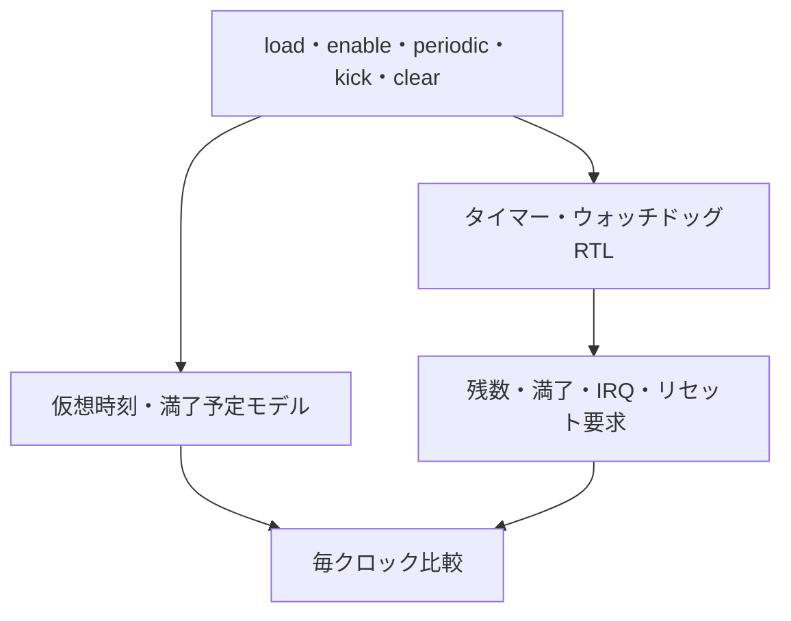

# タイマーとウォッチドッグの境界・競合を検証する

単発／周期タイマーの割込みと、ウォッチドッグのキック／タイムアウトを、独立した参照モデルで毎クロック比較します。カウンタ幅4／8の2構成、固定の境界・競合シナリオ、ランダム入力、4変異の検出をローカルで実行する教材です。

## 独立した満了予測と2系統の通知

Pythonは仮想時刻と満了予定を持ち、RTLの減算カウンターとは別の計算で残数と通知を予測します。



タイマーIRQとウォッチドッグのリセット要求は独立した出力です。リセット要求を回路自身へ戻す構成ではありません。

## 1. この回路の仕様

同一クロックの2つのダウンカウンタです。全入力は立上りで取り込み、アクティブLowの同期リセットを使います。各reload入力はカウンタと同じ幅です。レジスタバスは持たず、load・clear・kickを直接入力します。

| 動作 | 仕様 |
| --- | --- |
| リセット | 両カウンタ、保持reload値、IRQ、満了通知、リセット要求を0へ戻す |
| タイマーload | enableに関係なくreload値を保持し、countへロード。同クロックの満了より優先 |
| タイマーenable | count>0なら1ずつ減算。1から0になるクロックで満了 |
| 単発 | 満了後は0で停止し、再ロードまで再通知しない |
| periodic | 満了時のperiodic=1なら保持reload値を再ロード。周期1は毎有効クロックで満了する |
| reload=0 | 停止状態。満了イベントを出さない |
| enable=0 | countを保持し、満了しない。ただしloadとIRQクリアは有効 |
| IRQ | タイマー満了で保持し、clear_irqでクリア。両方同時なら満了のセットが優先 |
| ウォッチドッグload | enableに関係なくreload値を保持してロードし、kick・タイムアウトより優先 |
| ウォッチドッグkick | enable=1のとき保持reload値で再始動。同時のタイムアウトより優先。enable=0では無視 |
| ウォッチドッグ満了 | 1から0になるクロックでwatchdog_reset_requestを1クロック出力。自動再ロードしない |

タイマーの`timer_expired`は、満了した各クロックで1です。**periodicでreload=1なら連続して1になり得ます。** IRQは保持されるので、次イベントの有無は満了信号も含めて比較します。ウォッチドッグは満了後もkickで再始動できます。タイマーIRQとウォッチドッグ満了は独立で、同時発生を許します。

`watchdog_reset_request`は**リセット要求の出力だけ**です。この教材内で自分やタイマーを自動的にリセットする配線はありません。窓付きウォッチドッグ、独立発振器、ロック、プリスケーラ、製品固有の安全機構は含みません。これらの仕様は製品ごとに異なるため、上記を一般的な製品仕様とみなさないでください。

## 2. 期待値と検査

RTLは残りカウントを減算します。独立したPythonモデルは、enable=1だったクロックだけを進める仮想時刻と**満了予定時刻（deadline）**を保持します。残数は「予定時刻−仮想時刻」で求めるので、RTLのカウンタ実装をそのまま写しません。毎クロック、2つの残数、IRQ、ウォッチドッグのリセット要求、タイマーの満了を照合します。

固定シナリオでは、次を明示的に起こします。

- reload=0／1／最大、単発の停止、周期の再ロード、周期1の連続満了、disable中の保持と再開。
- 満了とIRQクリアの同時発生、IRQ単独クリア、タイマー満了直前の再ロード。
- ウォッチドッグの停止中kick、満了直前kick、満了後のkick、loadとkickの競合、タイムアウト後の再通知抑止。
- タイマー・ウォッチドッグの同時満了、動作中リセット、リセット後の新たな満了と待機状態への復帰。

追加のランダム入力では、enable、periodic、load、reload、kick、clear、resetを変更します。reload候補は0／1／2／最大／最大−1／一様乱数です。loadはタイマーで約1/5、ウォッチドッグで約1/8、kickは約1/4、clearは約1/3、resetは約1/40の確率です。これらは探索の分布であり、固定シナリオの代替にはしません。

[要求カタログ](requirements.json)は5要求・20目標です。各幅で全目標を満たし、満了・リセット要求の総件数と、全入力サイクルの比較完了も一致する必要があります。

## 3. 意図的な誤実装

| 番号 | 誤実装 | 期待する検出ラベル |
| --- | --- | --- |
| 1 | タイマーが残数2でも満了する | TIMER_STATE |
| 2 | 同時満了よりIRQクリアを優先 | TIMER_IRQ |
| 3 | 有効なkickを無視 | WDG_STATE |
| 4 | 周期タイマーが再ロードせず停止 | TIMER_STATE |

`TIMER_STATE`はタイマー残数と満了信号、`WDG_STATE`はウォッチドッグ残数とリセット要求の比較です。変異検出の合格には、対応するラベルと非ゼロ終了が必要です。

## 4. 実行

[共通の準備・証跡の説明](../local-common/README.md)に従い、リポジトリのルートから実行します。

```sh
python3 examples/local-timer-watchdog/run.py --out artifacts/timer-smoke
python3 examples/local-timer-watchdog/run.py --configuration width4 --seed 42 --iterations 500 --out artifacts/timer-width4
python3 examples/local-timer-watchdog/run.py --profile nightly --out artifacts/timer-nightly
python3 -m unittest discover -s examples/local-timer-watchdog/tests -v
```

構成名は`width4`と`width8`です。固定シナリオはそれぞれ92／572クロック、smokeは200ランダムクロック×1 seed、nightlyは2000×3 seedを追加します。各ランダムケースには先頭のresetと末尾のreset・待機2クロックを追加するため、検査数は指定iterations+4です。

正常時のJUnitは構成当たりsmoke **7件**、nightly **9件**で、2構成の合計は**14／18件**です（固定1＋ランダム1／3＋変異4＋ゲート1）。

```sh
python3 examples/local-timer-watchdog/run.py --configuration width4 --demo-bug 2 --out artifacts/timer-intentional-failure
```

このコマンドは通常回路側も優先順位を誤らせるため、終了コード1と`TIMER_IRQ`による失敗が期待結果です。

## 5. 実行確認

2026-10-27にIcarus Verilog 14.0開発版とPython 3.14.7で両構成のsmoke／nightly、各20目標、各4変異、確認テスト6件をローカルで確認しました。GitLabへの追加・CI実行は行っていません。任意の無限の入力列を証明した結果や、実システムの安全性・リセット到達を確認した結果ではありません。
