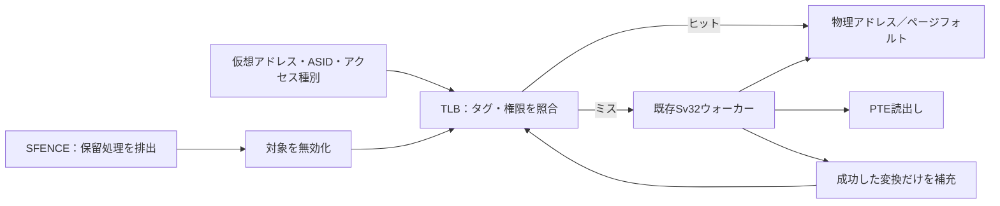

# TLBとSv32ウォーカーを接続し、ASID・権限・SFENCE.VMAを検証する

[Sv32ウォーク](../local-sv32/README.md)に完全連想方式のTLBを接続します。アドレス変換をキャッシュすると、同じ仮想アドレスでもASIDが違う場合、権限が変わる場合、PTEを書き換えてから無効化する場合の確認が必要になります。この例は、[RISC-V特権仕様 v20260120](https://docs.riscv.org/reference/isa/v20260120/priv/supervisor.html)のASID・グローバル変換・SFENCE.VMAを参照しています。

## 回路と期待値



TLBは2／4エントリーで、4KiBと4MiBページ、9ビットASIDを扱います。成功した変換だけをラウンドロビンで補充し、ヒットでは置換位置を進めません。BareではTLBを使わず、32ビットの仮想アドレスを34ビットへゼロ拡張します。

保存するのは物理ページ番号とPTE属性であり、特定の要求に対する許可結果ではありません。ヒットのたびにU／S・SUM・MXR・R/W/X・A/Dを判定します。例えば、読出しで補充したD=0のページへの書込みは、ヒットしてもページフォルトになります。

既存ウォーカーに`leaf_flags`・`large_page`・`global_mapping`を追加しました。グローバル属性はリーフだけでなく、経路中の非リーフPTEのGビットも引き継ぎます。ウォーカー単体のテストでも、これらのメタデータを照合します。

Pythonモデルは変換範囲を整数の`range`で持ち、所属するアドレスとASIDから検索します。ミスでは既存のページテーブル解釈モデルを使い、PTE読出し先・ヒット有無・応答・変換結果をRTLと比較します。ヒット有無の照合には、この教材で選んだ補充・置換規則も含みます。

## フェンスの受理と無効化

`fence_valid && fence_ready`でフェンスが完了します。保留中のウォークと応答があれば、それらを完了・消費するまで待ちます。待っている間は新規要求を受けず、同時に提示された通常要求よりフェンスを優先します。完了時点で遅れて補充される変換を残さないための、非投機的な実装です。

| address_valid | asid_valid | この教材で無効化する変換 |
| --- | --- | --- |
| 0 | 0 | グローバル変換を含む全エントリー |
| 0 | 1 | 指定ASIDの非グローバル変換 |
| 1 | 0 | 指定アドレスを含む全ASIDの変換。グローバル変換も含む |
| 1 | 1 | 指定アドレスを含む、指定ASIDの非グローバル変換 |

有効フラグは、ISAでrs1／rs2に`x0`を指定したかどうかを表すためのものです。**ASIDの値0を選ぶことと、全ASIDを選ぶことは別です。**4MiBページでは、その内部のどのアドレスを指定してもページ全体を無効化します。

ISAは広い範囲の無効化も認めています。この教材では選択無効化とグローバル変換の保持を実装方針として固定し、ヒット率も照合します。より広く無効化する実装を、ISA違反とみなすものではありません。

## 実行と誤実装の検出

Python 3.10以上とIcarus Verilogを使い、リポジトリのルートで実行します。

```sh
python3 examples/local-tlb/run.py
python3 examples/local-tlb/run.py --profile nightly
python3 -m unittest discover -s examples/local-tlb/tests -v
```

構成は`entries2`・`entries4`です。固定シナリオだけで21目標に到達し、各構成の固定・ランダム・4変異とカバレッジ判定で、JUnitはsmoke 14件／nightly 18件です。判定・証跡は[共通手順](../local-common/README.md)を使います。

4変異は、ASIDを無視する検索、4KiBページを4MiBのタグ幅で照合する検索、スーパーページのフェンスを完全一致の4KiBタグで判定する誤り、ヒット時の権限チェック漏れです。前の3つは`TLB_FLOW`、権限の誤りは`TLB_RESULT`で検出します。`--demo-bug 1..4`では通常ケースも失敗します。

セルフテストは7件です。ASID上位ビットの違い、非リーフから継承したグローバル変換、スーパーページ内を指定するフェンス、PTE更新後の再変換、ヒット時の権限変更、ウォーク・応答待ち中のフェンスを実RTLで照合します。

2026-10-31に、Python 3.14.7・Icarus Verilog 14.0開発版で両構成のsmoke／nightlyと7セルフテストが成功しました。Verilator 5.052で両構成・変異0〜4をlintしています。

## 確認範囲

CPU・OSへの統合、複数の未完了要求、投機・取消し、複数hartのTLB shootdown、PTEのハードウェア更新は含みません。TLBのキーにroot PPNは含めず、ASID再利用やPTE変更に必要なフェンスは呼出し側が行います。グローバル変換は各アドレス空間で同一に設定する前提です。通常メモリアクセスの順序を扱う[ストアバッファのFENCE](../local-store-buffer/README.md)とは、対象が異なります。
