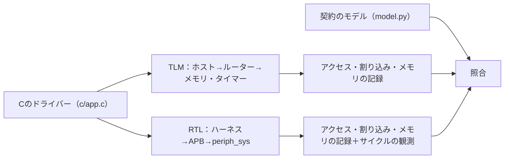

# TLM-2.0の仮想プラットフォームとRTLで同じCドライバーを動かす

同じCのドライバーを、SystemCのTLM-2.0で作った仮想プラットフォームと、周辺のRTL（Verilator）の両方で実行します。レジスタアクセスの列・割り込み・最後のメモリを、契約から書いたモデルと、互いとで比べます。そのうえで、TLMでは見えない競合をRTLの側で作り、そこでだけ見つかる誤りを示します。

**写したもの**：TLM-2.0の、ブロッキングの転送（`b_transport`）と汎用のペイロードを使う、緩い時間（loosely timed）の構成です。固定版のSystemC 2.3.4に含まれるTLM-2.0のヘッダーだけを使います。CPUの命令セットのシミュレーターは置かず、ホストのスレッドがCのドライバーを直接呼びます。量子（quantum keeper）、DMI、非ブロッキングの転送、近似時間（approximately timed）の位相は使っていません。商用の仮想プラットフォームの道具も使っていません。

[Cドライバーの例](../local-c-driver/README.md)は、CのドライバーとRTLを直接つなぎます。[VCIとSoCLibの例](../local-vci-soclib/README.md)は、SystemCのサイクル精度のモデルを検証します。この例は、その間にある「速いが時間の粗いモデル」と「遅いが正確なRTL」の両方で、同じソフトウェアが同じ結果を出すかを確かめます。

## 構成



| 部分 | TLMの側（`tlm/platform.cpp`） | RTLの側（`rtl/`、`tb/rtl_harness.cpp`） |
| --- | --- | --- |
| バス | ルーターが番地で振り分ける`b_transport`。1回のアクセスに1サイクル分の遅延を付け、ホストがそれを待つ | APB形式の転送。準備の1エッジ、`pready`が下がっている間の待ち、アクセスの1エッジ |
| メモリ | 64語の配列 | `periph_sram.sv`（64語、リセットで0） |
| タイマー | 満了の時刻を待つスレッド。COUNTは次の満了までの時間から計算 | `irq_timer.sv`（カウンター、pending、overrun、EXPIRED） |
| 割り込み | タイマーの`level()`をドライバーが読む | `irq`の出力をドライバーが読む |
| 待ち | なし | `WAIT`のパラメーターで、アクセスごとに0または2サイクル |

## 周辺の仕様

番地は、メモリが`0x0000`〜`0x00ff`（64語）、タイマーが`0x1000`〜`0x101f`です。それ以外と、境界に合わない番地はエラーを返します。

| 番地 | 名前 | 内容 |
| --- | --- | --- |
| `0x1000` | LOAD | 再装填の値（16ビット）。満了の間隔は LOAD＋1 クロック |
| `0x1004` | CTRL | ビット0 有効、ビット1 割り込みの許可。無効から有効にすると、カウントを再装填し、EXPIREDを0にする |
| `0x1008` | STATUS | ビット0 pending、ビット1 overrun。1を書いたビットだけ消える。pendingが立っている間に次の満了が来るとoverrun |
| `0x100c` | COUNT | 次の満了までのクロック数（読出しだけ） |
| `0x1010` | EXPIRED | 有効にしてからの満了の回数（8ビット、読出しだけ） |

割り込みの線は pending かつ 許可 です。**pendingを消す書込みと満了が同じエッジに重なったときは、満了を優先し、pendingを残します**。消す側を優先すると、その満了は失われます。

## ドライバー

`c/app.c` は次の順に動きます。どちらのプラットフォームでも同じコードです。

1. メモリの先頭16語に表を書く。
2. 番地の空き5か所（遠い番地、メモリの1つ先、タイマーの最後のレジスタの1つ先、タイマーの範囲の1つ先、境界に合わない番地）を読み、エラーになった印をメモリへ書く。
3. 割り込みを許可せずに、短い周期（LOAD＝5）で40クロック動かす。線が上がらないことを確かめ、タイマーを止めてから、STATUSの読出しとビットごとのクリアを確かめる。止めてから読むので、値は時間に依りません。
4. 周期の長いタイマーを許可つきで動かし、指定の回数だけ割り込みを処理する。処理ごとに、STATUSとEXPIREDを読み、pendingを消し、表を読んで累積の値を計算し、メモリへ書く。
5. タイマーを止め、累積の値と、CTRL・LOADの読み返しをメモリへ書く。

割り込みを待つときは、バスを読まずに線を見て、1クロックずつ待ちます。待つ回数に上限があり、超えると`APP_TIMEOUT`を返します。

## 3つの照合

`model.py` は、ドライバーと周辺の契約から、期待するアクセスの列・出来事・最後のメモリを作ります。TLMのモデルもRTLも参照しません。COUNTの読出しの値だけは時間に依るので、照合から外します。

| 照合 | 何が分かるか |
| --- | --- |
| TLM と モデル | 仮想プラットフォームが、契約どおりに振る舞うか |
| RTL と モデル | RTLが、契約どおりに振る舞うか |
| RTL と TLM | 同じドライバーが、両方で同じアクセス・出来事・メモリを生むか（COUNTの値を除く） |

差は、出来事（`PLAT_EVENT`：処理した割り込みと、ドライバーが見た線の値）、アクセス（`PLAT_ACCESS`）、最後のメモリ（`PLAT_MEMORY`）、ドライバーの戻り値（`PLAT_RESULT`）の順に調べ、最初に食い違った種類を記録します。

RTLのハーネスは、サイクルの単位でしか見えないことを別に確かめます。

- 転送の外で`pready`・`pslverr`が上がらないこと（`PLAT_PROTOCOL`）。
- タイマーを触っていない間、満了の間隔が LOAD＋1 クロックであること（`PLAT_PERIOD`）。
- 上限のクロック数で終わらなければ`PLAT_TIMEOUT`。

RTLのレジスタは、0ではなく乱数の値から始めます（Verilatorの`--x-initial unique`と、シードつきの`randReset(2)`）。リセットで消し忘れた状態を、最後のメモリの比較で見つけるためです。

## TLMでは見えない競合

| 場面 | RTLでの扱い | このTLMでの扱い | この例での確認 |
| --- | --- | --- | --- |
| pendingを消す書込みと満了が同じエッジに重なる | 満了を優先する規則が、ゲートの論理として働く | 書込みは1つの時刻の出来事で、ドライバーの時間の見積りがRTLと合わないので、重ならない | `race`の場面でRTLだけが重なり（`COVER race/clear-set`）、消す側を優先する誤り（変異1）がRTLだけで見つかる |
| バスの待ち | `pready`が下がり、アクセスが延びる | 待ちを持たない。1アクセス1サイクル | `wait2`の構成で、時間に依らない結果が変わらないこと。競合の場面のための見積り（`lead`）は、待ちに合わせて変える必要がある |
| 割り込みの線の遅れ | 満了のエッジの後に線が上がる | 満了を処理した直後から見える | 処理の時刻は違うが、時間に依らない結果は同じ |
| 書込みの到着順 | APBの転送は1つずつ順に終わる | `b_transport`は呼んだ順に終わる | この構成は開始側が1つなので差は出ない。複数の開始側や、書込みを先に受け付けるバッファがあると差が出うる（扱っていない） |
| COUNTの値 | クロックごとに減る | 現在の時刻から計算する | 照合から外す。ドライバーが待ちの長さを決めるのにだけ使う |

### 競合の場面をRTLで作る方法

`race`の場面では、ドライバーがCOUNTを読み、残りの回数から`lead`を引いた回数だけ待ってから、pendingを消します。RTLでは、読出しの最後のエッジから次の書込みが効くエッジまでが 2＋WAIT クロックなので、`lead`を 2＋WAIT にすると、書込みが次の満了のエッジにちょうど重なります。

この見積りは、RTLのハーネスのサイクルの数え方を前提にしたもので、教材のための作りです。TLMは1アクセス1サイクルなので、同じ見積りでは書込みが満了より前に効き、競合は起きません。どちらの側でも、正しい周辺なら EXPIRED の列は 1, 2, 3, … になります。消す側を優先するRTL（変異1）では、重なった満了が失われ、1, 3, 5, … になります。

## 構成と計画

| 構成 | 内容 |
| --- | --- |
| `wait0` | RTLの待ちなし、`lead`＝2 |
| `wait2` | RTLの待ち2サイクル、`lead`＝4 |

| 場面 | 割り込み | LOAD | 競合 |
| --- | --- | --- | --- |
| `basic` | 8回 | 150 | なし |
| `race` | 8回 | 90 | あり |
| `random-seed<N>` | 1〜16回 | 70〜400 | seedで決める |

smokeは乱数の場面が1つ、nightlyは3つです。各場面を、構成ごとにTLMとRTLの両方で実行します。

変異と診断は、`wait0`の構成で実行します。

| 名前 | 内容 | 場面 | 予定の結果 |
| --- | --- | --- | --- |
| RTLの変異1 | 消す書込みが同じエッジの満了に勝つ | `race` | `PLAT_ACCESS`（EXPIREDが飛ぶ） |
| RTLの変異2 | 割り込みの許可を無視する | `basic` | `PLAT_EVENT`（許可していない線が上がる） |
| RTLの変異3 | メモリの番地の最上位ビットを落とす | `basic` | `PLAT_MEMORY`（ドライバーが読み返さない語だけが壊れる） |
| RTLの変異4 | 割り当てのない番地がエラーにならない | `basic` | `PLAT_ACCESS` |
| RTLの変異5 | pendingを消すとoverrunも消える | `basic` | `PLAT_ACCESS` |
| RTLの変異6 | 有効にし直してもEXPIREDが0に戻らない | `basic` | `PLAT_ACCESS` |
| RTLの変異7 | メモリの48〜63語目への書込みが失われる | `basic` | `PLAT_MEMORY` |
| 診断：RTLの変異1を`basic`で | 競合のない場面 | `basic` | 差なし（見えない） |
| 診断：TLMで消す側を優先 | TLMのモデルを変異1と同じ規則にする | `race` | 差なし（このTLMでは重ならない） |
| TLMの変異 | TLMのモデルが割り込みの許可を無視する | `basic` | `PLAT_EVENT` |

JUnitは、smokeが28件、nightlyが36件です。内訳は、道具の確認1、ビルド1、構成ごとの場面（TLMとRTLで各3または5）と網羅1、変異7、診断と変異のTLM側3、要求1、入力の再照合1です。

## 要求と目標

[要求カタログ](requirements.json)は6要求・13目標です。目標のうち10個は、RTLの合格した実行で実際に観測したことから数えます。`bus/wait-state`は`wait2`の構成だけで数えます。残りの3個（`negative/…`）は、変異と診断の結果から数えます。

## 実行

POSIX、Python 3.10以上、C／C++のコンパイラー、make、Verilator、固定版のSystemC 2.3.4（`lsi-systemc-config`。準備は[実行環境](../../tools/ENVIRONMENT.md#systemcとsoclibの例)）を使います。Pythonの追加パッケージは要りません。

```sh
python3 examples/local-tlm-platform/run.py
python3 examples/local-tlm-platform/run.py --profile nightly
python3 -m unittest discover -s examples/local-tlm-platform/tests -v
```

`lsi-systemc-config`がPATHにないときは`--systemc-config`で渡します。ビルドは、Cのドライバー1つ、TLMの3つ（正しいもの、変異2つ）、RTLの9つ（`wait0`の正しいものと変異7つ、`wait2`の正しいもの）です。`--jobs`（既定4）で並べて行い、時間の上限は`--build-timeout`（既定300秒）です。各シミュレーションの上限は`--timeout`（既定30秒）です。

セルフテストは14件です。モデルの期待値、ログの読み方（欠け・重複・形式の誤りを拒否する）、差の種類の順、計画の件数と一意性、目標の出どころ、実際のsmokeの実行、Verilatorがないときの失敗、不正な引数の拒否を確かめます。

## 証跡

出力先には、`manifest.json`（入力のハッシュと計画）、`summary.json`、`junit.xml`、`tools.json`、`systemc-source.json`（SystemCの本体のヘッダーとライブラリーのハッシュ。統合ランナーが照合し直す）、`tlm-headers.json`（TLM-2.0のヘッダー50個のハッシュ）、`build/`（ビルドのログ）、`runs/`（各実行のログ・結果・RTLの波形）を残します。終わりに、入力とSystemCのヘッダーを照合し直します。

## 適用範囲と対象外

- TLMのモデルとRTLは、同じ人が同じ仕様から書いています。契約のモデルも同じ人です。3つが同じ誤解を持てば、どの照合でも見つかりません。
- TLMの時間は意図して粗くしています。サイクルの数え方を合わせた近似時間のモデルなら、同じ競合を再現できる場合があります。その場合でも、同じ時刻の2つの出来事の順は、SystemCのプロセスの実行順で決まり、RTLのゲートの規則とは別のものです。
- 競合の場面は、ドライバーがRTLのサイクルの数え方を知っている前提の教材の作りです。実際のソフトウェアは、こうした時刻の合わせ方をしません。
- 時間の正しさ（満了の間隔、待ちの長さ）はRTLの側だけで確かめます。TLMとRTLの比較は、時間に依らない結果だけを見ます。
- 開始側は1つだけです。DMAなど別の開始側、書込みのバッファ、キャッシュ、割り込みコントローラー、割り込みの例外の配送は扱いません。
- CPUの命令は実行しません。ドライバーはホストで動き、割り込みは線を見て待ちます。
- IEEE 1666-2011（SystemCとTLM-2.0）の節番号とは照合していません（未照合）。

## 参考にした一次資料

- IEEE 1666-2011（SystemCの言語とTLM-2.0）。汎用のペイロード、ブロッキングの転送、緩い時間の考え方を参考にしました。節番号は未照合です。
- Accellera公式のSystemC 2.3.4（[固定したコミット](https://github.com/accellera-official/systemc/tree/5fc1469339775b54b1fcc2020ac744a58be5b50e)）に含まれる`tlm_utils`の簡易ソケット。ソースは転載していません。

## 確認記録

2026-11-21に、Python 3.13、Apple clang、Verilator 5.052、SystemC 2.3.4で次を実行し、合格しました。

- smoke（seed 17・3・100）とnightly（`--timeout 60`）。JUnitは28件と36件。`race`の場面は、`wait0`・`wait2`の両方のRTLで競合に到達し、TLMでは到達しませんでした。
- セルフテスト14件。
- RTLのlint（Verilator 5.052 `--Wall`）：`periph_sys`の`WAIT`＝0・2、`irq_timer`、`periph_sram`、変異1〜7で警告0件。
- 手元ではVerilatorのビルドにccacheが効いていて、smoke全体は約10秒でした。ccacheのない環境の時間は測っていません。

**計画外の誤りの注入**：作業用の写しのRTLへ12個の誤りを入れ、smokeにかけました。

| 誤り | 見つけた検査 |
| --- | --- |
| overrunの条件が、同じエッジのクリアを見ない | `race`で`PLAT_ACCESS`（STATUSが3になる） |
| 満了の再装填が1つ短い | ハーネスの`PLAT_PERIOD` |
| 有効にしたときEXPIREDを1から数える | `PLAT_ACCESS` |
| タイマーの空き（`0x1014`）がエラーにならない | `PLAT_ACCESS` |
| タイマーの範囲が`0x103f`まで広い | `PLAT_ACCESS`（`0x1020`がエラーにならない） |
| メモリの範囲が`0x01ff`まで広い | `PLAT_ACCESS`（`0x0100`がエラーにならない） |
| 境界の検査がない | `PLAT_ACCESS` |
| `pready`が待ちを入れない | `wait2`で、競合に届かず、待ちの網羅も満たさない（結果そのものは変わらない） |
| 割り込みの許可が一度立つと消えない | `PLAT_ACCESS`（最後のCTRLの読み返し） |
| リセットがメモリの半分しか消さない | `PLAT_MEMORY`（乱数の初期値が残る） |
| `pslverr`が転送の外でも上がる | ハーネスの`PLAT_PROTOCOL` |
| pendingのクリアがビット1を見る | `PLAT_ACCESS` |

誤りの候補を考える段階で、最初の作りでは見えないものが4つありました。番地の空きを遠い番地しか試していなかったので、範囲の1つ先と境界に合わない番地を足しました。最後にCTRLを読み返していなかったので、許可が消えない誤りが見えず、読み返しを足しました。満了の間隔の誤りと、転送の外の`pslverr`は、時間に依らない結果を比べるだけでは見えないので、ハーネスの検査を足しました。そのうえで1回目の注入を行うと、リセットの抜けだけが合格のまま残りました。Verilatorの初期値0に隠れていたので、乱数の初期値にし、2回目の注入で12個すべてが見つかることを確かめました。注入の記録は作業用のディレクトリにあり、リポジトリには入れていません。

LinuxとGCC、kirimasim、統合ランナー経由では実行していません。
