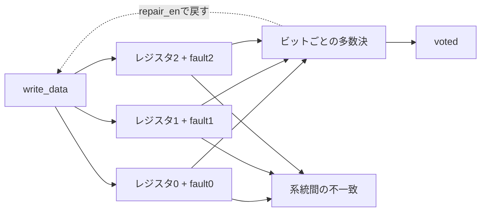

# TMR制御レジスタ：多数決・不一致検出・修復

3個のレジスタへ同じ値を保持し、ビットごとの多数決で出力するTMR（Triple Modular Redundancy）の教材です。単一系統の故障をマスクする動作、不一致の検出、修復、保証できない故障を分けて確認します。[航空宇宙・高信頼システムの検証手順](../../docs/method/aerospace-verification.md)と、[ECC・ウォッチドッグ付きFDIRサブシステム](../local-fdir/README.md)へつながります。

## 構成と更新規則



| 項目 | 契約 |
| --- | --- |
| 構成 | WIDTH 8／16ビット、3系統、単一クロック |
| リセット | 同期・active low。書込み・修復・故障注入より優先し、3系統と修復パルスを0にする |
| 通常書込み | `write_en`で同じ`write_data`を3系統へ保持。修復と競合した場合も書込みを優先 |
| 出力 | 各ビットの0／1の多数決。単一系統の任意のビット反転なら、残る2系統の値を出力 |
| 不一致 | 3系統の値がそろっていなければ`disagreement=1`。誤った系統を絶対に特定できるという意味ではない |
| 修復 | 不一致かつ`repair_en`かつ書込みなしのエッジで、多数決値を3系統へ戻す |
| `repair_attempt` | 修復を試みたことを示す1サイクルのパルス。同じエッジの再故障で不一致が残る場合も1になる |
| 故障注入 | 各エッジの機能更新後の各系統へ`fault0/1/2`をXORする。書込み・修復と同時なら新しい値を反転 |

故障マスクは検証用のモデル入力です。シリコン上の放射線や、飛行用の故障注入端子をモデル化したものではありません。`repair_en=0`なら不一致を保持し、1にすると次のエッジで修復を試みます。繰り返し注入中は修復後にも反転し、不一致が続きます。

## 保証範囲と限界

| 故障条件 | この回路で確認する結果 |
| --- | --- |
| 1系統だけの反転 | 多数決出力は正しい。不一致を通知し、故障が続かなければ修復できる |
| 2系統の同じビットが反転 | 多数決が誤る場合がある。不一致は検出しても、正しい少数側を識別できない |
| 誤った多数決値での修復 | 誤値を3系統へそろえてしまい、不一致が消える場合がある |
| 3系統が同じように反転 | 誤値で一致するため、不一致検出も働かない |
| 多数決回路・クロック・リセット等の故障 | このレジスタ三重化の保証範囲外 |

限界ケースでは、**誤値や未検出が実際に生じること**を期待結果として確認します。ケースの合格を「複数系統故障にも耐えた」と解釈しません。故障モデルを定めない一律の故障検出率・信頼度も算出しません。

## 自動チェッカーと要求

Pythonモデルは、各ビットの1の個数を数えて多数決を決めます。RTLのAND／OR式をそのまま複写していません。全系統・全ビット位置の単一反転、書込みと修復、共通原因を模した同時反転、処理中リセット、seed付きのマスク列を使い、出力・不一致・修復パルス・3系統の全状態を毎サイクル比較します。

[要求カタログ](requirements.json)は4要求・11観測目標です。通常成功ケースの`COVER`ログだけを構成別に集計します。`limit/*`は保護成功の指標ではなく、保証外の挙動を観測した目標です。ネイティブcovergroup DB・コードカバレッジ・フォーマル証明の結果とは区別します。

| 変異 | 誤実装 | 期待する検出 |
| --- | --- | --- |
| 1 | 多数決をORへ変更 | `TMR_VOTE` |
| 2 | 修復の状態更新を省略 | `TMR_STATUS` |
| 3 | 修復が新しい書込みを上書き | `TMR_VOTE` |
| 4 | 不一致を通知しない | `TMR_STATUS` |

故障注入は保護機構の反応を調べる刺激で、変異はチェッカーの検出力を調べる誤実装です。変異ケースを通常カバレッジへ加えず、コンパイル失敗・時間切れ・別の失敗ラベルを検出に数えません。

## 実行と証跡

Python 3・Icarus Verilog・vvpを使い、リポジトリのルートから実行します。

```sh
python3 examples/local-tmr/run.py --profile smoke --out artifacts/tmr-smoke
python3 examples/local-tmr/run.py --profile nightly --out artifacts/tmr-nightly
```

8／16ビットの2構成で、JUnitはsmoke 14件／nightly 18件です。nightlyはseedを1→3、各seedの追加ランダム行を32→128へ増やします。固定の故障位置・優先順位・限界ケースは両プロファイルで省略しません。

ソースと生成入力のハッシュ、`vectors.txt`、全サイクルの`expected.hex`、`trace.vcd`、ログ、完了件数、構成別カバレッジを保存します。全予定行数、注入サイクル数、実行中reset数も照合し、未完了や比較0件を合格にしません。[全体ランナー](../../tools/REGRESSION.md)と[追加記録](../../PROVENANCE.md#aerospace-20261101)も参照してください。
