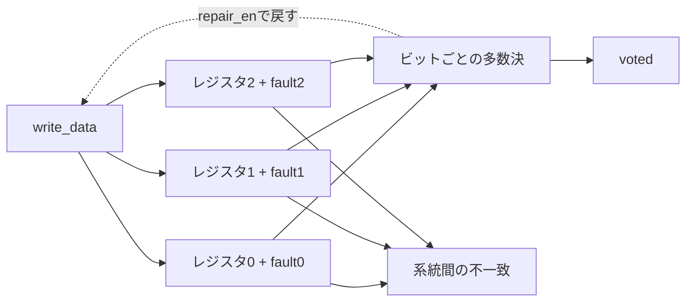

# TMR制御レジスタ：多数決・不一致検出・修復

3個のレジスタへ同じ値を保持し、ビットごとの多数決で出力するTMR（Triple Modular Redundancy）の教材です。単一系統の故障をマスクする動作、不一致の検出、修復、保証できない故障を分けて確認します。[航空宇宙・高信頼システムの検証手順](../../docs/method/aerospace-verification.md)と、[ECC・ウォッチドッグ付きFDIRサブシステム](../local-fdir/README.md)へつながります。

初めて読む場合は、[通常レジスタとの比較](#通常レジスタとの比較)から始めてください。3構成を同じ入力で動かし、SEUと持続するstuck-at故障の違いも確認できます。

## 構成と更新規則



| 項目 | 契約 |
| --- | --- |
| 構成 | 3系統、単一クロック。従来のベクトル試験はWIDTH 8／16ビット、比較試験は1／8／32ビットです |
| リセット | 同期・active low。書込み・修復・故障注入より優先し、3系統と修復パルスを0にする |
| 通常書込み | `write_en`で同じ`write_data`を3系統へ保持。修復と競合した場合も書込みを優先 |
| 出力 | 各ビットの0／1の多数決。単一系統の任意のビット反転なら、残る2系統の値を出力 |
| 不一致 | 3系統の値がそろっていなければ`disagreement=1`。誤った系統を絶対に特定できるという意味ではない |
| 修復 | 不一致かつ`repair_en`かつ書込みなしのエッジで、多数決値を3系統へ戻す |
| `repair_attempt` | そのサイクルの修復試行を示す。連続試行なら連続して1になり、同じエッジの再故障で不一致が残る場合も1になる |
| 故障注入 | 各エッジの機能更新後の各系統へ`fault0/1/2`をXORする。書込み・修復と同時なら新しい値を反転 |

故障マスクは検証用のモデル入力です。シリコン上の放射線や、飛行用の故障注入端子をモデル化したものではありません。`repair_en=0`なら不一致を保持し、1にすると次のエッジで修復を試みます。繰り返し注入中は修復後にも反転し、不一致が続きます。

各ビットの多数決は`(q0 & q1) | (q1 & q2) | (q2 & q0)`です。たとえば同じビットの値が`0, 1, 1`なら1になります。既存RTLの`q0/q1/q2`がA/B/C系統、`voted`が多数決出力、`disagreement`が現在状態の`mismatch`に相当します。`disagreement`は組み合わせ出力で、訂正可能かどうかを断定する信号ではありません。

## 保証範囲と限界

| 故障条件 | この回路で確認する結果 |
| --- | --- |
| 1系統だけの反転 | 多数決出力は正しい。不一致を通知し、故障が続かなければ修復できる |
| 異なる系統の異なるビットが反転 | 各ビットで誤った系統が1つまでなら、多数決出力は正しい |
| 2系統の同じビットが反転 | 多数決が誤る場合がある。不一致は検出しても、正しい少数側を識別できない |
| 誤った多数決値での修復 | 誤値を3系統へそろえてしまい、不一致が消える場合がある |
| 3系統が同じように反転 | 誤値で一致するため、不一致検出も働かない |
| 多数決回路・クロック・リセット等の故障 | このレジスタ三重化の保証範囲外 |

限界ケースでは、**誤値や未検出が実際に生じること**を期待結果として確認します。ケースの合格を「複数系統故障にも耐えた」と解釈しません。故障モデルを定めない一律の故障検出率・信頼度も算出しません。

## 通常レジスタとの比較

[比較テストベンチ](tb/tmr_compare_tb.sv)は、次の3構成を同時に動かします。比較試験の標準幅と[通常レジスタ](rtl/plain_register.sv)の標準幅は32ビットです。FDIRでも再利用する[既存TMR RTL](rtl/tmr_register.sv)は変更せず、`WIDTH`と`repair_en`を指定して使います。既存RTL自体の標準幅は8ビットです。

| 構成・インスタンス名 | 書き込みなしの動作 | 単一SEUの後 |
| --- | --- | --- |
| 通常レジスタ `plain` | 自分の保持値を維持します | 誤った値が出力へ現れ、正常な再書き込みまで残ります |
| 多数決のみ `vote_only` | `repair_en=0`で各系統の値を維持します | 出力は正しくても、内部の誤りと不一致が残ります |
| 自動修復付き `auto_repair` | `repair_en=1`で不一致時に多数決値を書き戻します | 出力を維持し、次の修復可能なクロックで内部状態も回復します |

3構成ともクロック立ち上がりで更新し、同期・アクティブLowリセットで全ビット0にします。通常動作は「リセット → 正常な書き込み → 修復 → 保持」の優先順位です。正常時は3系統が一致しているため、既存RTLが修復を不一致時だけに限定していても保持値は変わりません。

**正しい出力を維持することと、内部状態を修復することは別です。** 多数決だけでは、壊れた系統に誤りが残ります。次の故障と同じビット位置で重なると、保護の前提を失う可能性があります。

### SEUとstuck-atの注入

SEUは、保持中の立ち上がり1回だけ、指定した`fault0/1/2`または`plain_fault`を有効にします。RTLが機能更新後の**内部保持値そのもの**をXORするため、マスクを0へ戻しても誤りは残ります。出力だけを一時的に反転させるモデルではありません。リセット中はXORを無視し、それ以外では書き込み・修復・保持の結果へ反転を適用します。

stuck-atは比較TB内の`force/release`で、`vote_only.q0`と`auto_repair.q0`のbit 0を0または1へ持続的に固定します。IEEE 1800-2023の10.6.2は変数のビット選択への`force`を認めていないので、系統0の変数全体へ`force`をかけます。与える値は、bit 0が固定値、上位ビットが故障のない系統1の値です。両系統は同じ書き込みと修復を受けるので、上位ビットは固定しない場合と同じ値になります。固定値と反対のデータを保持させ、修復と正常な書き込みを試みても、そのビットだけが固定値に残ることを確認します。上位ビットと他の系統の更新は妨げません。XORの繰り返し注入はstuck-atとして扱いません。

この`force`は、有効な間はリセットを含む通常の手続き代入より強く働く検証操作です。stuck-at試験中にはリセットを掛けず、各試験の終了時に必ず解除します。変数のビットを`release`しても直ちに正常値へ戻るとは扱わず、解除直後には固定されていた値が残ることを確認します。その次の立ち上がりで、自動修復付きは正しい多数決値へ戻り、修復なしは誤値を保持します。修復なしは、その後の正常な再書き込みで回復します。

固定するのは定数のbit 0です。変数全体への`force`にしているのは、ビット選択への`force`を受け付けないシミュレータ（kirimasimなど）でも実行できるようにするためです。保持値の解除後の挙動まで検査します。この階層参照と`force/release`が比較TBのシミュレータ依存箇所です。SEUとstuck-atはいずれも0/1の物理的な故障を抽象化します。X注入は別のチェッカー負例だけで使います。

### 注入から判定までのタイミング

1. クロック立ち下がりで、書き込み・リセット・故障マスクを設定します。stuck-atの開始・解除も立ち下がりで行います。
2. 次の立ち上がりでRTLと独立参照モデルを更新します。`#1`（1 ns）待ち、NBA更新と組み合わせ回路の安定後に判定します。
3. SEU注入直後の不一致と、指定系統の実際の保持値の反転を確認します。この観測前に修復を成功扱いしません。
4. 次の立ち下がりで故障マスクを0にし、`write_en=0`のまま、直後の立ち上がりで修復を判定します。正常な書き込みで値が揃ったことを修復の証拠にはしません。
5. 修復なしの系統は複数サイクルの保持も確認したうえで再書き込みします。独立した試験へ移る前に、前の誤りを取り除きます。

独立参照モデル`golden`は、リセットと正常な書き込み履歴だけで更新します。通常レジスタのDUTも故障注入対象なので、正解として使いません。内部状態の期待値は`golden`とTBが指定した故障マスクから作り、DUTの多数決結果を正解へコピーしません。比較は`===`・`!==`と既知値検査を使い、X/Zを合格扱いしません。

### 比較試験の内容

| 試験 | 期待結果 |
| --- | --- |
| 故障なし | 全0・全1・交互ビット・その反転で、リセット・書き込み・保持が3構成とも参照値と一致します |
| 通常レジスタの単一SEU | 出力が参照値と異なり、3回の保持クロックでも残り、次の正常な書き込みで回復します |
| 全3系統・全ビット位置の単一SEU | 修復なしは正しい出力と内部不一致を維持し、修復付きは書き込みなしの次のクロックで全系統が回復します |
| 1系統の複数ビット | 他の2系統が正しければ出力は正しくなります。WIDTH=1では1ビットの試験になります |
| 系統0のbit 0と系統1のbit 1 | 異なるビットなので多数決出力は正しくなります。WIDTH=1では`NOT_APPLICABLE`と表示します |
| 同じビットの2系統故障 | 誤った多数決値と不一致を観測し、`EXPECTED_LIMITATION same_bit_two_lanes`として合格にします |
| 誤多数決で自動修復 | 誤値が3系統へ広がり、参照値と異なるまま不一致が0になることを`EXPECTED_LIMITATION wrong_repair`で確認します |
| 3系統の同じ誤り | 誤出力でも不一致が0になることを`EXPECTED_LIMITATION three_lanes_same_error`で確認します |
| stuck-at-0／1 | 反対値の保持、修復中・書き込み中の固定、解除直後の保持、構成ごとの回復方法を確認します |
| seed付きランダム | 正常書き込み・保持・単一SEUを組み合わせます。独立したSEUの前後で正常値を書き込み、保護範囲を超えて故障を蓄積させません |

ランダム列はTB内の32ビットxorshiftで生成します。同一シミュレータ・構成・seed・ステップ数で再現できます。`--seed`は既存ランナーでは非負整数を受け取り、比較TBへは下位32ビットを渡します。seed=0は内部初期値`0x6d2b79f5`へ対応させます。変換後のseedも`manifest.json`に記録します。

想定外の挙動では`CHECK_FAIL TMR_COMPARE`とともに、seed・サイクル・幅・構成・故障種別・対象・マスク・参照値・内部3系統・多数決値・不一致・修復試行を英語ログへ出し、非ゼロ終了します。ランナーも終了コード、完了マーカー、試験件数、3種類の限界マーカー、VCDの存在を照合します。

## 自動チェッカーと要求

Pythonモデルは、各ビットの1の個数を数えて多数決を決めます。RTLのAND／OR式をそのまま複写していません。全系統・全ビット位置の単一反転、書込みと修復、共通原因を模した同時反転、処理中リセット、seed付きのマスク列を使い、出力・不一致・修復パルス・3系統の全状態を毎サイクル比較します。

[要求カタログ](requirements.json)は4要求・11観測目標です。通常成功ケースの`COVER`ログだけを構成別に集計します。`limit/*`は保護成功の指標ではなく、保証外の挙動を観測した目標です。ネイティブcovergroup DB・コードカバレッジ・フォーマル証明の結果とは区別します。

| 変異 | 誤実装 | 期待する検出 |
| --- | --- | --- |
| 1 | 多数決をORへ変更 | `TMR_VOTE` |
| 2 | 修復の状態更新を省略 | `TMR_STATUS` |
| 3 | 修復が新しい書込みを上書き | `TMR_VOTE` |
| 4 | 不一致を通知しない | `TMR_STATUS` |

故障注入は保護機構の反応を調べる刺激で、変異はチェッカーの検出力を調べる誤実装です。変異ケースを通常カバレッジへ加えず、コンパイル失敗・時間切れ・別の失敗ラベルを検出に数えません。

## 実行と証跡

Python 3・Icarus Verilog・vvpを使い、リポジトリのルートから実行します。

```sh
python3 examples/local-tmr/run.py --profile smoke --out artifacts/tmr-smoke
python3 examples/local-tmr/run.py --profile nightly --out artifacts/tmr-nightly
python3 examples/local-tmr/run.py --profile smoke --seed 123 --out artifacts/tmr-seed123
```

従来の8／16ビットのベクトル試験に、1／8／32ビットの比較試験を加えています。JUnitはsmoke 17件／nightly 27件です。nightlyはseedを1→3、各seedの追加ベクトル行を32→128、比較TBのランダムステップを64→128へ増やします。固定の故障位置・優先順位・限界ケースは両プロファイルで省略しません。

ソースと生成入力のハッシュ、`vectors.txt`、全サイクルの`expected.hex`、`trace.vcd`、ログ、完了件数、構成別カバレッジを保存します。全予定行数、注入サイクル数、実行中reset数も照合し、未完了や比較0件を合格にしません。[全体ランナー](../../tools/REGRESSION.md)と[追加記録](../../PROVENANCE.md#aerospace-20261101)も参照してください。

比較試験は`comparison-bits32/seed17/`などへ`simulation.log`・`manifest.json`・`result.json`・`trace.vcd`を保存します。TB自身が期待値を判定するため、この試験には`vectors.txt`や`expected.hex`はありません。比較対象の幅は1〜32ビットです。

波形ビューアで`trace.vcd`を開き、`golden`、`plain.q`、`vote_only.q0/q1/q2`、`auto_repair.q0/q1/q2`、`vote_q/repair_q`、`vote_bad/repair_bad`、`write_en`、`plain_fault`、`fault0/1/2`、`phase_id`を追います。単一SEUでは、注入エッジ後に内部1系統だけが変化し、その次の立ち上がりで`auto_repair`だけが一致へ戻ります。`phase_id`は1が正常動作、2が通常レジスタSEU、3が全系統・全ビットSEU、4が1系統の複数ビット、5が異なるビット位置、6〜8が3種類の限界、9／10がstuck-at-0／1、11がランダム、12が最終リセットです。stuck-atでは、`stuck_active`・`stuck_fixed`とbit 0を見て、修復試行が続いても直らない区間と、解除後の回復を比較してください。文字列の`phase`はログ用で、VCDでは数値の`phase_id`を使います。

比較TBだけを実行してWIDTH・seed・波形を指定する場合は、次を使います。

```sh
mkdir -p artifacts/tmr-compare
iverilog -g2012 -s tmr_compare_tb -Ptmr_compare_tb.WIDTH=32 \
  -o artifacts/tmr-compare/tmr.vvp examples/local-tmr/rtl/plain_register.sv \
  examples/local-tmr/rtl/tmr_register.sv examples/local-tmr/tb/tmr_compare_tb.sv
vvp artifacts/tmr-compare/tmr.vvp +SEED=17 +STEPS=64 +WAVE=artifacts/tmr-compare/trace.vcd
```

### 実行確認と対象外

2026-11-18に、Icarus Verilog／vvp 14.0 (devel、`s20260301-411-gca6b8d376`)で比較試験と既存試験を実行しました。WIDTH=1／8／32のSEU・stuck-at・限界ケースとseed付きランダム試験を確認しています。セルフテストでは同じseedの再現、別seedの列の変化、誤多数決・修復欠落・不一致通知欠落の検出、Xが内部状態に入った場合の非ゼロ終了も確認します。他のシミュレータで比較TBを実行したという意味ではありません。

対象はレジスタ保持値の0/1反転と、系統0のbit 0の持続固定です。共通入力、クロック、リセット、多数決回路自体の故障、配線遅延、メタステーブル、放射線の物理特性はモデル化していません。`disagreement=0`は3系統の一致を示すだけで、正しいデータの保証ではありません。

実チップでは、RTLが3系統でも合成で統合されない制約と合成後ネットリストの確認、共通原因の影響を抑える物理配置の分離、配線・タイミング・多数決回路の保護を別途検討します。この教材のRTL機能試験だけでは確認できません。製品固有の実装上の前提は、たとえば[AMD TMR Subsystemの設計規則](https://docs.amd.com/r/en-US/pg268-tmr/TMR-Design-Rules)のような対象デバイスの一次資料でも確認してください。
