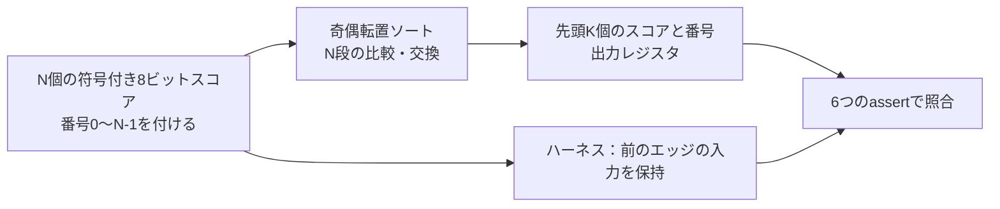

# Top-K選択回路をすべての入力についてフォーマルに証明する

分類モデルの出力（ロジット）から上位K個とその番号を選ぶ回路の教材です。ソーティングネットワークで並べ替え、先頭のK個をレジスタに出します。N=8では入力の組み合わせが2^64通りあり、シミュレーションでは全数を確かめられません。そこでフォーマル検証で、すべての入力について結果が正しいことを証明します。

## 並べ替えて上位K個を出す



比較・交換では、スコアが高い方、同点なら番号が小さい方を前にします。同点の扱いまで決めておくと、出力が入力ごとに一意に定まり、性質として書けます。

| 構成 | N | K | 入力の組み合わせ |
| --- | --- | --- | --- |
| `n4-k2` | 4 | 2 | 2^32 |
| `n8-k3` | 8 | 3 | 2^64 |

## 証明する性質

ハーネス[`topk_formal.sv`](topk_formal.sv)は、前のエッジの入力を回路の外に保持し、出力と比べます。

| assert | 内容 |
| --- | --- |
| `ap_valid` | `out_valid`は前のエッジの`in_valid`と一致し、リセット中は0 |
| `ap_index` | 各出力のスコアは、出力した番号の入力スコアと一致 |
| `ap_distinct` | K個の番号に重複がない |
| `ap_sorted` | スコアが高い順に並ぶ |
| `ap_ties` | 同点なら番号の小さい方が前 |
| `ap_topk` | 選ばれなかった入力は、同じ順序の付け方でK番目より後ろ |

`ap_index`と`ap_distinct`で「出力は入力の一部を重複なく取り出したもの」を、`ap_sorted`と`ap_ties`で並び順を、`ap_topk`で「選ばれなかったものが上位に入っていない」ことを表します。並べ替えだけを確かめても、上位K個を正しく選んだことにはなりません。

## タスク

各構成6タスク、計12件のJUnitです。

- `topk-proof`：6つのassertを、k-induction（深さ4）で時間無制限に証明します。出力は前のエッジの入力だけで決まるので、帰納法は深さ2で閉じます。深さ4にしたのは、ベースケースにリセット・入力・出力・検査の4ステップを含め、誤った回路では反例が出るようにするためです。深さ2でも正しい回路の証明は完了しますが、ベースケースが有効な出力の検査に届かず、`--demo-bug`で誤りを入れた回路はUNKNOWNになります。深さ1では帰納法が閉じません。
- `scenario-cover`：全入力が同点、選ばれる・選ばれないの境界での同点、全入力が負、昇順の入力（並べ替えの最悪の場合）、最大値が最後の番号、K番目に-128が入る、の6目標に到達することを確認します。
- 4種類の変異：深さ8のBMCで、予定したassertの反例を要求します。

| 番号 | 誤実装 | 期待する反例 |
| --- | --- | --- |
| 1 | 同点でも交換する（番号の順が崩れる） | `ap_ties` |
| 2 | 位置K-1とKを比べる最後の比較・交換を省く | `ap_topk` |
| 3 | スコアだけ交換し、番号を交換しない | `ap_index` |
| 4 | スコアを符号なしで比べる | `ap_topk` |

変異2で省くのは、選ばれる側と選ばれない側の境目にある比較です。最初は最終段の位置1と2の比較を省いていました。すると、`n4-k2`では選択の誤り（`ap_topk`）、`n8-k3`では選ばれたK個の中の並び順の誤り（`ap_sorted`）と、構成によって反例の出る性質が変わりました。`n8-k3`では位置1と2がどちらも選ばれる側にあるためです。そこで、どの構成でも選択そのものに影響する境目の比較を省く変異にしました。

## シミュレーションによる別の確認

セルフテストでは、Icarus Verilogで回路を動かし、Pythonの安定ソートで求めた上位K個と比べます。N=4は5種類の値（-128、-1、0、1、127）の全625通り、N=8は同点の多い1500ベクトルです。正しい回路は全件一致し、4種類の変異はどれも不一致になります。フォーマルの性質とは別の方法で、性質の書き方と変異の効果を確かめるものです。

## 実行

[共通フォーマル手順](../local-formal-common/README.md)の固定版ツールを使います。

```sh
. /tmp/lsi-bus-formal-venv/bin/activate
python3 examples/local-topk/run.py
python3 examples/local-topk/run.py --configuration n8-k3 --task topk-proof
python3 -m unittest discover -s examples/local-topk/tests -v
```

既定のBMC・coverの深さは8、証明の深さは4、各タスクの上限は600秒です。`--demo-bug 1..4`は証明のタスクにも変異を入れ、証明がFAILになることを確かめます。セルフテストは4件で、シミュレーションの1件にはIcarus Verilogが必要です。

## 確認範囲

2026-10-30に、Python 3.14.7とYoWASP版Yosys・SBY・Z3（[共通フォーマル手順](../local-formal-common/README.md)の固定版）で、両構成の12タスクが成功しました。`n8-k3`の証明には約115秒、ほかのタスクは各2秒程度かかりました。`n4-k2`の証明に4種類の変異を入れると、どれもベースケースの反例でFAILになりました。セルフテスト4件も成功しています。

出力レジスタ1段、逆圧なし、同期リセットの回路です。大きなNでの比較器数・段数の最適化、ビットニックソートなどほかのネットワーク、浮動小数点のスコア、NaNの扱いは対象外です。証明はRTLの論理についてのもので、合成後のネットリストやタイミングは含みません。
