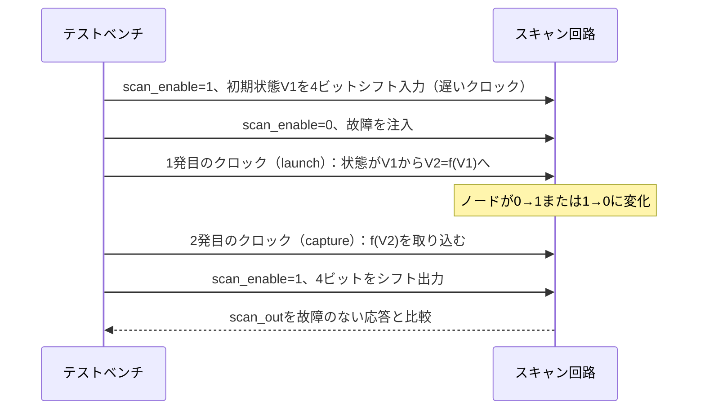

# 遷移故障を、launch-on-captureの2パターン試験と実速度のキャプチャで検出する

[内部スキャンとATPGの例](../local-scan-atpg/README.md)は、ノードが0か1に固定される縮退故障を扱います。この例は、値は正しく変わるが変化が遅いノード（遷移故障）を扱います。遅いノードは、十分に待てば正しい値になります。そのため、遷移を起こすクロックと、その結果を取り込むクロックの2発を、実際の動作周期の間隔で与えないと見つかりません。

同じスキャン試験を、SDFの遅延を付けたネットリストで2通りに実行します。取り込みまでの間隔を動作周期にした`at-speed`では遷移故障を検出し、4周期に広げた`slow`では同じ故障をすべて見逃します。縮退故障は、どちらでも検出します。DFTの題材全体は[DFTの検証手順](../../docs/method/dft-verification.md)、遅延つきのシミュレーションの位置付けは[ゲートレベルとタイミングの検証](../../docs/method/gate-level-and-timing-verification.md)を参照してください。

## launch-on-captureの手順



launch-on-capture（LOC）では、2発ともスキャンイネーブルが0の機能動作です。2つ目のパターンV2は、1つ目のV1から回路自身が作ります。V2を自由に選べないので、縮退故障は検出できても、遷移故障としては試験できないノードが出ます。この例の回路にも、そのノードが1つあります。

| 構成名 | launchからcaptureまで | 遷移故障 |
| --- | --- | --- |
| `at-speed` | 動作周期（手元では1.70 ns） | 検出できる10故障をすべて検出 |
| `slow` | 動作周期の4倍 | すべて見逃す |

シフトのクロックは、どちらの構成でも動作周期の10倍です。縮退故障の試験は、キャプチャ1発で行います。

## 対象回路

[`tf_core.sv`](rtl/tf_core.sv)は、4個のスキャンフリップフロップと、1ビットの一次入力`x`を持ちます。チェーンは`scan_in → q[0] → q[1] → q[2] → q[3] → scan_out`です。リセットはなく、状態はスキャンでロードします。

| ノード | 論理 | 次の状態での使い方 |
| --- | --- | --- |
| `n0` | `q[0] ^ q[1]` | `q[1]`の次の値 |
| `n1` | `q[2] \| x` | `n2`の入力 |
| `n2` | `n0 & n1` | `n4`と`q[3]`の入力 |
| `n3` | `~(q[1] & q[3])` | `q[0]`の次の値 |
| `n4` | `n2 ^ q[3]` | `q[2]`の次の値 |
| `n5` | `~q[0] & ~q[1] & q[3]` | `q[3]`の次の値は`n2 \| n5` |

6つのノードは、それぞれ`TFSITE`というセルを通します。RTLとしては[ただのバッファ](rtl/TFSITE.sv)です。合成では、ライブラリの同名のセルへ名前で対応させるので、最適化で消えません。ネットリストのシミュレーションでは、故障を注入できる[セルモデル](cells/tf_site.v)に差し替えます。

## 故障モデル

| 種類 | セルモデルでの表し方 | 故障の数 |
| --- | --- | --- |
| 0縮退・1縮退 | 入力に関係なく、出力を0または1に固定する | 6ノード×2＝12 |
| 立上りが遅い（slow-to-rise） | 入力が1になってから、1周期遅れて出力を1にする。立下りは遅らせない | 6 |
| 立下りが遅い（slow-to-fall） | 入力が0になってから、1周期遅れて出力を0にする。立上りは遅らせない | 6 |

遅れは動作周期と同じ1周期です（大きな遅延の故障）。遅れている間に入力が元の値へ戻ったら、出力は動きません。テストベンチは、試験する行ごとに、セルのインスタンスの変数（`kind`と`extra`）を階層参照で設定します。故障はロードの後に注入し、アンロードの前に外します。

SDFの値を書き換えて遅らせる方法も考えられますが、SDFは実行の最初に一度だけ反映するので、故障ごとにビルドが要ります。この例は、1つのネットリストと1つのSDFで全故障を順に試すために、セルモデルで遅らせます。SDFの遅延（`TFSITE`は0.10 ns）は、そのまま付いています。

## パターンの生成と、2つの分母

[`atpg.py`](atpg.py)は、状態16通り×`x` 2通りの32パターンを全数調査します。

- **縮退故障**：キャプチャ1発で、取り込む値が故障のない値と違うパターンを探します。
- **遷移故障**：次の2条件を満たすパターンを探します。
  1. launchでノードが遅い向きに変化する（立上りが遅い故障なら、V1で0、V2で1）。
  2. captureの時点でノードが古い値のままだと、取り込む値が故障のない値と違う。

残る故障を最も多く検出するパターンを順に選びます（貪欲法）。最小のパターン数を求めるものではありません。

| 故障モデル | 対象（分母） | 検出できる | 選んだパターン | 検出できない故障 |
| --- | --- | --- | --- | --- |
| 縮退故障 | 12 | 12 | 4 | なし |
| 遷移故障（LOC） | 12 | 10 | 4 | `n5`の立上り・立下りの2故障 |

2つの検出率は、別の分母で集計します。縮退故障の検出率12／12を、遷移故障の検出率へ読み替えません。`n5`の2故障は、縮退故障としては検出できますが、LOCの遷移故障としては検出できません。理由は故障ごとに違います。

| 故障 | 理由 | 説明 |
| --- | --- | --- |
| `n5`の立上りが遅い | launchできない（`no-launch`） | `n5`が1になる状態は8と12だけです。この2つは、どの状態の次の状態にもなりません。V2で`n5`を1にするV1がありません |
| `n5`の立下りが遅い | 観測できない（`not-observed`） | `n5`は状態8と12から立ち下がります。`n5`を使うのは`n2 \| n5`だけで、立ち下がった後の状態では`n2`が必ず1です。`n5`が古い値の1のままでも、結果は変わりません |

この2故障は、グリッチに依存しない全パターンを実際に適用し、一度も検出されないことを確かめます（`at-speed`で各20パターン前後、計39行）。

### グリッチに依存する行は計画に入れない

遷移故障の検出は、ノードの前後の値だけでは決まらない場合があります。ノードの値がlaunchの前後で同じ1でも、途中で一瞬0になる（グリッチ）と、立上りが遅いノードはcaptureの時点でまだ0です。これは実際の遅延で起きる現象ですが、遅延のないモデルからは予測できません。

`atpg.py`の`hazard_free`は、「ノードの前後の値が、故障が遅らせる側の値で同じ」かつ「そのノードの入力側の状態ビットが変化する」行を、結果がグリッチに依存する行として除きます。384通り（12故障×32パターン）のうち69通りです。手元の遅延では、このうち7通り（すべて`n4`の立上り）が実際に検出に変わります。セルフテストで、その1つが`at-speed`では検出になり、`slow`では検出にならないことを確かめています。

## 合成・STA・SDF

セルとライブラリは、[遅延つきのゲートレベルシミュレーションの例](../local-gate-timing/README.md)の[`cells.v`](../local-gate-timing/cells/cells.v)と[`teaching.lib`](../local-gate-timing/cells/teaching.lib)を再利用します。教材用の架空のライブラリで、実際の製造プロセスの値ではありません。ランナーは、`BUF`の定義を`TFSITE`という名前で写したライブラリを、ビルドごとに作ります。

```text
read_liberty -lib cells.lib          # TFSITEを加えたライブラリ
read_verilog -sv tf_core.sv
chparam -set MUTATION <番号> tf_core
synth -top tf_core -flatten
dfflegalize -cell $_DFF_P_ x
dfflibmap -liberty gates.lib         # 元のライブラリ
abc -liberty gates.lib
opt_clean
stat
write_verilog -noattr -noexpr mapped.v
```

ゲートとフリップフロップの割当てには元のライブラリを使います。割当てが`TFSITE`を普通のバッファとして使わないようにするためです。変異0のネットリストは、フリップフロップ4個、`TFSITE` 6個、そのほかのゲート25個です。

[`check.tcl`](sta/check.tcl)は、OpenSTAで2回実行します。1回目は、フリップフロップ間の最長経路の「遅延＋セットアップ時間」を測ります（手元では1.56 ns）。ランナーは、これに0.1 nsの余裕を足した最短の周期を0.05 ns刻みで選びます（1.70 ns）。2回目は、その周期でセットアップとホールドのスラックが負でないことを確かめ、SDFファイルを書きます。クロックは理想として扱います。スキャンの入力と`x`は、テストベンチがクロックから十分離れた時刻に変えるので、入力遅延を0にしています。

Icarus Verilogは`$setup`・`$hold`に対応していないので、gate-timingの例と同じく、セルモデルのフリップフロップが自分のデータ入力を検査します。限界値は、ランナーがSDFの`TIMINGCHECK`から読み取り、生成するモジュール`tf_timing`の`defparam`で設定します。違反があると、出力をXにして`TIMING`の行を表示します。

2つの構成と、テストベンチ側の変異1・2は、同じ設計を使います。ランナーは、設計ごとに最初のビルドだけ合成とSTAを行い、あとのビルドは同じネットリストとSDFをコンパイルします。`builds.json`の`reused_from`に、元のビルドの名前を記録します。

## 検査

テストベンチ[`tf_tb.sv`](tb/tf_tb.sv)は、クロックのパルスを自分で作ります。判定に使うのは、アンロードで実際に観測した`scan_out`だけです。

| 行の種類 | 検査 | 失敗のラベル |
| --- | --- | --- |
| フラッシュ | 8ビットをシフトし、4発後に同じビットが出る | `TF_SHIFT`、`TF_X` |
| 故障なし | タイミング違反が0件、応答にXがない、応答が期待値と一致 | `TF_TIMING`、`TF_X`、`TF_RESPONSE` |
| 故障あり | 応答が故障のない応答と違うか（検出）を、予定と照合 | `TF_ESCAPE`（予定した検出がない）、`TF_FALSE_ALARM`（予定しない検出） |

期待値は、RTLと別の考え方で作ります。故障のない次の状態は、仕様をまとめた式（`functional`）で計算します。故障時の値は、ノードの一覧に故障を入れたモデル（`capture`）で計算します。2つが故障なしで一致することは、セルフテストで全32パターンについて確かめます。

検出した故障の数は、テストベンチが`scan_out`の違いから故障の種類ごとに数え、`COUNT`で出します。Pythonのモデルの数をそのまま出すものではありません。ランナーは、計画から数えた値と照合します。

| 件数 | `at-speed`の固定シナリオ | `slow`の固定シナリオ |
| --- | --- | --- |
| `fault_free`（故障なしの行） | 64 | 64 |
| `stuck_applied`／`stuck_detected` | 12／12 | 12／12 |
| `transition_applied`／`transition_detected` | 12／10 | 12／0 |

固定シナリオは195行です。フラッシュ2行、全32パターンのキャプチャ1発と2発（64行）、縮退故障12×4パターン（48行）、選んだ4パターンでの遷移故障（42行）、試験できない2故障の全パターン（39行）から成ります。ランダム刺激は、故障なし・縮退故障（1発または2発）・遷移故障・フラッシュを混ぜます。

`slow`には、診断ケース`escaped-transition-faults`があります。`at-speed`が検出する遷移故障の行だけを実行し、検出が0件であることを記録します。診断の結果は、必須目標の到達には数えません。

[要求カタログ](requirements.json)は4要求・10目標です。どちらの構成でも、固定シナリオだけで10目標に達します。

## 検出する誤り

| 番号 | 誤り | 入れる場所 | `at-speed` | `slow` |
| --- | --- | --- | --- | --- |
| 1 | captureを、構成に関係なく4周期後に出す（低速のキャプチャ） | 試験手順 | `TF_ESCAPE` | 合格（診断`invisible-mutation1`） |
| 2 | launchの時点でスキャンイネーブルを0に戻していない（launchがシフトになる） | 試験手順 | `TF_RESPONSE` | `TF_RESPONSE` |
| 3 | チェーンから`q[2]`が抜けている | 設計 | `TF_SHIFT` | `TF_SHIFT` |
| 4 | `n2`のANDがORになっている | 設計 | `TF_RESPONSE` | `TF_RESPONSE` |

変異1は、試験が合格し続けるのに遷移故障を見逃す誤りです。故障のない回路の応答は変わらないので、故障を入れた行の「予定した検出がない」ことでしか見つかりません。`slow`は最初から低速なので、この変異は何も変えません。診断として実行し、合格することを記録します。

ビルドの失敗、無関係な時間切れ、別のラベルでの失敗は、検出に数えません。

## 実行

Icarus Verilog、Yosys、OpenSTAが要ります。Yosysは[共通フォーマル手順](../local-formal-common/README.md)の固定版、OpenSTAは[STAの例](../local-sta/README.md)と同じものです。`--yosys`と`--sta`で場所を指定できます。

```sh
. artifacts/toolchains/formal-venv/bin/activate
python3 examples/local-transition-fault/atpg.py
python3 examples/local-transition-fault/run.py --out artifacts/transition-fault
python3 examples/local-transition-fault/run.py --profile nightly --out artifacts/transition-fault-nightly
python3 -m unittest discover -s examples/local-transition-fault/tests -v
```

[共通手順](../local-common/README.md)を使い、構成は`at-speed`と`slow`です。smokeは60行×1 seed、nightlyは600行×3 seedのランダム刺激を、固定シナリオに加えます。`--demo-bug 1..4`は、通常のケースに変異を入れます。JUnitはsmoke 15件／nightly 19件、セルフテストは19件です。

## 証跡

共通手順の`manifest.json`・`builds.json`・`coverage.json`・`summary.json`・`junit.xml`と、ケースごとの`vectors.txt`・`simulation.log`・`wave.vcd`・`result.json`に加えて、次を残します。

- 設計ごとのビルドのディレクトリ（`at-speed-m0`など）：合成ログ、`mapped.v`と`netlist.v`、`TFSITE`を加えた`cells.lib`、STAのスクリプトとログ、`design.sdf`、測定と周期を記録した`timing.json`、生成した`tf_timing.v`。
- `simulation.log`の`FAULT`の行：故障を入れた行ごとの、ノード・種類・状態・`x`・検出の有無。
- `builds.json`：コンパイルした全ファイルのSHA-256と、合成とSTAの結果、`reused_from`。

## 確認範囲

2026-11-20に、macOS arm64のPython 3.14、Icarus Verilog 14.0開発版、YoWASP版Yosys 0.70、OpenSTA 3.1.0で、2構成のsmoke 15件／nightly 19件、10目標、縮退故障12／12、`at-speed`での遷移故障10／12の検出、`slow`での遷移故障0／12、7件の変異の検出と診断2件、セルフテスト19件が成功しました。ランダム刺激は、別の6 seedで各2,000行も実行し、予定と一致しました。Linuxでは実行していません。Verilatorのlint（`-Wall`）は、[`tf_core.sv`](rtl/tf_core.sv)と[`TFSITE.sv`](rtl/TFSITE.sv)の組で警告0件です。

この教材で確かめていないことは次のとおりです。

- 遅延は架空のライブラリの定数です。配線の遅延は0で、コーナーは1つです。実際のセルライブラリ、配置配線の結果は使いません。
- 故障は、名前を付けた6ノードの出力だけです。ゲートの各端子、配線の分岐、スキャンセルを網羅した故障リストではありません。検出率は、この6ノードについての値です。
- 遅れは1周期の大きな遅延だけです。周期の余裕に隠れる小さな遅延欠陥、経路全体の遅延を対象にするパス遅延故障、複数の故障は扱いません。
- パターンは全数探索と貪欲法で選びます。実際のATPGツール、パターンの圧縮、検出不能の証明は使いません。グリッチに依存する行は計画から除くだけで、グリッチによる検出の利用や、グリッチに強い試験（ロバストな試験）の生成は扱いません。
- 2発のクロックは、テストベンチが直接作ります。チップ内でPLLのクロックから2発を切り出す回路（OCC）、launch-on-shift、スキャンイネーブルの実速度での切替え、複数のクロック領域は扱いません。
- テスト電力、IRドロップによる遅延の増加、ATEの波形とタイミング、パターンの形式（STILなど）は扱いません。
- タイミング検査は、セルモデルが行います。違反の後のXは「分からない」ことの表示で、実機では0か1のどちらかです。
- スキャンは、RTLに明示的に書いたものです。スキャン挿入ツールの結果ではありません。

## 参考にした一次資料

- IEEE Std 1497（SDF）とIEEE Std 1800（SystemVerilog）：遅延の受渡しと`specify`の経路遅延。本文は引用していません。
- [OpenSTA](https://github.com/parallaxsw/OpenSTA)：周期の測定とSDFの出力に使うツール。
- [OpenROADのDFT資料](https://openroad.readthedocs.io/en/latest/main/src/dft/README.html)：スキャンチェーンの基本構造。
- [Yosysの文書](https://yosyshq.readthedocs.io/projects/yosys/en/latest/)：`read_liberty`・`dfflibmap`・`abc`による割当て。
- 遷移故障とlaunch-on-captureという用語は、DFTの一般的な呼び方に従っています。特定の規格やツールの文書の本文は写していません。
