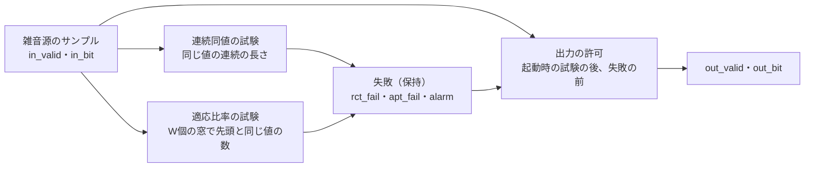

# 乱数源の健全性試験（連続同値・適応比率）を検証する

乱数源（雑音源）は、壊れても動き続けます。出力が0に固着しても、偏っても、回路は値を出し続けます。そのため、雑音源の出力を見張る健全性試験を置き、異常を見つけたら出力を止めて警報を出します。この例は、その健全性試験の回路を検証する、防御側の教材です。

検証で間違えやすいのは、次の3点です。

- **しきい値の境界**：カットオフちょうどで警報を出し、1つ少なければ出さないこと。1ずれると、誤警報の確率が2倍になるか、半分の確率でしか見つけなくなります。
- **起動・再起動と出力の抑止**：起動時の試験を飛ばす、再起動で数え直さない、警報の後も出力する、といった誤りは、正常な雑音源では何も起きないので見えません。
- **誤警報の確率**：しきい値は、正常な雑音源が誤って警報を出す確率から決めます。回路とモデルが同じ誤ったしきい値を使うと、ビット一致の比較は合格します。

この例は、試験の回路を、書き方の違うモデルと毎クロック照合し、さらに正常な雑音源での警報の回数を、設計の確率から求めた受容域で判定します。乱数源そのもののRTLは作らず、雑音源のビット列はPythonがseedから作ってテストベンチから与えます。

試験の考え方は、NIST SP 800-90B（2018年1月版）の健全性試験の節（連続同値の試験は4.4.1、適応比率の試験は4.4.2、起動時の試験の要求は4.3。節番号は記憶によるもので、本文とは照合していません）を参考にしました。本文は写しておらず、しきい値の求め方はこの例の言葉と式で書いています。**この例は、SP 800-90Bへの適合や、乱数源の認証・評価を示すものではありません。** 雑音源のエントロピーの評価、条件付け（conditioning）、乱数生成器（DRBG）は扱いません。

## 仕様



| 信号 | 向き | 意味 |
| --- | --- | --- |
| `rst_n` | 入力 | 同期リセット（Lowで有効）。電源投入のリセットです |
| `restart` | 入力 | 1サイクルのパルスで、試験を初めからにします。警報の後の再起動に使います |
| `in_valid`・`in_bit` | 入力 | 雑音源の1ビットのサンプル。`in_valid`が0のサイクルの`in_bit`は無視します |
| `out_valid`・`out_bit` | 出力 | 試験を通ったサンプル。受け付けた次のサイクルに出ます |
| `ready` | 出力 | 起動時の試験が終わり、失敗がなかったことを示します |
| `rct_fail`・`apt_fail`・`alarm` | 出力 | 各試験の失敗と、その論理和。リセットか再起動まで保ちます |

- **連続同値の試験（RCT）**：同じ値が`RCT_CUTOFF`回続いたサンプルで失敗します。数えるのはサンプルで、`in_valid`が0のサイクルは連続を切りません。
- **適応比率の試験（APT）**：サンプルを`W`個ずつの窓に区切り、窓の先頭のサンプルと同じ値の数（先頭を含む）が`APT_CUTOFF`に達したサンプルで失敗します。窓は重ならず、次の窓は新しい先頭で数え直します。
- **起動時の試験**：リセットと再起動の後、最初の`STARTUP`個のサンプルを両方の試験にかけ、出力しません。その間に失敗がなければ、`STARTUP`個目のサンプルの後に`ready`が上がります。最後の`STARTUP`個目で失敗しても、`ready`は上がりません。
- **出力の抑止**：試験を失敗させたサンプルとそれ以後のサンプルは出力しません。失敗の後も試験は数え続けるので、もう一方の試験も後から失敗を示すことがあります。
- 起動時の試験のサンプルを出力しない、失敗したサンプルも出力しない、再起動をリセットと同じに扱う、の3つはこの教材の仕様です。

## しきい値の決め方

雑音源を「1サンプルあたりの最小エントロピーが1ビット」、つまりどちらの値も確率1/2で出る理想の2値源と評価した、という前提で決めます。実際の設計では、評価した最小エントロピーHが1より小さく、しきい値はもっと大きくなります。αは、正常な雑音源が1回の機会に誤って失敗する確率の上限です。

- **RCT**：あるサンプルから同じ値がC回続く確率は、2の−(C−1)乗です。これがα以下になる最小のCをカットオフにします。C＝1＋log2(1/α)です。
- **APT**：窓の中の数は、先頭の1と、残りW−1個のうち先頭と同じ値の数（二項分布B(W−1, 1/2)）の和です。数がC以上になる確率がα以下になる最小のCを、二項分布の厳密な和で求めます。窓の先頭を数に入れるか、Wで数えるかW−1で数えるかで、規格の表の値と1ずれることがあります。この例の値は、規格の表とは照合していません。

| 構成 | W・STARTUP | RCTのα | RCT_CUTOFF | APTのα | APT_CUTOFF | 用途 |
| --- | --- | --- | --- | --- | --- | --- |
| `fast` | 64 | 2^−8 | 9 | 2^−4 | 40 | 教材用。誤警報が数えられるほど起きるように、αを大きくした構成 |
| `std` | 1024 | 2^−20 | 21 | 2^−20 | 590 | 製品で使う大きさのα。誤警報は事実上起きない |

セルフテストは、どちらのカットオフも「αを満たす最小の値」であること（1つ小さい値ではαを超えること）を確かめます。

## 独立した期待値

- **モデル**（[`run.py`](run.py)の`evaluate`）：受け付けたサンプルの列だけを見て、`itertools.groupby`で連続を、スライスで窓を数えます。クロックごとの状態を持たず、回路の書き方とは違います。返すのは、`ready`が上がるサンプル、各試験が失敗するサンプル、出力するサンプルの数です。テストベンチは、この3つの位置から、毎クロックの`ready`・各フラグ・`out_valid`・`out_bit`の期待値を作って照合します。
- **2つ目の参照**：セルフテストには、仕様の文をクロックごとの状態機械として書いた参照を置き、ランダムな試行と固定シナリオの全試行で、モデルと一致することを確かめます。
- **確率**：誤警報の確率は、モデルやシミュレーションを使わず、整数の動的計画法（連続の長さを状態にした数え上げ）と二項分布の和で厳密に求めます。セルフテストは、どちらも短い列の全数の数え上げと一致することを確かめます。

## 刺激

| ケース | 内容 |
| --- | --- |
| `boundaries` | 固定シナリオ16試行。各試行はリセットか再起動から始まります |
| `statistic-seed*` | 理想の雑音源の独立な試行（`fast`は256サンプル×200／600試行、`std`は2048サンプル×25／75試行）と、警報の回数の判定 |
| `degrade-seed*` | 起動時の試験を健全な雑音源で通った後に、固着する、または偏る雑音源。偏りの値（0か1）はseedで決めます。健全な部分は、警報の出ない列になるまで引き直すので、警報は劣化の後にだけ出ます |

固定シナリオの試行は次のとおりです。どの試行も、計画の作成時にモデルの結果が意図どおりかを確かめ、違えばエラーにします。

| 試行 | 意図 |
| --- | --- |
| 電源投入のリセットの後、カットオフより1つ少ない1の連続（途中に0を載せた、直後に1を載せた受け付けないサイクル）と0の連続 | 失敗しない。受け付けないサイクルは連続を切らず、同じ値が載っていても繰返しに数えない |
| 起動時の試験の後、カットオフちょうどの1の連続 | その位置で失敗。以後の出力を止め、警報を保つ |
| 警報の後の再起動と、交互に変わる長い列 | 失敗しない（試験の限界） |
| 受け付けないサイクルを挟んだ、カットオフちょうどの0の連続 | 失敗する |
| 先頭と同じ値がカットオフより1つ少ない窓を3つ（最初の窓は、最後の一致の直後に先頭と同じ値を載せた受け付けないサイクル）。次の窓は前と同じ値で始まる | 失敗しない。受け付けないサイクルは一致に数えず、窓の境界で数え直す |
| カットオフちょうどの数に、窓の最後のサンプルで達する窓（先頭は1） | 窓の最後のサンプルで失敗 |
| 窓の途中でカットオフに達する窓（先頭は0） | 窓の途中で失敗 |
| 起動時の試験の中でのRCTの失敗、APTの失敗、最後の`STARTUP`個目でのRCTの失敗 | `ready`が上がらず、何も出力しない |
| 起動時の試験の直後のサンプルでの失敗 | `ready`は上がるが、何も出力しない |
| 起動時の試験の後に固着する雑音源 | 両方の試験が失敗する |
| カットオフより1つ少ない連続で終わる試行と、同じ値で始まる次の試行 | 再起動が連続を数え直す |
| 窓の途中で、1の多い列で終わる試行と、1の多い列で始まる次の試行 | 再起動が窓を数え直す |

## 統計の判定：受容域・試行数・誤って不合格にする確率

### 何を1回の試行とするか

1回の試行は、再起動から始まる理想の雑音源のサンプル列です（`fast`は256個、`std`は2048個。どちらもAPTの窓の整数倍）。試行の間に再起動を入れるので、試行は互いに独立です。判定する数は2つです。

- **RCTで警報が出た試行の数**
- **APTで警報が出た試行の数**

どちらも「警報あり／なし」の独立な試行の数なので、二項分布がそのまま当てはまります。1つの試行の中のサンプルは独立でも、警報の機会（RCTはサンプルごと、APTは窓ごと）を独立な試行として数えることはしません。連続は重なり合うからです。

### 1回の試行で警報が出る確率

αは1回の機会の確率なので、1つの試行の確率はもっと大きくなります。どちらも、シミュレーションやモデルを使わずに厳密に求めます。

- **RCT**：長さLの理想の2値列に、C回以上の連続が含まれる確率です。最後の連続の長さを状態にした動的計画法で、C回に届かない列の数を整数で数えます。
- **APT**：窓1つで数がC以上になる確率tは、二項分布の和です。窓はm＝L／W個あり、互いに独立なので、試行の確率は1−(1−t)^mです。

| 構成 | 試行の長さ | RCT：C・試行の確率 | APT：C・窓の確率t・窓の数・試行の確率 |
| --- | --- | --- | --- |
| `fast` | 256 | 9・0.3901 | 40・0.03846・4・0.1452 |
| `std` | 2048 | 21・0.000967 | 590・7.05×10^−7・2・1.41×10^−6 |

### 受容域

正しい回路を誤って不合格にする確率を、2つの判定のそれぞれで0.001以下（両側。片側0.0005ずつ）にします。受容域は、二項分布B(n, q)で、両端の外側の確率がそれぞれ0.0005以下になる最も狭い範囲です。近似は使わず、二項分布の確率を倍精度で足し合わせて求めます。受容域は、設計のカットオフから求めた確率で作り、モデルの計算は使いません。

| 構成 | 試行数n | RCTの期待値・受容域 | APTの期待値・受容域 |
| --- | --- | --- | --- |
| `fast`（smoke） | 200 | 78.0・56〜101 | 29.0・14〜46 |
| `fast`（nightly） | 600 | 234.1・195〜274 | 87.1・60〜117 |
| `std`（smoke） | 25 | 0.02・0〜1 | 0.00004・0〜0 |
| `std`（nightly） | 75 | 0.07・0〜2 | 0.0001・0〜0 |

### 試行数の決め方

`fast`の試行数は、RCTのカットオフが1つ小さい誤りを確実に見つける大きさにしました。カットオフが8になると試行の確率は0.6343に上がり、200試行の期待値は126.9で、受容域の上限101を大きく超えます。

同じ試行数でも、見つからない誤りがあります。APTのカットオフが1つ大きい（41）と、試行の確率は0.1452から0.0832に下がります。この回数が受容域に入ってしまう確率は、200試行で78.5％、600試行で8.1％です。この誤りを統計で確実に見つけるには、600試行より多く要ります。この例は、この誤りを計画に入れていません（ビット一致の照合は、回路とモデルが違えば見つけます）。

`std`では、αが2の−20乗なので、カットオフが1つ小さくても試行の確率は0.0019です。25試行・75試行で受容域に入ってしまう確率は、どちらも99.9％以上です。`std`の統計の判定は、誤警報が大量に出ていないことの確認で、カットオフの誤りを見つける手段ではありません。

### seedと、誤って不合格にする確率

既定のseedは17で固定です。同じseedなら雑音源の列も同じなので、結果は毎回同じです。seedを変えると、1つの統計のケースは最大0.002の確率（2つの判定の和）で、正しい回路を不合格にします。

この確率が設計どおりかを、モデルで確かめました。回路は使っていません（回路とモデルの一致は、毎クロックの照合が別に確かめます）。

| 構成 | 試行数 | seedの数 | 受容域を外れた数（RCT・APT・どちらか） | 回路とモデルが同じ誤り（RCTのカットオフ−1）を見つけた数 |
| --- | --- | --- | --- | --- |
| `fast` | 200 | 2000 | 1・3・4（0.2％） | 2000（100％） |
| `fast` | 600 | 600 | 0・0・0 | 600（100％） |
| `std` | 25 | 400 | 1・0・1 | 1（0.25％） |
| `std` | 75 | 200 | 0・0・0 | 1（0.5％） |

APTの3／2000（0.15％）は、1つの判定の設計値0.1％より少し多いですが、2000 seedでの数え方の揺れの範囲で、設計値と矛盾しません。

## 偏りの大きさと検出までのサンプル数

雑音源が、起動時の試験を通った後のどこか（窓の中の位置は一様）で、偏った源に変わったとします。偏りは、同じ値が出る確率です（1.0は固着）。変わってから最初の警報までのサンプル数を、モデルで測りました。`fast`は400試行、`std`は100試行で、変わる前に誤警報が出た試行は数えていません（`fast`はαが大きいので、試行の2割ほどがこれに当たります）。`std`は、変わってから65,536サンプルまでを見ました。

| 偏り | `fast`：中央値・95％点・RCTが先の割合 | `std`：中央値・95％点・RCTが先の割合 |
| --- | --- | --- |
| 1.0（固着） | 8・9・99％ | 20・21・100％ |
| 0.9 | 11・33・95％ | 64・242・100％ |
| 0.8 | 21・78・87％ | 403・1,183・72％ |
| 0.75 | 30・100・79％ | 693・1,786・47％ |
| 0.7 | 51・143・67％ | 1,025・2,572・15％ |
| 0.65 | 72・262・56％ | 1,254・3,439・4％ |
| 0.6 | 108・368・62％ | 1,698・4,818・2％ |
| 0.55 | 197・888・74％ | 18,968・51,995・9％（100試行中19試行は65,536サンプルで検出されない） |

- 固着は、RCTがカットオフ以内のサンプルで見つけます。固着した値が直前の連続を延ばすと、カットオフより少ないサンプルで見つかります。
- `std`では、中程度の偏りを見つけるのはAPTです。偏りが小さいほど、窓の数がかかり、0.55では中央値で約1万9千サンプルかかり、2割近くは6万サンプルを超えても見つかりません。どれだけの遅れを許すかは、製品の要求として決めることで、この例では表にするだけです。
- `fast`で、弱い偏りでもRCTが先に出る割合が高いのは、αが大きく、RCTが偶然の連続でも出るからです。`fast`の数字は、試験の設計の目安にはなりません。

セルフテストは、`fast`で偏りが強いほど中央値が小さいことと、固着がカットオフ以内で見つかることだけを確かめます。この表そのものは回帰では判定しません。

## 要求と目標

7要求・27目標です（[`requirements.json`](requirements.json)）。目標は、テストベンチが回路の動作から出すものと、試行の意図の札（再起動の後、窓の境界、雑音源の種類）から出すものがあります。札から出す目標も、その試行の全サイクルの照合に合格したときだけ数えます。2構成とも、固定シナリオ・統計・劣化のケースで27目標すべてに届きます。

| 要求 | 内容 | 目標 |
| --- | --- | --- |
| TRNG-RCT | 連続同値の試験のカットオフちょうどと1つ少ない値、0と1、受け付けないサイクルを挟む連続 | 5 |
| TRNG-APT | 適応比率の試験のカットオフちょうどと1つ少ない値、先頭の値0と1、窓の最後での失敗、窓の境界での数え直し | 6 |
| TRNG-STARTUP | 起動時の試験の合格と、RCT・APT・最後のサンプルでの失敗、最初の出力 | 5 |
| TRNG-SUPPRESS | 失敗後の出力の抑止、警報の保持、両方の失敗 | 3 |
| TRNG-RESTART | 電源投入のリセット、警報の後の再起動、再起動での連続と窓の数え直し | 4 |
| TRNG-SOURCE | 固着と偏りの検出、交互の列が検出されないこと | 3 |
| TRNG-RATE | 理想の雑音源での警報の回数が受容域に入る | 1 |

## 意図的な誤実装

| 変異 | 誤り | 予定のラベル | 見つけた試行（両構成） |
| --- | --- | --- | --- |
| 1 | RCTが1回早く失敗する | `TRNG_RCT` | カットオフより1つ少ない連続 |
| 2 | APTが1つ遅く失敗する | `TRNG_APT` | 窓の最後のサンプルで達する窓 |
| 3 | 再起動がRCTの状態を消さない | `TRNG_RCT` | 1つ少ない連続で終わる試行の次の試行 |
| 4 | 再起動がAPTの窓を消さない | `TRNG_APT` | 窓の最後のサンプルで達する窓（注） |
| 5 | 失敗の後も出力する | `TRNG_OUTPUT` | 起動時の試験の後、カットオフちょうどの連続 |
| 6 | 起動時の試験を飛ばす（リセット直後から`ready`） | `TRNG_READY` | 最初の試行の最初のサイクル |
| 7 | APTの窓が1サンプル長い | `TRNG_APT` | 1つ少ない窓が3つ続く試行 |
| 8 | 受け付けないサイクルが連続を切る | `TRNG_RCT` | 受け付けないサイクルを挟んだ連続 |

注：変異4は、設計した「窓の途中で終わる試行と、その次の試行」より前に、窓の途中で終わる別の試行の影響で見つかります。設計した2試行だけでも見つかることを、セルフテストが変異3とともに確かめます。

### 回路とモデルが同じ誤りを持つ場合

`fast`の`detect-mutation1-common-mode`は、変異1（RCTのカットオフが1つ小さい）の回路を、同じく1つ小さいカットオフで計算したモデルの期待値で動かします。毎クロックの照合はすべて合格します。受容域は、モデルではなく設計のカットオフから求めた確率で作るので、警報の回数が受容域を超え、`TRNG_RATE`で不合格になります。

`std`の`survive-mutation1-common-mode`は、同じ誤りを製品の大きさのαで試す診断で、合格のまま残ることを確かめます。αが2の−20乗では、カットオフが1つ小さくても、75試行で警報はほぼ起きないからです。カットオフの1ずれは、統計では見つからず、カットオフの値そのものを設計の式と照合する検査（この例ではセルフテスト）で見つけます。

## 実行

```sh
python3 examples/local-trng-health/run.py --out artifacts/local-trng-health-smoke
python3 examples/local-trng-health/run.py --profile nightly --seed 17 --out artifacts/local-trng-health-nightly
python3 -m unittest discover -s examples/local-trng-health/tests
```

必要なツールはIcarus Verilogだけです。`--configuration`で構成を1つに絞れます。`--demo-bug 1`〜`8`は、通常のケースにも変異を入れ、リグレッションが終了コード1になることを確かめます。`--iterations`は`fast`の統計の試行数で、`std`はその8分の1（4以上）です。`--seed`は開始seedです。`--out`には新しいディレクトリを指定します。

出力は[共通ランナー](../local-common/README.md)の形式です。JUnitは、2構成でsmoke 26件／nightly 34件です（構成ごとに、固定1＋統計1／3＋劣化1／3＋変異8＋共通の誤りの検出か診断1＋目標の判定1）。長い試行の波形は、最初の4,000サイクルだけを残します。

セルフテストは15件です。カットオフが最小であること、確率の計算と全数の数え上げの一致、受容域の両側の確率、受容域が設計のカットオフから作られること、モデルとクロックごとの参照の一致、計画の名前とラベル、固定シナリオの規則ごとの試行、劣化の検出と偏りによる検出の早さ、全構成の実行と証跡、`--demo-bug`の終了コード、再起動の2組の試行だけで変異3・4が見つかること、期待値を書き換えたときのラベルを確かめます。Icarus Verilogが見つからなければ、skipせずに失敗します。

## 確認範囲と残る制限

- 2値の雑音源だけです。多値のサンプル、評価した最小エントロピーが1より小さい場合のカットオフ、エントロピーの評価そのものは扱いません。
- 試験は2つだけです。交互に変わる列のように、連続も偏りもない壊れ方は、どちらも見つけません（固定シナリオで、合格することを確かめています）。周期性や相関を見る試験は、規格が任意としている追加の試験の領域で、この例にはありません。
- 失敗の後の扱いは、出力を止めて警報を保つだけです。間欠的な失敗の扱い、警報の回数による判断、上位への通知の経路はこの例の範囲外です。
- 起動時の試験は、両方の試験を`STARTUP`個のサンプルにかけるだけです。起動時に追加の試験を行う設計や、試験に使ったサンプルを後で出力する設計は扱いません。
- 雑音源はPythonの擬似乱数で、物理的な雑音源ではありません。偏りは独立なサンプルの偏りだけで、時間とともに変わる偏りや相関は作っていません。
- 誤警報の確率と受容域は、ここで書いた前提と式による値で、規格の表とは照合していません。
- サイドチャネル、故障注入による試験の無効化、試験回路そのものの故障（試験回路の自己診断）は扱いません。

## 確認記録

2026-11-21に、macOS arm64、Python 3.13、Icarus Verilog 14.0開発版（`ca6b8d3`）で確かめました。Linuxとkirimasimでは実行していません。

- smoke（seed 17・3・100）とnightly（seed 17、`--timeout 60`）が合格し、2構成とも27／27目標です。JUnitはsmoke 26件・nightly 34件で、変異8種類を2構成で予定のラベルどおり16件、回路とモデルが同じ誤りの`TRNG_RATE`を1件検出し、`std`の診断1件が合格のまま残りました。最も長いケースは、smokeで約0.5秒、nightlyで約1.7秒でした。nightlyの`manifest.json`は約1.5 MBです。
- seed 17の統計のケースで数えた警報の回数は、`fast`の200試行でRCT 76・APT 35（受容域56〜101・14〜46）、`std`の25試行で0・0でした。回路とモデルが同じ誤りのケースは、RCTが116回で受容域の上限101を超えました。
- セルフテスト15件が合格しました。
- RTLは、2構成・変異0〜8で`verilator --lint-only --Wall`（5.052）の警告0件です。`tools/check_tb_races.py`の候補は0件です。
- 統計の判定の誤り率と、偏りと検出までのサンプル数は、上の節のとおりモデルで測りました。

### 既存の変異とは別の誤りを入れた確認

作業用の写しのRTLへ、小さな誤りを1つずつ15個入れて、smoke（2構成）にかけました。

- **最初の固定シナリオで、2つの抜けが見つかりました。** 受け付けないサイクルの`in_bit`が、いつも連続や窓の値と逆の値でした。そのため、受け付けないサイクルの同じ値を「繰返し」や「一致」として失敗にする誤りが合格しました。連続の後と窓の中に、同じ値を載せた受け付けないサイクルを足し、2つとも固定シナリオで不合格になることを確かめました。
- **11個は、2構成とも固定シナリオが不合格にしました。** 窓の先頭を0と数える、先頭の値を毎サンプル読み直す、受け付けないサイクルにも出力する、起動時の試験が失敗しても`ready`を上げる、1つ前のサンプルを出力する、`ready`が1サンプル早い、警報がRCTだけを示す、受け付けないサイクルで窓が進む、再起動が起動時の試験の数を消さない、受け付けないサイクルの同じ値でRCT・APTを失敗にする（上の2つ）、です。
- **合格のまま残った4個は、どれも動作に差が出ない誤りです。**
  - 連続の長さが飽和しない：長さが折り返すのは失敗の後で、失敗の表示は保持されます。
  - 再起動の直後の最初のサンプルを、リセット値と比べる：連続の長さも0に戻るので、長さは1から数えられます。
  - 受け付けないサイクルでもRCT・APTの判定を計算する（2個）：失敗の表示を立てる処理と出力の許可が、受け付けたサイクルにだけ働くので、計算の結果は使われません。
- 最初の注入では、窓が受け付けないサイクルで進む誤りの書き方を誤り、動作が変わらない形になっていました。書き直して取り直しています。

注入の内容と結果は、作業用のディレクトリに残したもので、リポジトリには含めていません。
