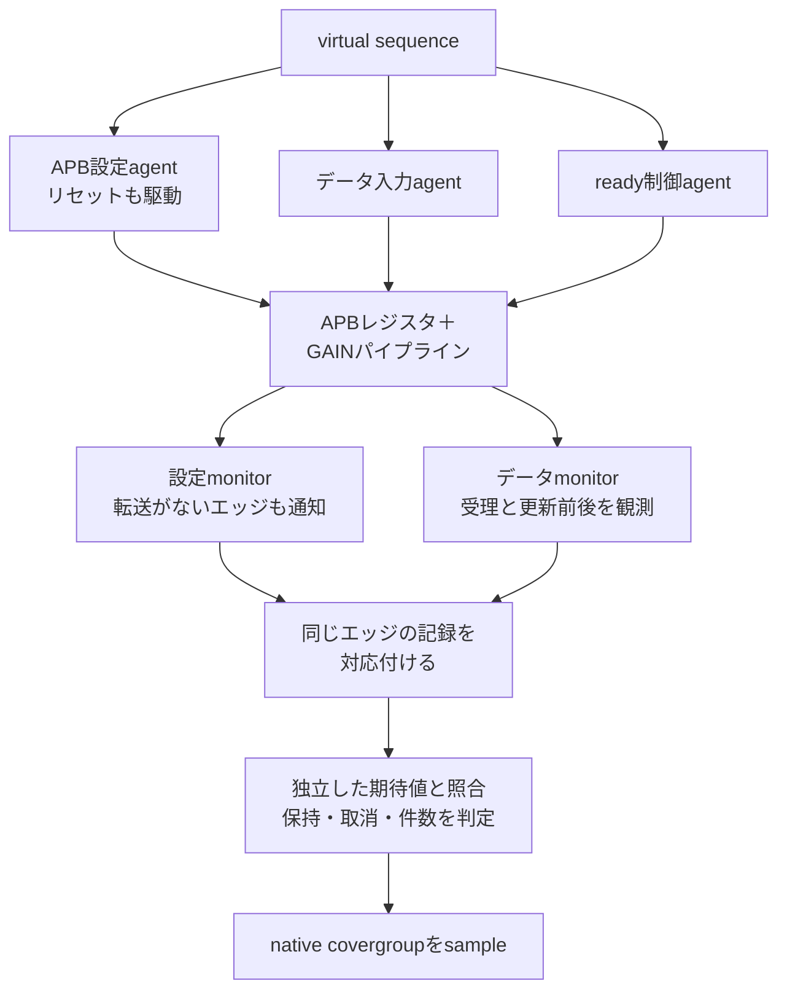

# 複数UVM agentで設定・データ・readyを協調させる

APB設定、データ入力、受信側readyを、3つのactive agentから同じクロック列に沿って駆動します。virtual sequenceが各sequenceを並行して開始し、2つのmonitorの観測をエッジIDでそろえて、設定の採用時点・データ・取消・終了を判定します。

[UVMの実践設計](../../docs/method/uvm-practical-design.md)のGAIN例を、実RTL・native UVM・Python参照モデル・SVA・機能カバレッジで動かす教材です。

## 1. 対象の仕様

入力xとGAINは符号なし8ビットです。入力の受理エッジの**更新前GAIN**を使い、十分な幅で乗算して`min(255, x × GAIN)`へ飽和します。同じエッジのAPB書込みは、次の入力から使います。

| 受理エッジ | 更新前GAIN | 同時に行うこと | その入力の結果 | 更新後GAIN |
| --- | --- | --- | --- | --- |
| k | 3 | x=7、GAINへ5を書込み | 21 | 5 |
| k+1 | 5 | x=7 | 35 | 5 |

データパスは1段のready/validパイプラインです。出力待ち中はvalidと値を保持し、出力受理と次の入力受理を同時に行えます。入出力の受理条件は、立上りで`rst_n=1`かつ対応するvalid・readyがともに1であることです。Low有効の同期リセットを取り込むエッジでは受理せず、GAINと出力validをクリアし、出力受理前の結果を取り消します。

APB設定には既存のレジスタRTLを使い、CONFIGの下位8ビットをGAINとします。待ちは0に固定しています。APB仕様全体・全アドレスの確認は[元のAPB例](../local-apb/README.md)へ分担し、本例は設定とデータパスの相互作用を確認します。

## 2. 駆動・観測・判定



driverは担当する信号だけを駆動します。設定agentがAPBとリセット、データagentが入力valid・データ、ready agentが出力readyを担当します。モジュール側は時刻0の初期化とクロック生成を行います。

各monitorは、転送の有無に関係なく毎エッジの記録を新しいオブジェクトで送ります。collectorは両方がそろった次のエッジIDだけを処理し、入力の期待値を確定した後にGAINを更新します。monitorのcallbackが先に届いた順に設定を適用しません。

設定monitor→データmonitor、データmonitor→設定monitorの2順序を、公開するまでの1ns／2nsの遅延で作ります。入力列・観測エッジは同じです。両順序で、Pythonの独立モデルとの全サイクル比較と、正規化した観測列の一致を要求します。無効なデータバスの値は比較対象へ数えません。

トレースには更新前後のready/valid・データと、scoreboard側の期待GAINを記録します。期待GAINはAPBの実受理から更新し、DUTのCONFIG値を参照モデルへコピーしません。

受理数＝出力数＋リセットによる取消数＋未完了数を確認し、最後は未完了0を要求します。観測・比較の欠落、余分な記録、未接続を、正常終了だけで合格にしません。

## 3. カバレッジとSVA

| 計測 | 必須の集合 |
| --- | --- |
| GAIN分類 | 0、1、中間、255の4 bin |
| 入力分類 | 0、1、2以上の3 bin |
| 飽和の有無 | 2 bin |
| 設定書込みと入力受理の同時性 | 2 bin |
| GAIN分類×入力分類 | 12 bin |
| native covergroupの合計 | 23 bin |
| native SVA cover | 同時受理、出力待ち、保持中のリセット、取消結果の4目標 |

既知の境界列で全binへ到達し、その後へseed付きのランダム操作を加えます。各正常実行で、native DBのbin集合・正のカウンター、ソースと階層、SVA actionの件数を照合します。APIの割合だけで合格にしません。

SVAのassertは出力待ち中のvalid・データ保持を確認します。リセット後の出力破棄とGAINの採用時点は、エッジの観測を使うscoreboardとPythonモデルでも検査します。受理した入力だけをcovergroupへ渡し、失敗・診断ケースから正常実績を補いません。

## 4. 意図した誤りで検出力を確認する

両方のmonitor順序で、次を実行します。

| ケース | 予定する検出 |
| --- | --- |
| 同時書込みの新しいGAINを現在の入力へ適用 | `COORD_DATA` |
| 飽和せず下位8ビットへ切り詰める | `COORD_DATA` |
| リセットで出力を取り消さない | `COORD_RESET` |
| データmonitorを未接続にする | `COORD_COUNTS` |
| 設定monitorの1エッジを欠落させる | `COORD_COUNTS` |
| covergroupのsampleを止める | `COORD_COVERAGE` |
| SVAの観測データだけを破壊する | `COORD_STABILITY` |

予定したラベルと非0終了を要求し、タイムアウトやビルド失敗を検出成功にしません。最初の3つはRTL変異、残りは検証環境の診断です。

## 5. 実行

POSIX、Python 3.10以上、Verilator 5.052、C++20コンパイラー、make、Accellera UVM 2020-3.2を用意します。[UVMの準備](../local-uvm/README.md#ライブラリの準備)を行い、リポジトリのルートで実行します。

```sh
python3 examples/local-uvm-coordination/run.py \
  --uvm-home /tmp/lsi-uvm-library/1800.2-2020.3.2
python3 examples/local-uvm-coordination/run.py --profile nightly \
  --uvm-home /tmp/lsi-uvm-library/1800.2-2020.3.2
python3 -m unittest discover -s examples/local-uvm-coordination/tests -v
```

smokeは1 seed×2順序、各seedのランダム操作200件でJUnit 19件です。nightlyは3 seed×2順序、各seedのランダム操作2,000件でJUnit 25件です。初期化・境界・最後の排出操作は別に加えます。SVの`randomize()`は使わず、保存したPython生成入力を再生します。制約付きランダム化そのものは[UVMランダム例](../local-uvm-random/README.md)を参照してください。

`--demo-bug 1`、`--sva-off`を付けた正常リグレッションは、全体の終了コード1が期待値です。`--out`は新しいディレクトリを指定します。全入力、ツール・UVM・実行ソースの版、ビルド、ログ・VCD・native DB、正規化トレース、比較・取消件数、JUnitを保存します。

確認は保存した同期的な0／1動作、単一クロック・1段パイプラインに限ります。任意のcallback遅延、複数クロック、4値・X/Z、深いoutstanding、物理タイミング、製品全体のUVM再利用を証明する例ではありません。

追加時のsmoke・nightlyと感度確認は[2026-10-31の記録](../../PROVENANCE.md#verification-workflow-expansion-20261031)にまとめています。
