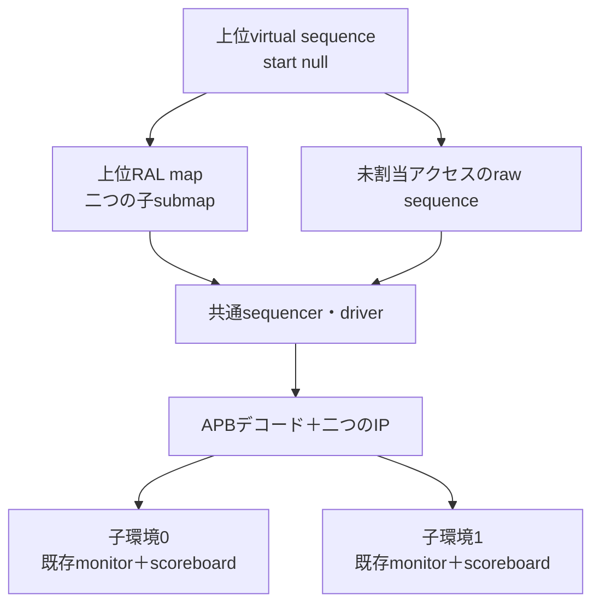

# 子のUVM環境と階層RALを上位で再利用する

1本のAPBバスへ2つのレジスタIPを接続し、上位のvirtual sequenceから階層RALを通して操作します。既存の`apb_block`、`apb_monitor`、独立した`apb_scoreboard`を再利用し、子環境にはdriver・sequencerを作りません。上位に1組だけを置きます。

## 1. 階層と配置



| 構成 | IP0のベース | IP1のベース | 待ち |
| --- | --- | --- | --- |
| layout0 | `0x00` | `0x40` | IP0=1、IP1=2サイクル |
| layout1 | `0x40` | `0x00` | 同じ |

各IPのローカルオフセットはCONFIG=`0`、ID=`4`、PENDING=`8`です。上位mapに`add_submap`し、ロック済みの既存子モデルを含めて動かします。上位mapだけに共通sequencerとadapter、auto predictionを設定します。子の物理インターフェースとモデルは、型付き設定オブジェクトで対応付けます。

両配置で同じ子コードを使い、実際のRALアドレスが物理配置と一致することを起動時に検査します。子モニターにはデコード後のローカルアドレスを渡します。

## 2. 独立した判定

virtual sequenceは`start(null)`し、RALアクセスと、物理sequencerで動くraw sequenceを協調させます。両IPへ異なる値を書き、両方を読戻すため、別IPへの書込みが上書きされる別名配線も検出します。リセット、W1Cとイベントの競合、未割当へのエラー応答も確認します。

CONFIGの期待値は書込み前に独立して保持します。ハードウェアイベントによるPENDINGの予測は、与えたイベントの契約から行い、DUTやscoreboardの実値をコピーして合格にはしません。ミラー比較と明示的な期待値比較を併用します。

通常1実行あたりの明示的な読出し・応答比較は`2×iterations+9`件です。各子は`3×iterations+6`転送を観測し、全サイクルの状態も既存scoreboardで比較します。driver所有数、比較数、転送数、UVMのERROR／FATALと固定したWARNINGも照合します。

機能目標は各IPの読戻し・PENDING・リセットの6目標と未割当応答の1目標です。ネイティブSVAで待ち中の制御保持をassertし、両IPの受理とリセットの3 coverをDB・action件数と照合します。機能目標のログとnative coverは別の集合です。

## 3. 実行と診断

Python 3.10以上、POSIX、Verilator 5.052、C++20、makeと、[固定版UVM](../local-uvm/README.md#ライブラリの準備)を用意します。

```sh
python3 examples/local-uvm-hierarchy/run.py \
  --uvm-home /tmp/lsi-uvm-library/1800.2-2020.3.2
python3 examples/local-uvm-hierarchy/run.py --profile nightly \
  --uvm-home /tmp/lsi-uvm-library/1800.2-2020.3.2
python3 -m unittest discover -s examples/local-uvm-hierarchy/tests -v
```

smokeは1 seed・iterations=4でJUnit 16件、nightlyは3 seed・iterations=20で20件です。3種類のRTL変異と3種類の検証環境診断を、両配置で実行します。

| 意図した誤り | 必須の検出 |
| --- | --- |
| IP1のCONFIGをSETUPで早く更新 | `UVM_CONFIG` |
| IP1のW1Cをクリア優先へ変更 | `UVM_PENDING` |
| IP1宛てのアクセスをIP0へ誤配線 | `HIER_READ` |
| 子1のscoreboardを未接続 | `HIER_COUNTS` |
| RALのsubmap配置を誤る | `HIER_MAP` |
| SVAが見るアドレスだけを破壊 | `HIER_STABILITY` |

予定ラベルと非0終了を要求します。`--demo-bug 1`、`--sva-off`を付けた通常リグレッションは全体の失敗が期待値です。出力には配置・seed・ソースとUVMの版、ビルド、全ログ・VCD・native DBを保存します。

対象は単一クロック・共通リセット・単一マスター・同期的な0／1動作です。別クロック、複数マスター、割り込みtapを含む任意SoCへの再利用は、別の適用判断と検証が必要です。[実践設計](../../docs/method/uvm-practical-design.md)の上位再利用の説明と併せて使います。
