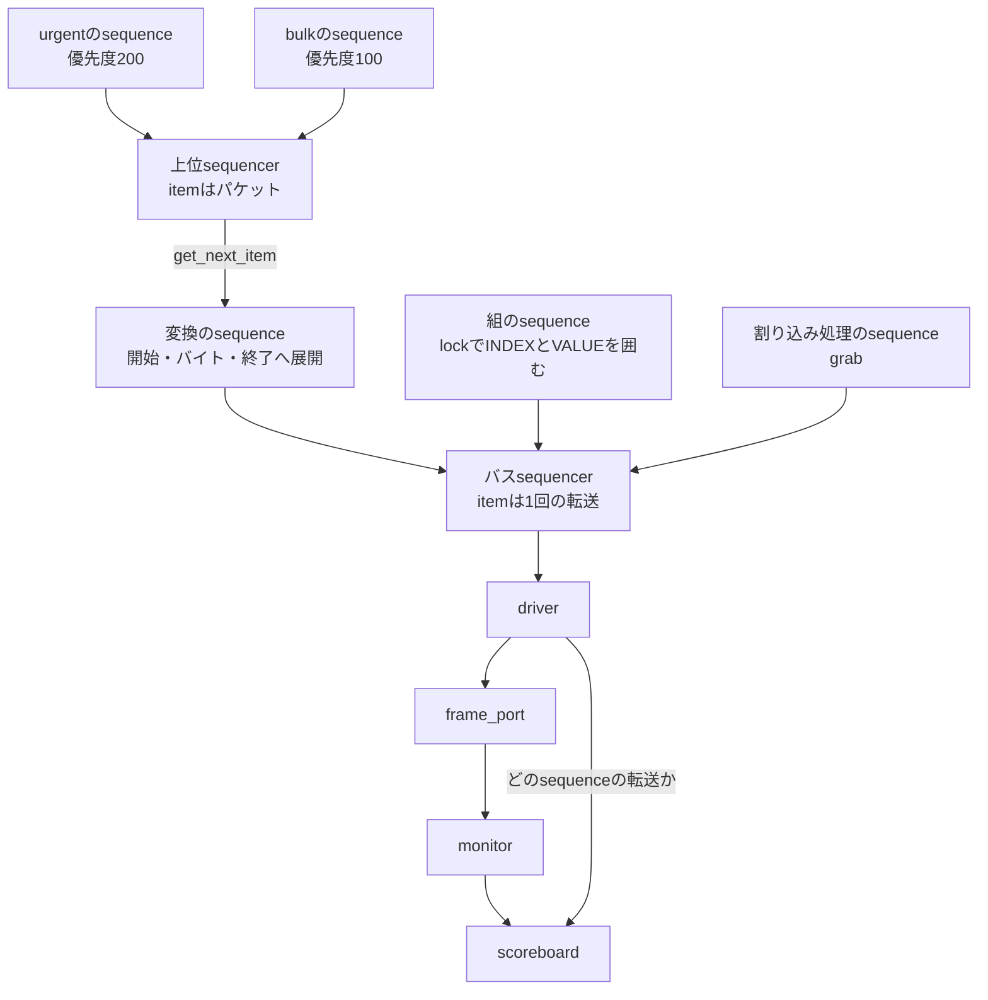

# UVMでsequenceを階層化し、lock・grab・優先度の動作を確かめる

上位のパケットを下位のバス転送へ変換するsequenceの階層化と、同じバスsequencerを取り合うsequenceの間の調停を扱う教材です。固定版のVerilator 5.052とAccellera UVM 2020-3.2（`UVM_NO_DPI`）で実行します。

確かめることは3つです。

- 上位sequencerのパケットを、下位のsequenceが1つずつ取り出してバス転送の列にする方式で、フレームが混ざらないこと。
- `lock`で囲んだ2回の転送の組が、割り込み処理に分けられないこと。割り込み処理は`grab`で、既に待っている`lock`の要求より先に実行されること。
- `set_arbitration`で厳密な優先度のモードにしたときだけ、sequenceの優先度が効くこと。

[複数agentの協調例](../local-uvm-coordination/README.md)のvirtual sequenceは、複数のsequencerで別々のsequenceを同時に始めるものです。この例の階層化は、1つのsequencerのitemを別のsequencerのsequenceが消費する接続で、役割が違います。違いは[4節](#4-virtual-sequenceとの違い)にまとめます。UVMの構成の考え方は[UVM検証の手順](../../docs/method/uvm-verification.md)にあります。

## 1. 対象の回路

[`frame_port.sv`](rtl/frame_port.sv)は、8ビット幅のレジスタを持つ架空の回路です。`req`が1のクロックで1回の転送を行い、次のクロックで`ack`と読出し値を返します。出力はすべてレジスタから出ます。

| 番地 | 名前 | 動作 |
| --- | --- | --- |
| 0 | CTRL | ビット0の書込みでフレーム開始、ビット1の書込みでフレーム終了。読むとフレームの途中かどうか |
| 1 | DATA | フレームの途中だけ、1バイトを足す。読むと今のバイト数 |
| 2 | INDEX | 間接読出しの選択（0〜3） |
| 3 | VALUE | 読出し専用。INDEXが0なら最後のフレームの長さ、1なら合計、2ならフレーム数、3なら違反の数 |
| 4 | STATUS | 割り込みの要因。ビット0はフレーム終了、ビット1は`alarm`入力、ビット2は違反。1を書いたビットだけ消える |
| 5 | ENABLE | 要因ごとの割り込み許可 |

フレームが終わると、`frame_valid`を1クロック出し、先頭バイト・長さ・合計（256を法とする和）を出力します。フレームの途中での開始、途中でない終了とバイト書込みは違反です。読出し値は、そのクロックで起きる変化の前の値です。要因の発生と同じビットのクリアが同じクロックに重なったときは、要因が残ります。

VALUEを正しく読むには、INDEXの書込みとVALUEの読出しを、ほかのINDEXの書込みに割り込まれずに続ける必要があります。これが、`lock`で守る対象です。フレームの書込み（CTRLとDATA）はINDEXに関係しないので、フレームの途中に割り込み処理が入っても壊れません。

## 2. テストベンチの構成



- **上位**：パケット（ポート、通し番号、1〜4バイトのペイロード）を流すsequenceが、ポートごとに1つあります。上位sequencerにdriverはつなぎません。
- **変換**：[`layer_seq`](tb/layer_pkg.sv)がバスsequencerの上で動き、上位sequencerから`get_next_item`でパケットを1つ取り、フレーム開始、先頭バイト（ポートと通し番号）、ペイロード、フレーム終了の転送にして、終わってから`item_done`を返します。パケットを1つずつ扱うので、2つのポートのフレームは混ざりません。
- **組**：INDEXを書いてVALUEを読む[`pair_seq`](tb/layer_pkg.sv)は、全体を`lock`と`unlock`で囲みます。2回の転送の間に、待ちのクロックを入れられます。
- **割り込み処理**：[`isr_seq`](tb/layer_pkg.sv)は`irq`を待ち、`grab`してからSTATUSを読み、要因に応じてVALUEを読み、読んだ値をSTATUSへ書いて消し、`ungrab`します。
- **筋書き**：[`layer_vseq`](tb/layer_pkg.sv)がvirtual sequenceです。自分のitemは持たず、2つのsequencerでsequenceを始め、`alarm`入力を決めた時点で動かします。

driverは、転送ごとに「どのsequenceが出したか」の印を付けて記録します。この印はピンには出ないので、monitorがピンから作った転送と1件ずつ突き合わせてから使います。

テストベンチは立下りエッジで駆動し、立下りエッジで読みます。monitorが読むのは、DUTのレジスタ出力と、インターフェースが立上りエッジで写し取った入力（`tap_*`）だけです。driverが値を変えるのと同じ時刻に、その信号を別の部品が読むことはありません。

## 3. 固定版のUVMでのlock・grab・優先度の動作

実装の前に、小さな試作で各機能が固定版のVerilatorとUVMで動くかを確かめました。動かなかった機能はありません。観測した動作は次のとおりで、固定版のライブラリの`src/seq/uvm_sequencer_base.svh`の`m_lock_req`・`grant_queued_locks`・`m_choose_next_request`を読んだ内容と合っています。IEEE 1800.2-2020の本文の節番号とは照合していません（未照合）。

| 機能 | 固定版で観測した動作 |
| --- | --- |
| 仲裁の既定（`UVM_SEQ_ARB_FIFO`） | 要求が届いた順に選ぶ。sequenceの優先度は見ない |
| `UVM_SEQ_ARB_STRICT_FIFO` | 待っている要求のうち、優先度が最も高いものを選ぶ。同じ優先度なら届いた順 |
| `UVM_SEQ_ARB_WEIGHTED`・`RANDOM`・`STRICT_RANDOM` | エラーなく動く。選択は乱数によるので、この例の判定には使わない |
| `start`の優先度の引数 | `get_priority`で読め、厳密なモードの選択に使われる。省略時は100 |
| `lock` | ほかのsequenceがlockを持っていなければ、通常の要求が先に待っていても、すぐに得られる。持たれていれば、待ち行列の後ろで待つ |
| `grab` | 待ち行列の先頭に入る。ほかのsequenceがlockを持っている間は待ち、外れると、先に待っていた`lock`の要求より前に得られる |
| 既に選ばれた転送 | driverが`get_next_item`で受け取った転送は、後から`lock`や`grab`が来ても取り消されず、最後まで実行される |
| 階層化 | sequenceの中から、別のsequencerの`get_next_item`と`item_done`を呼べる |

つまり、この版では、誰もlockを持っていないときの`lock`と`grab`の速さは同じです。差が出るのは、lockを持つsequenceがいて、ほかにも`lock`の要求が待っているときだけです。「`lock`は、先に待っている通常の要求がすべて終わってから得られる」という説明を見かけますが、固定版の実装はそうなっていません。ほかのシミュレーターや版では確かめていません。

## 4. virtual sequenceとの違い

| | virtual sequence | 階層化 |
| --- | --- | --- |
| 役割 | 複数のsequencerでsequenceを始め、時点をそろえる | 上位のitemを下位のitemの列へ変換する |
| itemの流れ | 自分のitemは持たない | 上位sequencerのitemを、下位のsequenceが`get_next_item`で消費する |
| 上位の仲裁 | 行わない | 上位sequencerが、パケットの単位で仲裁する |
| この例での使い方 | 筋書き（`layer_vseq`） | 変換（`layer_seq`） |

階層化をやめて、ポートごとのsequenceがフレームの転送を直接バスsequencerへ出すと、仲裁は転送の単位になり、2つのポートのフレームが混ざります。この例では、`+FLAT=1`でその構成に切り替え、scoreboardが「フレームの途中の開始」として検出することを確かめます。階層化しない構成でも、フレームごとに`lock`で囲めば混ざらないはずですが、その場合、パケットの順は`lock`を待つ順序で決まり、sequenceの優先度は効きません。この構成は実行していません。

## 5. 筋書きと期待値

1回の実行は、次の段階を順に行います。段階の境目では、パケット・割り込み・scoreboardの待ちがすべて空になるのを待ちます。

| 段階 | 内容 | 確かめること |
| --- | --- | --- |
| 待ち合わせ | 2つのポートが、全パケットを同時に上位sequencerへ出す | 優先度の高いポートのパケットが、すべて先に届く |
| 組の途中の割り込み | 組の2回の転送の間を6クロック空け、その間に`alarm`を入れる | 割り込み処理が、組が終わるまで待つ |
| lockとgrabの順 | sequence Hがlockして4回転送する間に、sequence Lが`lock`を要求し、その後で`alarm`を入れる | Hの次に割り込み処理、最後にLの順になる |
| 処理中の要因 | フレーム終了の処理でSTATUSを読んだ直後に`alarm`を入れる | 後から来た要因が消されずに残り、もう1回処理される |
| クリアと同時の要因 | `alarm`の処理でSTATUSへ書くのと同じクロックに、もう一度`alarm`を入れる | 2回目の要因が残り、もう1回処理される |
| 混在 | 2つのポートのパケット、組、`alarm`を、乱数で決めた間隔で同時に流す（smokeは3回、nightlyは12回） | 上の規則がすべて保たれる |
| 待ち合わせ（2回目） | 乱数で決めた数のパケットで、もう一度 | 同上 |

入力は[`run.py`](run.py)がseedから作り、`plan.txt`に保存します。SystemVerilogの`randomize()`は使いません。

期待値は3つの方法で、UVMのscoreboardとは別に持ちます。

- **サイクルモデル**：`run.py`の`Port`は、1節の仕様から書いたPythonのモデルです。全クロックの入力を与えて、DUTの全出力と毎クロック比べます。
- **パケットの計画**：段階ごとに届くはずのフレームを計画から求め、バスのピンから組み立てたフレーム、DUTのフレーム出力と比べます。待ち合わせの段階は全体の順序、ほかの段階はポートごとの順序を比べます。
- **転送の列の規則**：driverが付けた印とピンの記録を1件ずつ対応させてから、次を調べます。
  - VALUEの読出しの直前の転送が、同じsequenceのINDEXの書込みであること。
  - `irq`が1の間に、割り込み処理以外の転送が続く回数が5回以下であること。
  - lockとgrabの順の段階で、転送の出し手がH、割り込み処理、Lの順であること。
  - 処理中の要因とクリアと同時の要因の段階で、STATUSの読出しが2回あり、2回目に`alarm`が残っていること。

「5回以下」は、この例で最も長いlock（4回の転送）に、既に選ばれていた転送1回を足した数です。手元の実行で観測した最大は3回でした。

scoreboardも、同じ規則をUVMの中で調べます。違反を見つけると、次のラベルを出して止まります。

| ラベル | 意味 |
| --- | --- |
| `LAYER_BUS` | driverの転送とピンの観測が違う、または`ack`がない |
| `LAYER_FRAME` | バスの上で、フレームの途中の開始、開始のない終了・バイトがあった |
| `LAYER_DATA` | DUTのフレーム出力が、バスのバイトから求めた値と違う |
| `LAYER_TRANSLATE` | フレームが、上位のパケットと違う |
| `LAYER_PRIORITY` | 優先度の高いパケットが待っているのに、低いパケットが先に届いた |
| `LAYER_ATOMIC` | VALUEを読む前に、別のsequenceがINDEXを書いた |
| `LAYER_VALUE` | VALUEの読出し値が、バスで見たフレームから求めた値と違う |
| `LAYER_LATENCY` | 割り込みが出ているのに、ほかの転送が6回以上続いた |
| `LAYER_IRQ` | 要因の数と処理の数が合わない、または要因が処理されないまま待ちが尽きた |
| `LAYER_COUNTS` | パケット・組・`alarm`のどれかが実行されなかった、または計画が余った |

## 6. 要求と目標

[`requirements.json`](requirements.json)は6要求・12目標です。目標は、ログから`run.py`が判定します。通常の実行のすべてで、12目標の全部に届くことを求めます。

| 要求 | 内容 | 目標 |
| --- | --- | --- |
| LAYER-001 | パケットが順序と内容を保ってフレームになり、混ざらない | 両ポートのフレーム、混在の段階での同時進行 |
| LAYER-002 | 待ちがあるとき、優先度の高いポートが先 | 待ち合わせの段階で両ポートに待ちがある |
| LAYER-003 | INDEXとVALUEの組が分けられない | 割り込みが出ている間にlock中の転送がある、間を空けた組が守られる |
| LAYER-004 | 割り込み処理は待っているlockより先で、遅れは5回以下。フレームの途中でも実行できる | grabがlockを追い越す、フレームの途中の割り込み処理 |
| LAYER-005 | 要因が失われない | `alarm`の処理、フレーム終了の処理、処理中の要因、クリアと同時の要因 |
| LAYER-006 | DUTの全出力がサイクルモデルと一致 | 全クロックの比較 |

## 7. 意図した誤りで検出力を確かめる

RTLの変異は`MUTATION`パラメーターで4種類です。5つの変種を1回のビルドに含め、`+MUTATION`で選びます。

| 変異 | 内容 | 検出するラベル | 止まる段階 |
| --- | --- | --- | --- |
| 1 | フレーム開始で合計を0に戻さない | `LAYER_DATA` | 待ち合わせ |
| 2 | STATUSへの書込みで、書いた値に関係なく全ビットを消す | `LAYER_IRQ` | 処理中の要因 |
| 3 | 間接読出しの2番と3番が入れ替わる | `LAYER_VALUE` | 組の途中の割り込み |
| 4 | 要因の発生とクリアが重なると、要因が消える | `LAYER_IRQ` | クリアと同時の要因 |

テストベンチ側の誤った構成も、4種類を実行します。どれもRTLは正常です。

| 名前 | 切り替える構成 | 検出するラベル | 止まる段階 |
| --- | --- | --- | --- |
| `lock-off` | 組のsequenceが`lock`を使わない（`+LOCK_OFF=1`） | `LAYER_ATOMIC` | 組の途中の割り込み |
| `isr-uses-lock` | 割り込み処理が`grab`の代わりに`lock`を使う（`+ISR_LOCK=1`） | `LAYER_LATENCY` | lockとgrabの順 |
| `fifo-arbitration` | 上位sequencerを既定のモードのままにする（`+ARB_FIFO=1`） | `LAYER_PRIORITY` | 待ち合わせ |
| `no-layering` | 階層化をやめ、ポートごとにフレームを直接出す（`+FLAT=1`） | `LAYER_FRAME` | 待ち合わせ |

`isr-uses-lock`は、3節の動作のとおり、lockを待つ要求がほかにないときは`grab`と区別できません。lockとgrabの順の段階で初めて、割り込み処理がLの後になり、検出されます。

## 8. 実行

[検証環境の準備](../../tools/ENVIRONMENT.md)で用意したUVMライブラリの場所を`--uvm-home`に渡します。

```sh
python3 examples/local-uvm-layering/run.py \
  --uvm-home /tmp/lsi-uvm-library/1800.2-2020.3.2
python3 examples/local-uvm-layering/run.py --profile nightly \
  --uvm-home /tmp/lsi-uvm-library/1800.2-2020.3.2
python3 -m unittest discover -s examples/local-uvm-layering/tests -v
```

構成は1つです。smokeは1 seedで混在の段階が3回、JUnitは11件です（ビルド1、通常1、変異4、テストベンチの誤った構成4、要求と目標1）。nightlyは3 seedで混在の段階が12回ずつ、JUnitは13件です。`--seed`で最初のseedを変えられます。`--demo-bug 1`〜`4`は、通常の実行のRTLをその変異に替えるもので、全体の終了コード1が期待値です。`--out`は新しいディレクトリを指定します。

保存する証跡は、マニフェスト（入力のハッシュ、seed、計画）、ツールの版、UVMライブラリのファイルごとのハッシュ、ビルドのログ、実行ごとの`plan.txt`・ログ・波形・`result.json`、`coverage.json`（要求と目標）、`summary.json`、`junit.xml`です。

セルフテストは16件で、シミュレーターを使いません。計画の再現性、サイクルモデル（フレームの組立て、違反、要因とクリアの重なり、読出しの時点）、手で書いた予定表から作ったログの受理、ログの改変（優先度の逆転、組の分断、lockの後ろに回った割り込み処理、失われた要因、出力値・段階・件数・印の書換え）の拒否、UVMのエラーと版の検査、要求表と目標の対応、ランナーの引数の検査を確かめます。

## 9. 確認範囲と残る制限

- lock・grab・仲裁の動作は、固定版のVerilator 5.052とAccellera UVM 2020-3.2で観測したものです。ほかのシミュレーターや版では実行していません。3節の表は実装の観測で、IEEE 1800.2-2020の本文とは照合していません。
- 順序の判定は、要求が待ち行列に入る時点をクロックで分けた筋書きに限っています。同じ時刻に届いた要求の順は、待ち合わせの段階の「2つのポートが同時に出す」場合だけを使い、厳密な優先度のモードではその順に結果が依存しないことを利用しています。既定のモードでの順（`fifo-arbitration`）は、開始した順に依存します。
- 乱数を使う仲裁のモードは、試作でエラーなく動くことを見ただけで、分布は確かめていません。`UVM_SEQ_ARB_USER`、`is_relevant`と`wait_for_relevant`、sequenceの`kill`の途中でのlockの解放は扱っていません。
- 階層は2段で、上位1つに下位1つです。下位の応答を上位へ戻す経路、複数の下位への振り分け、上位のmonitorの再構成（下位の転送からパケットを組み立てて上位のanalysis portへ出す部品）は、scoreboardの中の組立てで代用しています。
- 割り込み処理の遅れは、転送の回数で数えています。時間（クロック数）の上限は判定していません。
- DUTは教材用の架空の回路です。実行中のリセット、`ack`を待たせるバス、複数の割り込み線は扱っていません。フレームの長さは8ビットで、255バイトを超えるフレームは試していません。
- 機能カバレッジはcovergroupではなく、ログから判定する12目標です。
- kirimasimでは実行していません。UVMを使うので、Icarusだけで動く例の自動選択には入りません。

## 10. 確認記録

2026-11-21に、macOS arm64、Python 3.13.15、Verilator 5.052、Accellera UVM 2020-3.2（`UVM_NO_DPI`）で実行しました。

- smoke（seed 17）：JUnit 11件が合格。通常の実行は9段階、846クロック、399回の転送、29フレーム、`alarm` 12回、割り込み処理40回、組80回。
- nightly（seed 17〜19）：JUnit 13件が合格。通常の実行は各18段階で、1,970〜2,317クロック、920〜1,101回の転送。
- 別のseed（0、1、100、5000、99999、2147483000）のnightlyも合格。
- 変異4種類とテストベンチの誤った構成4種類は、すべて予定のラベルで、7節の表の段階で止まりました。
- `--demo-bug 1`は、通常の実行と要求の判定が不合格になり、終了コード1でした。
- セルフテスト16件が合格。RTLは`verilator --lint-only -Wall`で、変異0〜4のすべてが警告0件。`tools/check_tb_races.py`は候補0件。

ビルドは1回で、手元では初回が約40秒、実行は全部で数秒です。
