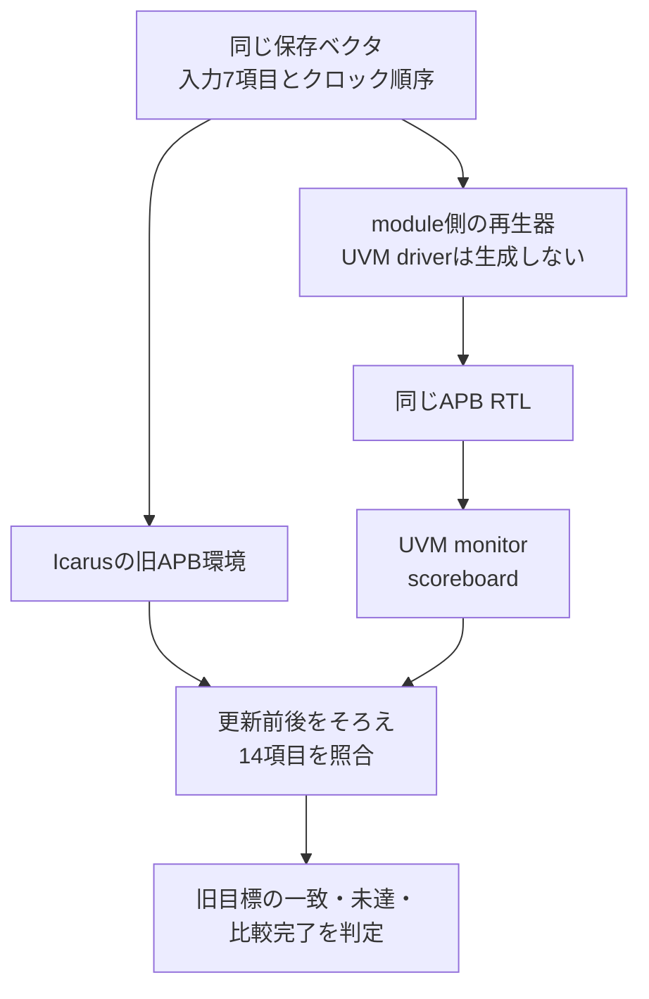

# 保存ベクタをpassive UVM環境へ流し、旧環境と照合する

既存の[APB例](../local-apb/README.md)と同じ保存ベクタを、旧テストベンチとnative SystemVerilog UVM環境へ与えます。UVM側は**passive agent**で観測し、設定オブジェクト、factory、analysis接続、scoreboard、SVAの報告と到達を実行します。Pythonは起動・照合・記録を担当し、UVMクラスはAccelleraの実装で動きます。

[移行ガイド](../../docs/method/uvm-migration-guide.md)のM1〜M2を具体化した例です。旧手順をUVM driver・sequenceへ置き換えるM3や、複数IPを協調させるvirtual sequence・上位RALは含みません。[基礎の学習案内](../../docs/method/uvm-basics.md)と[設定・再利用の設計](../../docs/method/uvm-practical-design.md)から参照しています。

## 1. 同じ入力と観測を比較する



再生する入力はリセット、PSEL、PENABLE、書込み方向、番地、データ、イベントの7項目です。旧側のVCDから、更新前の入力・PREADY・PSLVERR・読出し値・CONFIG・PENDINGと、更新後のCONFIG・PENDINGを抽出します。UVM monitorの同じ14項目と、クロックごとに照合します。

旧側はIcarus、新側はVerilatorのため、VCDファイルの文字列そのものは比較しません。旧側の更新前を立上り直前、更新後をNBA後へそろえ、UVM側の観測列へ正規化します。入力、行数、順序、値、最後の観測の欠落も失敗にします。

これは保存したケースの0／1動作の照合で、任意入力への等価性証明ではありません。X/Z、サンプル間のグリッチ、物理タイミング、CDCは対象外です。

## 2. UVMで引き継ぐもの

| 部品・仕組み | 実装と判定 |
| --- | --- |
| 設定オブジェクト | `migration_cfg`にvif・待ち構成・予定数・active／passive・比較の有効化をまとめ、対象agentへ渡す。 |
| passive agent | monitorのみ生成。driver・sequencerが存在したら、再生開始前に失敗させる。 |
| 参照モデル | 既存UVMの`apb_scoreboard`を再利用し、待ち・要求保持・応答の検査と旧目標の収集を追加する。 |
| analysis接続 | 派生scoreboard用のimpへ接続する。元クラスの非virtualな`write()`だけに接続して、追加検査を飛ばさない。 |
| 終了 | objectionを保持し、旧再生器の完了イベントを`wait_on()`で待つ。予定数・観測数・比較数の一致を別に要求する。 |
| factory | 診断時だけ`corrupt_monitor`へ差し替え、観測値の故障を検出する。 |
| SVA | 同期リセットの結果を次サンプルでassert。actionがUVMへ報告し、reportのエラーと非0終了を確認する。 |

待ち構成は旧例と同じ0／1／3です。旧カタログをそのまま読み、wait=0は20目標、wait=1／3は21目標を要求します。新側は`MIG_COVER`、旧側は`COVER`からIDを収集し、合格した同一ケースの集合が一致することを確認します。基本UVM・RAL例の9目標とは別の集合です。

SVAは`cp_reset_seen`と`cp_reset_done`の2目標をnative DBから読み、source・階層・カウンターの存在と、actionログの件数を照合します。20／21の機能目標は手続き的な観測ログ、2つのSVA目標はnativeユーザーカウンターです。ネイティブcovergroupで20／21目標を計測する例ではありません。

SVAの有効化は実行ごとに固定します。実行途中のオン・オフや複数インスタンスのスコープ制御は、この例で確認する範囲には含みません。

## 3. 少ない刺激から未達を埋める

正常ケースは名目動作、旧境界ケース、保存したランダム列の順に実行します。名目動作はCONFIGへの通常書込みと読戻しだけです。wait=0では4/20、wait=1／3では5/21にとどまります。

次の境界ケースで、全アドレス分類×読書き、代表データ、W1C、IDLE・SETUP・ACCESS中のリセット、連続転送、適用する待ちを追加し、20／21目標へ到達します。`coverage-progress.json`へ各段階の不足を保存し、名目動作だけで全目標を満たしたことにはしません。

これは固定の境界ケースを追加する収束確認です。SystemVerilogの制約付きランダムとnative binは[UVMランダム例](../local-uvm-random/README.md)で扱います。

## 4. 意図した誤りで検出力を確認する

| ケース | 期待する検出 |
| --- | --- |
| RTL変異1：SETUPでCONFIGを更新 | 旧側`APB_STATE`、新側`UVM_CONFIG` |
| RTL変異2：W1Cがイベントより優先 | 旧側`APB_W1C`、新側`UVM_PENDING` |
| RTL変異3：禁止書込みがCONFIGを更新 | 旧側`APB_ERROR_SIDE_EFFECT`、新側`UVM_CONFIG` |
| monitorの観測値を破壊 | factoryで差し替えた観測の誤りを`UVM_CONFIG`で検出 |
| scoreboardを未接続にする | `MIG_COMPARISONS`。観測だけ行えても比較0件を合格にしない |
| agentをactiveにする | `MIG_OWNERSHIP`。旧再生器と同時に駆動しない |
| SVAの観測値だけを破壊 | `MIG_SYNC_RESET`。ネイティブassertからUVM report・非0終了への経路を確認 |

最後の4つは検証環境の診断で、RTL変異の検出率へ加算しません。予定したラベルと非0終了を要求し、タイムアウトや別の異常は成功にしません。負例から機能カバレッジを集計しません。

## 5. 実行

POSIX環境、Python 3.10以上、Icarus Verilog、Verilator 5.052、C++20対応コンパイラとmake、Accellera UVM 2020-3.2を用意します。[ライブラリの準備](../local-uvm/README.md#ライブラリの準備)を行い、リポジトリのルートから実行します。例同士のコードとC++ハーネスを再利用するため、リポジトリ全体を取得してください。

```sh
python3 examples/local-uvm-migration/run.py \
  --uvm-home /tmp/lsi-uvm-library/1800.2-2020.3.2 --seed 73
python3 examples/local-uvm-migration/run.py \
  --uvm-home /tmp/lsi-uvm-library/1800.2-2020.3.2 --profile nightly --seed 73
python3 -m unittest discover -s examples/local-uvm-migration/tests -v
```

既定のsmokeはwait=1、正常3ケース（名目・境界・1 seedのランダム操作200件）と感度確認で**JUnit 25件**です。既定のnightlyはwait=0／1／3で各3 seed、各seedのランダム操作を2,000件へ広げ、**JUnit 91件**になります。`--wait all|0|1|3`と`--transactions`で範囲を選べます。初期化・終了確認の操作は別に加えます。両環境の実行・比較・ビルドなどを別の判定として数え、JUnit件数を独立した要求数にはしません。

`--out`は新しいディレクトリを指定します。ソース・外部UVMのハッシュ、全入力、ツール版、ビルド、ケースごとのログ・VCD・正規化トレース・結果、比較差分、未達の推移、JUnitを保存します。

```sh
# どちらも回帰全体の終了コード1が期待値
python3 examples/local-uvm-migration/run.py \
  --uvm-home /tmp/lsi-uvm-library/1800.2-2020.3.2 --demo-bug 1
python3 examples/local-uvm-migration/run.py \
  --uvm-home /tmp/lsi-uvm-library/1800.2-2020.3.2 --sva-off
```

前者は正常ケースの新側だけを誤実装にし、旧側の成功で相殺しません。後者はSVAの到達・感度不足により失敗します。

## 6. covergroupの割合を校正する付属コード

[`coverage_probe.sv`](coverage_probe.sv)は、UVMを使わない独立した校正用fixtureです。policy 2 bin、size 3 bin、cross 6 binに既知の2サンプルを与え、APIの値と二つの集計方法を表示します。主要環境の`tb/top.sv`とは別にビルドします。

```sh
mkdir -p artifacts/uvm-coverage-probe
verilator --cc --exe --build --timing --coverage-user --top-module top \
  --Mdir "$PWD/artifacts/uvm-coverage-probe/build" \
  "$PWD/examples/local-uvm-migration/coverage_probe.sv" \
  "$PWD/examples/local-uvm-random/sim_main.cpp"
(
  cd artifacts/uvm-coverage-probe || exit
  ./build/Vtop
)
```

Verilator 5.052での表示は、instance=45.454545、type=0、項目の等重み平均=55.555556、全bin比率=45.454545でした。`matches_weighted=0`はこの差を報告する診断で、DUTの失敗ではありません。native DBには11 binが存在し、そのうち5 binが非0になります。詳細は[割合の読み方](../../docs/method/uvm-practical-design.md#62-binの割合と項目の平均を区別する)を参照してください。

## 7. 確認範囲

2026-10-31にsmoke・nightly、3種類のRTL変異、4種類の環境診断、`--demo-bug 1`・`--sva-off`、ランナーのセルフテストを確認しました。[追記記録](../../PROVENANCE.md#qiitaのuvm連載の整理とpassive移行の実行例2026-10-31)に範囲と証跡をまとめています。

確認は保存したベクタの同期的な0／1観測に限ります。旧環境を廃止する判断や、M3以降のdriver置換、全UVM API、商用VIP、複数IPのRAL、任意の入力・履歴の証明は含みません。移行の残りは[計画テンプレート](../../docs/templates/uvm-migration-plan.md)へ対応付けます。
