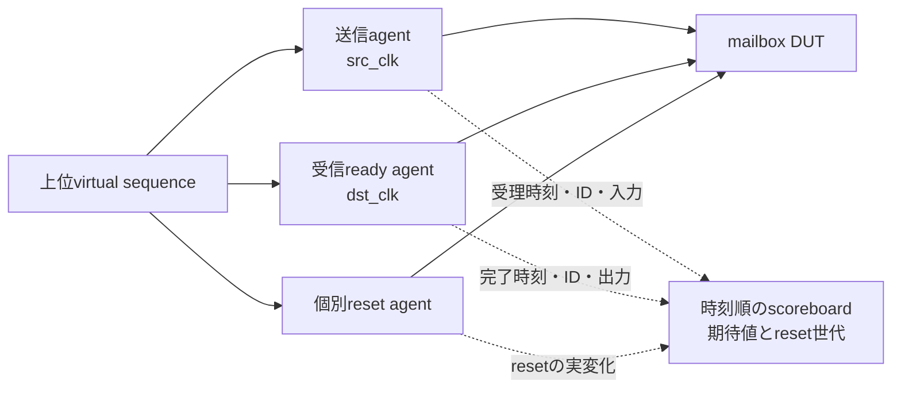
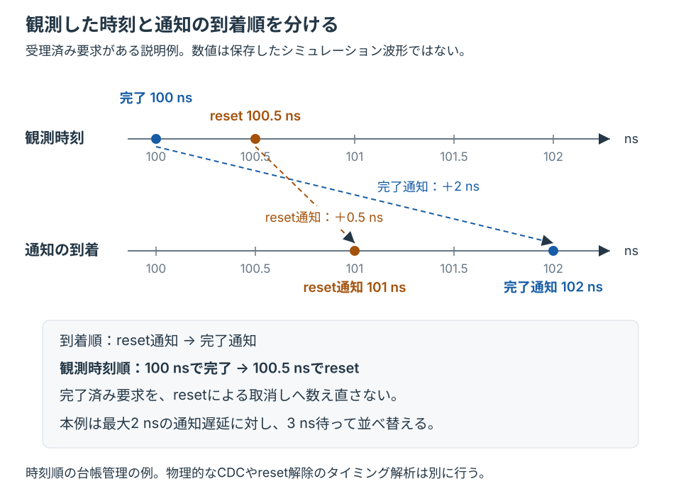

# 複数クロック・個別リセットを扱う上位UVM環境

独立したクロックで動く送信側と受信側を、一つの上位virtual sequenceから協調させます。片側だけのリセットでも受理済み要求を取り消し、リセット前の応答を復帰後に受け付けないことを確認します。[単一クロックのagent協調](../local-uvm-coordination/README.md)、[子環境と上位RAL](../local-uvm-hierarchy/README.md)の次の演習です。

## 1. 回路の契約

`reset_mailbox`は、同時に1件だけ未完了要求を持つbundled-dataのreq／ack回路です。送信側で`src_valid && src_ready`を受理し、受信側で`dst_valid && dst_ready`が成立すると、同じIDと`src_data ^ 8'h3c`を完了として観測します。IDは検証時の追跡用メタデータで、実行中はリセットをまたいで再利用しません。

| 条件 | 要求する動作 |
| --- | --- |
| 受信側が待ち状態 | valid・ID・データを保持 |
| 一方または両方のresetをアサート | チャネル全体を破棄し、未完了要求を取消。古い応答を再開しない |
| ローカルresetを解除 | 各ドメインで2段同期して`up`を立てる |
| 両端復帰 | チャネル用resetも各ドメインで同期解除し、相手の`up`を同期してから転送を再開 |

未完了要求をreset時に保持して後で再送する仕様ではありません。要求の受理、正常完了、取消を別に数えます。

送信側の復帰は端子で検査します。`ap_channel_release`は、チャネルreset解除後に送信側クロック2エッジを経て、さらに`dst_up`を2エッジ観測するまで`src_ready`が立たないことを要求します。driverは事前に`up`を待たず、解除直後からvalidを提示します。

受信側の同期解除は、送信側が受信側より十分に速いときだけ端子に現れます。そのときは要求が解除の完了より先に届くので、解除を省くと`dst_valid`が早く立ちます。クロック条件2で、解除後に受理した要求が受信側の5エッジより前に完了しないことを`ap_receiver_release`で検査します。解除を省く変異6は、この条件では`MC_CHANNEL`になり、クロック条件0・1では回帰を通過します。

`src_seen`のゲートは、どのクロック比でも端子に現れません。[形式証明](formal/mailbox_formal.sv)で、クロックとリセットを自由に動かしても、`present`が立っていれば`src_seen[1]`も立っていることをk-帰納法で示しました。したがって、`dst_valid`の値はこのゲートの有無で変わりません。[セルフテスト](tests/test_formal.py)では、受理と完了に到達できることと、鎖を壊すと証明が失敗することも確かめます。補助の不変条件をすべて満たしたまま目標だけを破る壊し方でも、目標のアサーションで失敗します。これは論理モデルの証明で、物理的なメタスタビリティは含みません。受信側の解除回路は、構造のレビューやCDC/RDC解析でも確認してください。

## 2. 環境と観測時刻



各monitorは通知前に新しい観測オブジェクトへ実際のエッジ時刻を保存します。scoreboardは最大2nsの通知遅延より長い3nsを待ち、時刻順に処理します。同じ時刻ではreset、送信受理、受信完了の順です。この待ち時間は本例で固定した通知遅延に対する設計で、無制限な遅延を扱う一般的な同期機構ではありません。

通常の転送だけでは観測の間隔が通知遅延より十分長く、通知順と時刻順は入れ替わりません。そこで誘導シナリオを2つ入れます。

| シナリオ | 観測の順 | 通知の順 | 正しい処理 | 到着順に処理した場合 |
| --- | --- | --- | --- | --- |
| 完了の0.5ns後に送信側reset | 完了→reset | reset→完了 | 完了を数える | 取消済みの応答と誤判定し`MC_STALE` |
| 受理の0.5ns後に受信側reset | 受理→reset | reset→受理 | 受理して取り消す | 取り消せず次の受理で`MC_COUNTS` |

Pythonは、通常実行の通知ログに両方の入れ替わりがあることを要求します。scoreboardが処理した順は、独立に時刻順へ並べた観測列と一致する必要があり、source／destinationの通知遅延を入れ替えた2構成でも同じ処理順を要求します。到着順に処理するscoreboardは、シナリオの順序を変えた2種類の診断で検出します。

同時刻の観測は本例の刺激では発生しません。この契約は未完了1件で確認応答の同期を待つため、受理と完了が同じ時刻に並ばないからです。同時刻の処理規則はscoreboardの実装にありますが、実行では確かめていません。



図は受理済み要求がある説明例です。完了通知の遅延を2ns、reset通知を0.5nsとすると、到着順が逆になります。観測時刻へ戻して処理し、reset前に完了した要求を取消しへ数え直さないことを確認します。数値は保存した波形からの抜粋ではありません。

resetのアサートで世代を進め、期待値・受理時刻・世代をまとめて取り消します。取消済みIDや未知のIDの応答は`MC_STALE`です。全観測時点で次の台帳を検査します。

`受理数 = 完了数 + 取消数 + 未完了数`

Python側も生の`MC_OBS`記録と`MC_ISSUED`から独立に同じ契約を再構成します。刺激を発行しただけでは受理と数えず、実際のハンドシェイクと照合します。

## 3. 実行

[基本UVM例の準備](../local-uvm/README.md#ライブラリの準備)でAccellera UVM 2020.3.2を取得してから実行します。Python 3.10以上、POSIX、Verilator 5.052、C++20コンパイラー、makeが必要です。

```sh
python3 examples/local-uvm/setup_uvm.py --out artifacts/toolchains/uvm-library
python3 examples/local-uvm-multiclock/run.py \
  --uvm-home artifacts/toolchains/uvm-library/1800.2-2020.3.2 \
  --out artifacts/uvm-multiclock
```

すでにUVMを準備している場合は、取得を省略し`--uvm-home`へ実際の場所を指定します。`--profile nightly`で通常のseedを1個から3個へ、追加要求を40件から160件へ増やします。既存のディレクトリは上書きしません。

| 構成・判定 | 内容 |
| --- | --- |
| クロック条件0 | src周期6ns、dst周期10ns、位相差0。正エッジが同時になる場合を含む |
| クロック条件1 | src周期10ns、dst周期6ns、dst開始位相1ns |
| クロック条件2 | src周期4ns、dst周期30ns。受信側の解除より先に要求が届く |
| 通知順序 | source／destinationの通知遅延1.5ns／2nsを入れ替える2構成。resetの通知遅延は0.5ns |
| reset試験 | 送信側のみ、受信側のみ、両端から送信側先に解除、受信側先に解除、誘導シナリオ2種 |
| 正常実行 | 6構成×seed。各実行で受理`21+追加要求数`、完了`16+追加要求数`、取消5、世代6、未完了0 |
| 変異 | データ破損（`MC_DATA`）、相手resetの無視（`MC_STALE`）、ローカル同期解除の迂回（`MC_RELEASE`）、チャネル同期解除の迂回、相手の`up`待ちの省略（ともに`MC_CHANNEL`）を全6構成で検出。受信側のチャネル同期解除の迂回（`MC_CHANNEL`）をクロック条件2の2構成で検出 |
| 検査の診断 | source観測停止、reset観測停止、保持検査への故障注入、到着順の処理2種を全6構成で検出 |

JUnitはsmoke 73判定／nightly 91判定です。ネイティブSVAの10 coverについて、ラベル・ソース・階層・DB件数とactionの件数を照合し、全正常実行で到達を要求します。UVMの版と完了件数、ERROR／FATAL 0、既知のDPI無効化に関するWARNING 2件も確認します。ログ、VCD、coverage DB、UVMソースのハッシュ、予定と実行結果を保存します。

## 4. 対象外

resetの刺激は半整数ns、クロックのエッジは整数nsに置き、同一シミュレーション時刻でのresetとクロックの競合を除外しています。両クロックは常時動作し、未完了要求は最大1件です。任意のクロック停止、多数のID、タイムスタンプの折返し、全位相・全比率の試験ではありません。

このRTLと論理シミュレーションだけで、物理的なメタスタビリティ、束ねたデータの到着制約、MTBF、CDC/RDCの構造、resetのrecovery／removalを保証しません。実装時は同期器の属性・配置、タイミング制約、CDC/RDC解析を別に確認します。[領域の点検](../../docs/method/verification-gap-review.md#4-cdcrdcとクロック制御)も参照してください。
