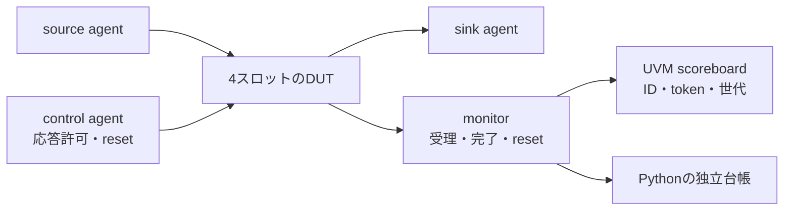

# UVMで複数の未完了要求と順不同応答を検証する

4つのIDを持つ小さな要求・応答回路を、公式Accellera UVM 2020.3.2とVerilator 5.052で動かします。同時に4件まで受理し、受付順と異なる順序で応答します。IDをキーに照合し、完了・取消し後のID再利用も確認します。

[UVMの基礎](../../docs/method/uvm-basics.md)、[複数クロックと個別reset](../local-uvm-multiclock/README.md)の次に試せる例です。本例は単一クロックで、AXIなど特定のバス規格の実装ではありません。

## 回路と契約

| 項目 | この例の仕様 |
| --- | --- |
| 受理 | `s_valid && s_ready`。2ビットのIDが未使用で、空きスロットがある場合に受付可能 |
| 応答 | `m_valid && m_ready`。ID・16ビットtoken・8ビットデータを返す |
| データ | `(3 × 入力データ + ID) mod 256` |
| 順序 | ID間の順序保証なし。受付済み要求だけを、1件につき1回完了させる |
| 保持 | 応答待ち中はvalidとID・token・データを保持 |
| リセット | 未完了要求を全件取り消す。解除後に古い応答を返さない |
| 再利用 | 完了・取消し後は同じIDを使用可能。tokenは本実行中に重複しない |

入力データの下位3ビットで内部待ち時間を変え、成熟したスロットのうち番号の大きいものを選びます。刺激は4件を蓄積してから応答を許可し、順不同応答を確実に起こします。



scoreboardはIDごとに期待データ・token・リセット世代・受理順を保持します。毎回、`受理数 = 完了数 + 取消数 + 未完了数`を検査します。Pythonも実信号の観測ログとseedから再計算し、UVMの集計値との一致を要求します。

## 実行

[full環境](../../tools/ENVIRONMENT.md)を準備し、リポジトリのルートで実行します。

```sh
artifacts/toolchains/full/python/bin/python examples/local-uvm-outstanding/run.py \
  --uvm-home artifacts/toolchains/full/uvm/1800.2-2020.3.2 \
  --profile nightly --seed 17 --out artifacts/uvm-outstanding
```

| プロファイル | 通常実行 | 通常実行1本あたりの受理／完了／取消し |
| --- | --- | --- |
| smoke | 4ラウンド、1 seed | 20／16／4 |
| nightly | 12ラウンド、連続する3 seed | 52／48／4 |

途中で4件を未完了のままリセットし、同じIDを新しいtokenで再利用します。最終的な未完了数は0、最大同時未完了数は4、順序を追い越す応答はラウンド数の3倍以上を要求します。

## 合格条件と対照ケース

通常実行の全比較・台帳・波形に加え、実際のSVAカバレッジDBとアクションの回数を照合します。8目標は受理・応答・応答待ち・4件占有・ID再利用・追越し・途中reset・reset後の復帰です。受理や応答等の回数は独立台帳にも一致させます。待ち中の信号保持はSVAで検査します。

| 意図した異常 | 必須の検出ラベル |
| --- | --- |
| 応答データの破損 | `OO_DATA` |
| 応答tokenの破損 | `OO_TOKEN` |
| 同じ要求への二重応答 | `OO_UNKNOWN` |
| reset前の要求の残留 | `OO_UNKNOWN` |
| 受理monitorの接続を外す | `OO_UNKNOWN` |
| scoreboardへの観測をすべて外す | `OO_COUNTS` |

意図したラベルと非0終了がそろったときだけ異常の検出に成功したと判定します。ビルド失敗や時間切れは成功になりません。検出力の対照ケースは、通常の要求数とは別集計です。

`--out`には固定計画・入力ハッシュ・JUnit・通常／異常ケースのログ・VCD・`coverage.dat`・独立台帳を保存します。外部UVMのソースハッシュも保存し、全体ランナーが固定版と照合します。

## 適用範囲

2値・単一クロック・4スロットの教材です。16ビットtokenの周回は試しません。IDの周回とtokenの周回を混同せず、実機のID幅・最大未完了数・再利用条件・reset契約へ置き換えてください。ここでの追越し回数は刺激の到達目標であり、任意の応答順序に対する網羅的な証明ではありません。
