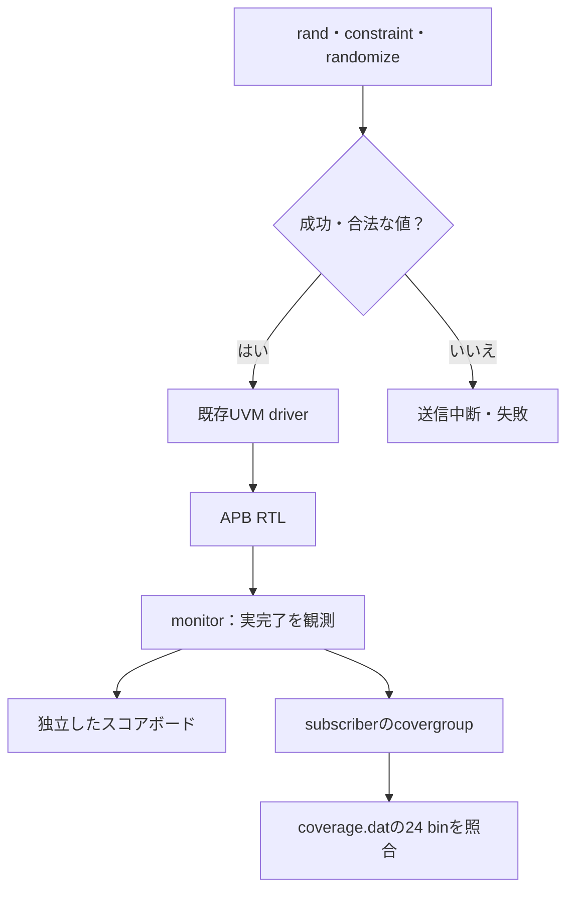

# UVMの制約付きランダム化とネイティブcovergroup

[既存のUVM APB例](../local-uvm/README.md)のagent・driver・monitor・独立したスコアボードを再利用し、新しいテストとsubscriberを接続します。SystemVerilogの`rand`・`constraint`・`randomize()`と、実際のcoverpoint・crossを使うローカル教材です。

## ランダム刺激と観測カバレッジ

randomizeの成功後にAPBへ送り、実完了の観測を独立したスコアボードとネイティブcovergroupへ渡します。



固定12操作で境界を確保してからランダム操作を追加します。24 binの達成は、ランダム刺激だけの収束性能を表しません。

| カバレッジ区分 | 内訳・合格条件 | 確認単位 |
| --- | --- | --- |
| バス用 | 番地4＋方向2＋応答2＋番地×方向8 | 16 bin |
| 競合用 | イベント2＋クリア2＋cross4 | 8 bin |
| 通常実行ごと | 独立比較の合格と全24 binのヒット | 構成やseedの和集合で補わない |

## 検査内容

ランダム化するのは読書き、番地、データ、イベントです。番地は0／4／8／12、PENDING書込みデータは0〜15、イベントは0／1／3／15に制約します。ROへの書込み・未定義番地も含め、許可されたエラー応答をscoreboardで比較します。生成後にも制約への適合を検査し、`randomize()`の失敗を検出してから送信を中断します。

monitorが観測した実際のAPB完了をsubscriberへ渡します。バス用は番地4・方向2・応答2のcoverpointと番地×方向8、競合用はイベント2・クリア2とcross4で、**計24 bin**です。待ち0／2を別実行とし、各通常実行で全24 binのヒットを要求します。両構成の和集合で不足を埋めません。

最初に固定12操作で必要なbinを確保し、その後smoke 16操作、nightly 100操作×3 seedのランダム履歴を加えます。100%を、ランダム探索だけで達成したという結果ではありません。データ分布や統計的な品質を評価する教材でもありません。

## 実行

Verilator 5.052、C++20ビルド環境、Accellera UVM 2020-3.2、Z3を使います。[UVMの準備](../local-uvm/README.md)と[Z3を含む固定版環境](../local-formal-common/README.md)を用意します。既存環境を再作成する必要はありません。

```sh
python3 examples/local-uvm-random/run.py \
  --uvm-home /tmp/lsi-uvm-library/1800.2-2020.3.2 \
  --solver /tmp/lsi-bus-formal-venv/bin/z3 --out artifacts/uvm-random
python3 -m unittest discover -s examples/local-uvm-random/tests -v
```

`--profile nightly`、`--seed`、`--timeout`、`--build-timeout`、`--verilator`を指定できます。seedは0〜2147483644です。同じseedを独立したプロセスで再実行し、生成した操作列の一致も要求します。同じツール・ソルバー・ソースの版を再現条件に含めます。

## ネガティブテストと証跡

既存のRTL変異3件に加え、番地制約と矛盾する`addr==1`のinline制約、およびsubscriberのsample無効化を試します。前者は`CRV_RANDOMIZE`、後者は`CRV_COVERAGE`と非ゼロ終了が必要です。これら2件はRTL変異の検出率へ含めません。

`coverage.dat`の実際のcovergroupカウンターを読み、名前24個の固定集合、重複なし、全ヒットを確認します。`get_inst_coverage()`の表示だけで合格にしません。通常実行は転送数・読書き数・エラー数・生成数、UVM report、VCDも必要です。既存のDPIなし構成で出る既知の2警告だけを許可します。

ソース・外部ライブラリのハッシュ、ビルド、ツール版、ソルバー、生成操作、ネイティブbinの内訳、通常実行／ネガティブテストの結果を保存します。JUnitはビルド・各実行・構成ごとのbin達成判定を含め17／21件です。ネガティブテストの観測は通常実行のカバレッジへ加算しません。

[Verilatorのcovergroup収集](https://verilator.org/guide/latest/simulating.html)と[カバレッジ形式](https://verilator.org/guide/latest/exe_verilator_coverage.html)を参照しています。商用VIPや全APB適合性、異なるライブラリ版間の互換性を認定する例ではありません。
