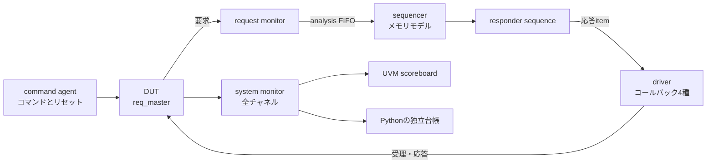

# UVMで応答側（responder）のagentを作る

要求を出す側（マスター）の小さな回路を、応答を返す側のUVM agentで検証します。公式Accellera UVM 2020.3.2とVerilator 5.052で動かします。monitorが観測した要求にsequenceが応答を返す方式、メモリモデル、`uvm_callback`による遅延・エラー応答・プロトコル違反の注入、factoryによるエラー版itemへの差替えを扱います。

これまでのUVMの例（[UVMとRAL](../local-uvm/README.md)、[未完了要求と順不同応答](../local-uvm-outstanding/README.md)、[複数agentの協調](../local-uvm-coordination/README.md)）は、テストベンチが要求を出し、DUTが応答する向きでした。この例は向きが逆です。応答側のテストベンチは、いつ要求が来るかを自分では決められません。[UVMの実践的な設計](../../docs/method/uvm-practical-design.md)の次に試せる例です。

## 回路と契約

[`req_master.sv`](rtl/req_master.sv)は、コマンドを1件ずつ受け取り、バスへ要求を出して結果を返します。特定のバス規格の実装ではありません。

| 項目 | この例の仕様 |
| --- | --- |
| コマンド | `cmd_valid && cmd_ready`で受理。読み書きの別、8ビットの番地、8ビットの書込みデータ。処理中は`cmd_ready`が0 |
| 要求 | `req_valid`と番地・データを、`req_ready`で受理されるまで変えずに保持する |
| 応答 | 受理の後、`rsp_valid`の1クロックで受け取る。`rsp_err`と読出しデータを伴う |
| 再試行 | エラー応答なら同じ要求を出し直す。出し直しは`RETRIES`回（この例は2回）まで。使い切ったらエラーで完了する |
| 時間切れ | 受理から`TIMEOUT`エッジ（この例は8）以内に応答がなければ、時間切れで完了する。再試行はしない |
| 余分な応答 | 要求が受理される前の応答と、応答待ちでないときの応答は無視する |
| 完了 | `done_valid`の1クロックで、エラー・時間切れ・読出しデータ・試行回数を返す |
| リセット | 同期リセット。処理中のコマンドを取り消し、完了は返さない |

応答側（テストベンチ）の契約は次のとおりです。

- 読出しには、メモリモデルの値を返します。書いたことのない番地は、番地のビット反転を返します。
- 書込みは、OKの応答を実際に送り終えたときだけメモリモデルへ反映します。エラー応答、応答なし、リセットによる中断では反映しません。

## 検証環境の構成



| 部品 | 役割 |
| --- | --- |
| `rx_request_monitor` | 要求が最初に提示されたエッジで1回だけ観測を送る。リセットの回数（世代）も数える |
| `rx_rsp_sequencer` | 観測した要求を受ける`uvm_tlm_analysis_fifo`と、メモリモデルを持つ |
| `rx_responder_seq` | FIFOから要求を取り出し、応答itemを作る。`finish_item`から戻った後、driverが書いた結果を見て書込みを反映する |
| `rx_rsp_driver` | コールバックでitemを加工し、受理の待ち・応答の遅れ・エラー・応答なし・余分な応答を駆動する。世代が変わったitemは途中でやめる |
| `rx_driver_cb`と4つの派生 | 遅延、エラー、応答なし、プロトコル違反。次のN件だけに効かせる指定と、seedから決める乱数の指定を持つ |
| `rx_err_item` | `rx_rsp_item`の派生。番地の上位2ビットが11の領域を常にエラーにする |
| `rx_system_monitor` | コマンド・要求の受理・応答・完了・リセットを、1つのプロセスで決まった順に観測する |
| `rx_scoreboard` | バスの観測だけからマスターを検査する。応答側が何を注入したかは知らない |

応答のsequenceは、要求が来るまでFIFOで待ち続ける`forever`のループです。テストの本体とは別に`fork`で起動し、テストが終わるときに一緒に終わります。

書込みをメモリモデルへ反映する時点には注意が要ります。エラーにするかどうかはdriverのコールバックが決めるので、sequenceがitemを作った時点ではまだ分かりません。この例では、driverが結果（`sent_ok`）をitemへ書き戻し、sequenceが`finish_item`の後でそれを見ます。

2つのテストは、同じ環境を使います。違いはfactoryの設定だけです。

| テスト | 内容 |
| --- | --- |
| `rx_base_test` | コールバックなしの応答、コールバックごとの固定シナリオ、ランダム、`callback_mode(0)`による無効化、`delete`による取外し |
| `rx_error_test` | `set_type_override_by_type`で応答itemを`rx_err_item`に差し替える。エラーのコールバックは使わず、itemがエラーを決める |

## 実行

[full環境](../../tools/ENVIRONMENT.md)を準備し、リポジトリのルートで実行します。

```sh
artifacts/toolchains/full/python/bin/python examples/local-uvm-reactive/run.py \
  --uvm-home artifacts/toolchains/full/uvm/1800.2-2020.3.2 \
  --profile nightly --seed 17 --out artifacts/uvm-reactive
```

| プロファイル | 通常実行 | 1本あたりのコマンド数（基本／エラー版） | JUnit |
| --- | --- | --- | --- |
| smoke | 2テスト、1 seed | 66／44 | 20件 |
| nightly | 2テスト、連続する3 seed | 426／404 | 24件 |

基本のテストは、固定の20コマンドとランダムのコマンド（smokeは40、nightlyは400）、無効化と取外しの確認の6コマンドを出します。ランダムの番地は16種類に絞り、読み書きが同じ番地で重なるようにしています。`--demo-bug 1..9`は通常実行に変異を入れ、不合格になることを確かめる引数です。`--sva-off`はSVAを無効にします。

## 要求と目標

[`requirements.json`](requirements.json)は7要求・22目標です。目標は、Pythonの独立台帳が観測ログから判定します。通常実行の全体で22目標がそろわなければ不合格です。

| 要求 | 目標 |
| --- | --- |
| `RX-RESPOND` | 要求1件に応答item 1件、未書込みの番地の読出し、書込み後の読出し |
| `RX-CALLBACK` | 受理の待ち、時間切れ直前の応答、エラー、応答なし、無効化、取外し |
| `RX-VIOLATION` | 受理前の応答、応答直後の2回目の応答 |
| `RX-RETRY` | 1回の再試行で成功、2回の再試行で成功、使い切ってエラー、失敗した書込みが反映されていないこと |
| `RX-TIMEOUT` | 時間切れ、その次のコマンドの成功 |
| `RX-RESET` | 応答待ち中のリセットによる取消し、その次のコマンドの成功 |
| `RX-FACTORY` | 基本のテストのitemの型、エラー版のitemの型、エラー領域とそれ以外の応答 |

これとは別に、SVAのcover 10個（受理の待ち、成功、エラー応答、再試行後の成功、使い切り、時間切れ、時間切れ直前の応答、受理前の応答、待っていないときの応答、応答待ち中のリセット）を、VerilatorのカバレッジDBとアクションの回数で照合します。基本のテストは10個すべて、エラー版のテストは成功・エラー応答・使い切りの3個が必要です。

## 独立した期待値

Pythonの台帳（[`run.py`](run.py)の`ledger`）は、UVMのscoreboardとは別に書いた期待値です。入力は、発行したコマンドの記録と、driverが応答itemごとに記録した注入の内容です。そこから、観測されるはずの出来事を順番に予測し、実際の観測ログと1件ずつ照合します。

- コマンドの列は、固定の表とseedから再計算したものに一致すること。
- 固定シナリオの応答21件の注入内容が、Python側の表に一致すること。コールバックを付けていない区間と取り外した後の区間は加工なし、無効化した区間はエラー・応答なし・余分な応答なしであること。
- 読出しデータが、Python側のメモリモデルに一致すること。
- 受理は待ちの長さどおりのエッジ、応答は遅れどおりのエッジ、完了は応答の次のエッジ、時間切れの完了は受理から`TIMEOUT + 1`エッジ後であること。
- 最後の集計（コマンド、完了、取消し、試行、エラー応答、時間切れ、余分な応答、使い切り、再試行後の成功）が、UVMのscoreboardの値に一致すること。

注入の内容そのものは、テストベンチの記録を信用しています。乱数のコールバックがseedどおりに引いたかは、Python側では再計算していません。確かめているのは、記録された注入に対して回路と応答側が正しく動いたかです。

## 変異と対照ケース

| 意図した異常 | 必須の検出ラベル |
| --- | --- |
| 1：受理を待つ間に番地が変わる | `RX_HOLD`（SVA） |
| 2：エラー応答でも再試行しない | `RX_RETRY` |
| 3：再試行が1回多い | `RX_RETRY` |
| 4：時間切れが1エッジ早い | `RX_TIMEOUT` |
| 5：受理前の応答を受け取ってしまう | `RX_SPURIOUS` |
| 6：完了の読出しデータが応答のものでない | `RX_DATA` |
| 7：再試行で書込みデータが変わる | `RX_REQUEST` |
| 8：待っていないときの応答で完了を出す | `RX_SPURIOUS` |
| 9：時間切れにならない | `RX_DRAIN` |
| scoreboardへの観測をすべて外す | `RX_DRAIN` |
| 完了の観測だけを外す | `RX_ORDER` |
| メモリモデルが誤った値を返す | `RX_MEMORY` |
| コールバックを登録しない | `RX_GOALS` |
| factoryの差替えをしない | `RX_FACTORY` |

変異4・5・8は、注入がなければ見つかりません。時間切れ直前の応答、受理前の応答、応答直後の2回目の応答を、コールバックで作って初めて検出できます。下の5行は検証環境の側の対照ケースで、チェッカーやコールバックが外れたら通常実行が合格のままにならないことを確かめます。

意図したラベルと非0終了がそろったときだけ、検出に成功したと判定します。ビルド失敗や時間切れは成功になりません。

`--out`には、固定計画・入力ハッシュ・JUnit・通常／異常ケースのログ・VCD・`coverage.dat`・台帳の結果を保存します。外部UVMのソースハッシュも保存し、全体ランナーが固定版と照合します。

## 固定版で先に試したこと

実装の前に、Verilator 5.052とUVM 2020.3.2（`UVM_NO_DPI`）で、使う機能を小さな試験で確かめました。

| 機能 | 結果 |
| --- | --- |
| `uvm_register_cb`、`uvm_do_callbacks`（関数とタスクの両方）、`uvm_callbacks::add`・`delete`、`callback_mode` | 動く |
| `uvm_tlm_analysis_fifo`をsequencerに持たせ、`uvm_declare_p_sequencer`でsequenceから読む | 動く |
| `set_type_override_by_type`（テストの`build_phase`） | 動く |
| 実行の途中で差替えを元の型へ戻す（`set_type_override`を同じ型で上書き） | 動くが、`TYPDUP`の警告が出る |
| `+UVM_TESTNAME`によるテストの選択 | `UVM_NO_DPI`では使っていない。トップが`+TEST=`を読んで`run_test`へ渡す |

差替えを途中で戻す方法は警告が出るので使わず、テストを2つに分けました。動かなかった機能はありません。

## 確認範囲と残る制限

- 2値・単一クロックの教材です。未完了の要求は常に1件で、複数の未完了要求への応答や順不同の応答は扱いません（[未完了要求と順不同応答の例](../local-uvm-outstanding/README.md)が要求側から扱います）。
- 時間切れの後に遅れて届く応答は、次の要求が受理される前に届くものだけを無視できます。次の要求の受理後に届く古い応答は、タグがないので区別できません。この例の応答側は、遅れを時間切れの手前までに制限し、応答なしと組み合わせて時間切れを作ります。
- リセットによる取消しは、応答待ち中の1か所だけです。要求の受理を待つ間やランダム区間でのリセットは試していません。
- 乱数のコールバックの引き方は、Python側で再計算していません。
- scoreboardとPythonの台帳は別に書いていますが、どちらも同じ人が同じ仕様から書いたものです。
- 注入は応答側の動作に限ります。`req_ready`を要求なしで上げる、応答のデータを途中で変える、などの違反は作っていません。
- 手順の説明はIEEE 1800.2-2020のクラスライブラリの用語に沿っていますが、規格の節番号とは照合していません（未照合）。

## 確認記録

2026-11-21に、macOS arm64、Python 3.13.15、Verilator 5.052、Accellera UVM 2020.3.2（`UVM_NO_DPI`）で実行しました。

- smoke（seed 17）：20件が合格。基本のテストは66コマンド・応答item 83件（エラー応答20、時間切れ7、余分な応答16、取消し1）、エラー版は44コマンド・72件（エラー応答42、使い切り14）。
- nightly（seed 17〜19）：24件が合格。
- seed 0・1・2・1000・2147483644のsmokeも合格。
- 変異9種類と対照ケース5種類は、すべて予定のラベルで検出。`--demo-bug 6`と`--sva-off`では不合格になることも確かめました。
- セルフテスト14件が合格。シミュレーターは使わず、合成した観測ログで台帳の受入れと拒否を確かめます。
- RTLは`verilator --lint-only -Wall`で警告なし（既定の構成、`RETRIES=1`・`TIMEOUT=4`、変異1・5・9）。

ビルドは初回で約30秒、実行は1本あたり1秒未満です。Linuxでは実行していません。
