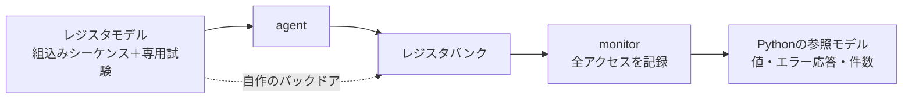

# UVMの組込みレジスタシーケンスと、それが見逃す不具合を確かめる

UVMのレジスタモデル（RAL）には、モデルを書くだけで使える組込みのシーケンスがあります。リセット値の確認、ビットごとの書込みと読出し、表と裏の2経路の照合、メモリのウォークです。この例は、小さなレジスタバンクでそれらを実際に動かし、次の3点を確かめます。

- 組込みシーケンスが見つける不具合と、見つけない不具合。
- レジスタを対象から外す指定（除外）が要る場合と、その根拠。外しすぎると何が起きるか。
- DPIを使わない構成（`UVM_NO_DPI`）で動かない機能と、その代わり。

公式Accellera UVM 2020.3.2とVerilator 5.052で動かします。[UVMとRALの例](../local-uvm/README.md)の次に試せる例です。RALを仕様から生成する方法は[生成したRALの例](../local-generated-ral/README.md)、レジスタ仕様の書き方は[レジスタ仕様の例](../local-register-spec/README.md)にあります。位置付けは[UVMによる検証](../../docs/method/uvm-verification.md)を参照してください。

## 回路と仕様

[`reg_bank.sv`](rtl/reg_bank.sv)は、APBの信号の一部を使う、待ちなしのレジスタバンクです。アドレスはバイト単位で、1語は32ビットです。

| アドレス | 名前 | アクセス | 幅 | リセット値 | 動作 |
| --- | --- | --- | --- | --- | --- |
| 0x00 | CTRL | 読み書き | 8 | 0xA5 | 上位24ビットは0を返す |
| 0x04 | ID | 読出しのみ | 32 | 0x52475351 | 書込みは受け付けて無視する |
| 0x08 | STATUS | 読出しのみ | 8 | 0 | リセット解除からのサイクル数。読むたびに値が変わる |
| 0x0C | IRQ | 1を書くとクリア（W1C） | 4 | 0 | 入力`events`でセットされる。同じサイクルのクリアとセットは、セットが勝つ |
| 0x10 | SCRATCH | 読み書き | 32 | 0 | |
| 0x14 | CMD | 書込みのみ | 1 | 0 | 1を書くと、CTRL・IRQ・SCRATCHをリセット値へ戻す。読むと0 |
| 0x40〜0x7C | メモリ | 読み書き | 32×16語 | なし | リセットしない |

これ以外のアドレスは、エラー応答（`pslverr`）を返し、何も変えません。



## 実行する段階

1回のシミュレーションで、次の順に実行します。前半が組込みシーケンス、後半が専用試験です。

| 段階 | 内容 | ライブラリが報告したときのラベル |
| --- | --- | --- |
| `hw_reset` | `uvm_reg_hw_reset_seq`。リセット直後の値をモデルのリセット値と比べる | `REG_RESET` |
| `access` | `uvm_reg_access_seq`。表から書いて裏から読み、裏から書いて表から読む | `REG_ACCESS` |
| `preload` | CTRLとSCRATCHへ、リセット値と違う値を書く（準備） | `REG_SETUP` |
| `bit_bash` | `uvm_reg_bit_bash_seq`。1ビットずつ反転して書き、読んで比べる | `REG_BITBASH` |
| `mem_walk` | `uvm_mem_walk_seq`。メモリの各語へ、番地の反転と番地を順に書いて読む | `MEM_WALK` |
| `mirror_after_builtin` | STATUS以外の全レジスタを読み、モデルの値（ミラー）と比べる | `REG_MIRROR` |
| `cross_register` | CTRLとSCRATCHへ全0・全1・seedから作った値を書き、そのたびに全レジスタを比べる | `REG_MIRROR` |
| `unmapped` | 割り当てのない42個のアドレスすべてへ書込みと読出しを行い、エラー応答と、レジスタが変わらないことを確かめる | `REG_ALIAS` |
| `w1c` | `events`で4ビットをセットし、1ビットずつクリアする。クリアと同じサイクルにセットを重ねる | `REG_W1C` |
| `soft_reset` | CMDへ0と1を書き、1のときだけ3つのレジスタがリセット値へ戻ることを確かめる | `REG_CMD` |
| `mem_unique` | メモリの全語へ別々の値を書いてから、全語を読む | `MEM_ALIAS` |

`preload`を`bit_bash`の前に置くのは、ビットバッシュが各ビットを2回反転して、レジスタを始めの値へ戻すからです。リセット値のままで始めると、ほかのレジスタをリセット値へ戻してしまう副作用は、後からミラーと比べても見えません。

UVMライブラリが出した`UVM_ERROR`と`UVM_FATAL`は、[`reg_seq_pkg.sv`](tb/reg_seq_pkg.sv)の`stage_catcher`が受け取り、その段階のラベルを付けた`CHECK_FAIL`と非ゼロの終了コードへ変えます。

## 独立した期待値

合否は、テストベンチの中の比較だけでは決めません。monitorは比較をせず、完了した全アクセスを`REGLOG`の行として記録します。[`model.py`](model.py)が、その記録を次の2つに照合します。

- **値とエラー応答**：上の表をPythonで書き直した参照モデルで、読出しの値とエラー応答を1件ずつ確かめます。W1Cとイベントの優先、CMDによるリセット、メモリ、自作バックドアによる書込みも追います。
- **段階ごとのアクセス数**：組込みシーケンスが「本当に対象のレジスタへアクセスしたか」を、表から計算した件数と比べます。たとえばビットバッシュは、対象の1ビットにつき書込み2回・読出し2回です。除外したレジスタや、シーケンスが自分で飛ばしたビットは、件数に表れます。

参照モデルは、UVMのレジスタモデルもRTLも読みません。STATUSの期待値には、monitorが記録したサイクル番号を使います。番号が単調に増えることは確かめますが、番号そのものはmonitorの値です。

既定の構成（`--profile smoke`）の1回の実行は、986アクセスです。内訳は、`hw_reset` 5、`access` 4、`preload` 2、`bit_bash` 732、`mem_walk` 47、専用試験196です。

## 組込みシーケンスが見つけるもの・見つけないもの

RTLの`MUTATION`パラメーターで、9種類の誤りを入れます。

| 変異 | 誤り | 全段階での検出 | 組込みシーケンスだけ |
| --- | --- | --- | --- |
| 1 | CTRLのリセット値が0xA4 | `REG_RESET`（リセット値の確認） | 検出 |
| 2 | SCRATCHのビット7に、書いた語のビット6が入る | `REG_BITBASH`（ビットバッシュ） | 検出 |
| 3 | 読出しのみのIDのビット0に書ける | `REG_BITBASH`（ビットバッシュ） | 検出 |
| 4 | メモリの書込みだけ、アドレスの1ビットを無視する | `MEM_WALK`（メモリのウォーク） | 検出 |
| 8 | メモリの語3のビット31に書けない | `MEM_WALK`（メモリのウォーク） | 検出 |
| 5 | SCRATCHへの書込みが、CTRLのビット0もクリアする | `REG_MIRROR`（終了後の全レジスタの照合） | **見逃す** |
| 6 | 割り当てのない0x90が、SCRATCHの別名になっている | `REG_ALIAS`（未割当アドレスの試験） | **見逃す** |
| 7 | IRQのビット2がクリアされない | `REG_W1C`（イベントを使う試験） | **見逃す** |
| 9 | メモリの読み書きの両方が、アドレスの1ビットを無視する | `MEM_ALIAS`（全語へ別々の値） | **見逃す** |

「見逃す」の4種類は、組込みシーケンスだけの実行（`builtin-only-mutation5`など）が合格で終わることを、ランナーが毎回確かめます。この実行では参照モデルの照合も合格します。モデルが弱いのではなく、誤りが表に出るアクセスが1回も行われないからです。理由は次のとおりです。

- **変異5（副作用）**：ビットバッシュとアクセスの確認は、書いたレジスタだけを読みます。ほかのレジスタが変わっても読みません。
- **変異6（別名）**：組込みシーケンスは、モデルに登録したアドレスにしかアクセスしません。
- **変異7（W1C）**：ハードウェアがセットするビットは、バスからは1にできません。イベントがなければ値は0のままで、ビットバッシュは0が0のままであることしか見ません。
- **変異9（メモリの別名）**：ウォークは、語kへ書いた直後に語k−1を読みます。2つの語が1つの記憶を共有していても、読む時点では期待どおりの値が入っています。書込みだけがずれる変異4は、読んだ語が空なので見つかります。

## 除外の指定と根拠

組込みシーケンスは、`uvm_resource_db`に置いた名前（`NO_REG_TESTS`、`NO_REG_BIT_BASH_TEST`など）でレジスタを対象から外せます。この例の既定の構成で外しているものと、外していないものは次のとおりです。

| レジスタ | 指定 | 根拠 |
| --- | --- | --- |
| STATUS | フィールドを揮発（volatile）として宣言。除外の名前は置かない | 読むたびに値が変わる。揮発と宣言すると、リセット値の確認はこのレジスタを読まず、ビットバッシュはこの8ビットを飛ばす |
| ID（読出しのみ） | 外さない | 書いても変わらないことを、ビットバッシュが確かめる（変異3を検出する） |
| IRQ（W1C） | 外さない | 組込みシーケンスの間、イベントを入れない。ただし確認の中身は「0が0のまま」だけなので、専用試験が必要 |
| CMD（書込みのみ） | ビットバッシュからは外さない | 書込みのみのフィールドは、ビットバッシュが自分で飛ばす。実測では、空いている31ビットだけを試し、ビット0へ1を書くことはなかった |
| ID・STATUS・IRQ・CMD | `NO_REG_ACCESS_TEST` | バックドアを用意していない。外さなくても警告を出して飛ばすだけだが、意図して対象外にしたことを残す |

除外が要る場合と、外しすぎた場合を、対照の実行で確かめます。

| 実行 | 設定 | 結果 |
| --- | --- | --- |
| `status-nonvolatile` | STATUSを揮発でないと宣言する | 正しい回路なのに`REG_RESET`で失敗する（偽の失敗） |
| `status-nonvolatile-excluded` | そのうえで`NO_REG_TESTS`を置く | 合格。揮発の宣言と除外の名前の、どちらでも避けられる |
| `events-during-bash` | ビットバッシュの間に`events`を入れる | 正しい回路なのに`REG_BITBASH`で失敗する |
| `events-during-bash-excluded` | そのうえでIRQに`NO_REG_BIT_BASH_TEST`を置く | 合格。ハードウェアがいつでもセットできるレジスタは、外す根拠がある |
| `over-exclusion-mutation2` | 外す必要のないSCRATCHに`NO_REG_TESTS`を置き、変異2を入れる | 組込みシーケンスだけの実行が合格する。外したレジスタの不具合は見つからない |

除外は、理由と一緒に台帳として残し、外したレジスタを確かめる別の試験を対応付けます。ランナーは、除外したレジスタへのアクセスが実際に0件であることを、件数の照合で確かめます。

## DPIなしで動かないものと、その代わり

このリポジトリのUVMの例は、VerilatorとUVMを`+define+UVM_NO_DPI`で組み合わせています。このとき、UVMがHDLの階層名でレジスタを直接読み書きする経路（`uvm_hdl_read`など）は使えません。

| 実行 | 設定 | 結果 |
| --- | --- | --- |
| `backdoor-hdl-path` | レジスタにHDLパスだけを設定する | `uvm_hdl_read`が`UVM_FATAL`（`UVM_HDL_READ`）を出して止まる。`REG_ACCESS`として記録 |
| `backdoor-none` | バックドアを何も設定しない | `uvm_reg_access_seq`は、レジスタごとに警告を1件出して飛ばす。段階は「成功」で終わるが、アクセスは0件 |
| 既定 | `uvm_reg_backdoor`を継承した自作のバックドアを設定する | CTRLとSCRATCHで、2経路の照合が動く |
| `backdoor-crossed` | 自作のバックドアの観測点を、わざと入れ替える | `REG_ACCESS`で失敗する。バックドア側の比較が実際に効いていることの確認 |

自作のバックドア（`probe_backdoor`）は、インターフェース経由でレジスタの値を観測し、書込みはテストベンチの`force`と`release`で値を置きます。DPIは使いません。その代わり、観測と書込みの配線をレジスタごとに手で書く必要があり、レジスタが多い設計には向きません。この例で用意したのは2レジスタだけです。

`backdoor-none`が示すとおり、バックドアがないと、アクセスの確認は警告だけで何もせずに終わります。警告の件数とアクセスの件数を見ないと、確認したつもりになります。

次のシーケンスは実行していません。

- `uvm_mem_access_seq`：メモリのバックドアを用意していません。
- `uvm_reg_mem_hdl_paths_seq`：HDLパスの確認で、DPIが必要です。
- `uvm_reg_mem_shared_access_seq`：複数のアドレスマップを持つモデルが対象で、この例のマップは1つです。
- `uvm_reg_mem_built_in_seq`：上のシーケンスをまとめて呼ぶものです。個別に呼んでいます。

## RALのカバレッジ

レジスタモデルには、アクセスのたびに呼ばれるフックがあります。この例は、そのフックで2種類を集計します。

- **アドレスマップ**（`UVM_CVR_ADDR_MAP`）：ブロックの`sample`で、レジスタ6本とメモリについて、読出しと書込みがそれぞれあったかを記録します（14目標）。
- **フィールドの値**（`UVM_CVR_FIELD_VALS`）：レジスタの`sample`で、CTRL・SCRATCH・IRQの値が、全0・全1・それ以外の3分類に入ったかを記録します（9目標）。

カバレッジは、モデルを作る前に`uvm_reg::include_coverage`で有効にし、作った後に`set_coverage`で集計を始めます。どちらかを忘れると、フックは呼ばれても何も記録しません。`coverage-off`の実行で、有効にしなければ23目標が1つも記録されないことを確かめます。

値の分類は、レジスタのクラスに書いたcovergroupでも集計し、Verilatorのカバレッジデータベース（`coverage.dat`）の3つのbinがすべてヒットしていることを確かめます。このcovergroupはクラス単位で、どのレジスタの値かは区別しません。レジスタごとの目標は、ログの`COVER`行で判定します。

実行して分かった点が1つあります。UVM 2020.3.2の`uvm_mem`は、1語のアクセスにつき、その語と次の語の2つのアドレスでブロックの`sample`を呼びます。メモリの最後の語にアクセスすると、メモリの範囲の外（0x80）が1回記録されます。この例では、範囲外の記録を`RAL_SAMPLE_OUTSIDE`として分けて残し、カバレッジには数えません。メモリのアドレスのカバレッジを語の単位で読むときは、この重なりに注意が必要です。

## 要求と目標

[`requirements.json`](requirements.json)は、8要求・34目標です。

| 要求 | 目標 |
| --- | --- |
| `REGSEQ-RESET` | リセット値の確認の完了 |
| `REGSEQ-BITS` | ビットバッシュの完了 |
| `REGSEQ-ACCESS` | 2経路の照合の完了 |
| `REGSEQ-MEMORY` | メモリのウォーク、全語へ別々の値 |
| `REGSEQ-CROSS` | 終了後の全レジスタの照合、レジスタ間の干渉、未割当アドレス |
| `REGSEQ-W1C` | 1ビットずつのクリア、クリアとセットの同時 |
| `REGSEQ-COMMAND` | CMDによるリセット |
| `REGSEQ-COVERAGE` | アドレスマップ14目標、フィールドの値9目標 |

目標は、変異も対照の設定も入れていない実行（`seed*`）だけで数えます。

## 実行

UVMライブラリの準備は、[UVMとRALの例](../local-uvm/README.md#ライブラリの準備)と同じです。

```sh
python3 examples/local-uvm-reg-sequences/run.py \
  --uvm-home artifacts/toolchains/full/uvm/1800.2-2020.3.2 \
  --profile smoke --seed 17 --out artifacts/local-uvm-reg-sequences-smoke

python3 -m unittest discover -s examples/local-uvm-reg-sequences/tests
```

`--profile nightly`は、seedを3個に増やし、`cross_register`の乱数の回数を4回から16回にします。`--verilator`、`--jobs`（既定4）、`--build-timeout`（既定600秒）、`--timeout`（1回のシミュレーションの上限、既定30秒）を指定できます。ビルドは1回で、変異10通りの回路を1つの実行ファイルに入れ、実行時の`+MUTATION`で選びます。

JUnitはsmokeが26件、nightlyが28件です。内訳は、ビルド1、通常の実行1（nightlyは3）、変異9、組込みシーケンスだけの実行4、除外の対照5、バックドアの対照3、カバレッジ無効1、目標の判定1、ソースの鮮度1です。

出力先には、`manifest.json`、`summary.json`、`junit.xml`、ビルドのログ、UVMライブラリのハッシュ、実行ごとのログ・波形・`coverage.dat`・`result.json`を保存します。`result.json`には、段階ごとのアクセス数、covergroupのヒット数、ライブラリが報告したエラーのIDが入ります。

## 確認範囲と残る制限

- 小さな教材用の回路で、アドレスマップは1つ、レジスタの幅は32ビットに固定、バスの待ちはありません。
- 組込みシーケンスの動作は、UVM 2020.3.2のソースを読み、実行して確かめたものです。IEEE 1800.2-2020の本文の節番号とは照合していません（未照合）。ほかの版のUVMでは、飛ばす条件や警告が違う可能性があります。
- フィールドは1レジスタに1つだけです。複数フィールドの組合せ、フィールド単位のアクセス、バイトイネーブル、読むとクリアされるフィールド（RC）は扱いません。
- バックドアは、DPIを使う本来の経路（HDLパス）を実行していません。自作のバックドアは2レジスタだけで、メモリにはありません。
- 「見逃す」の4種類は、この回路とこの順序での結果です。たとえば変異5は、ビットバッシュの後にCTRLを読む段階があれば見つかります。どの誤りを見逃すかは、レジスタの並びと値にも依存します。
- 参照モデルのSTATUSの期待値は、monitorが記録したサイクル番号に依存します。
- kirimasimとIcarus Verilogでは実行していません。UVMのクラスライブラリが必要で、この例はVerilator専用です。

## 確認記録

2026-11-21に、macOS arm64、Python 3.13、Verilator 5.052、Accellera UVM 2020.3.2で確認しました。

- smoke（seed 17と5）とnightlyが合格し、JUnitは26件と28件でした。
- 変異9種類はすべて予定のラベルで検出し、うち4種類は組込みシーケンスだけの実行で見逃すことを確かめました。
- セルフテストは15件が成功しました。期待件数の表、参照モデルの再計算、合否の判定、カバレッジデータベースの読取り、コマンドラインの誤りを確かめます。UVMのビルドは行いません。
- RTLは、変異0〜9のすべてで`verilator --lint-only -Wall`の警告がありません。
- 事前の小さな試行で、クラスの中のcovergroupと、インターフェース経由の`force`・`release`が、固定版のVerilatorで動くことを確かめました。
- Linuxでは実行していません。

## 参考にした資料

- Accellera UVM 2020.3.2の`src/reg/sequences/`（各シーケンスの対象と除外の名前）、`src/reg/uvm_mem.svh`（カバレッジのフックの呼出し）、`src/dpi/uvm_hdl.svh`（DPIなしの場合の動作）。ソースは転載していません。
- IEEE 1800.2-2020（レジスタ層）。節番号は未照合です。
