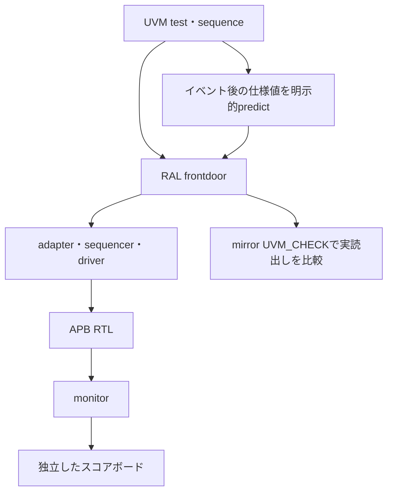

# SystemVerilog UVMとRALでAPBレジスタを検証する

既存の[APBレジスタ](../local-apb/README.md)を、実際のSystemVerilog UVMクラスライブラリで検証します。PythonでUVMを模倣する例ではありません。Verilator 5.052とAccellera UVM 2020-3.2で実行します。対応状況は[Verilatorの公式変更履歴](https://verilator.org/guide/latest/changes.html)と[Accelleraの配布情報](https://www.accellera.org/downloads/standards/uvm)を参照してください。

## RALと独立したスコアボードの二重照合

RALのfrontdoorを実APBへ変換し、monitorの観測を仕様から作った期待値と比較します。



明示的predictへDUTのPENDINGをコピーしません。predict単独では合否を決めず、scoreboardと実読出しも要求します。

| 確認する場面 | 期待する動作 | 主な照合対象 |
| --- | --- | --- |
| 通常バス操作 | frontdoorとauto prediction | 戻りstatusとscoreboard |
| イベントとW1Cの競合 | 終了後に仕様値を明示的predict | その後の実読出し比較 |
| リセット | DUT駆動とRAL resetを別々に実施 | 初期値・ミラー照合 |

## 構成と判定

agentがsequencer・driver・monitorを持ち、`uvm_config_db`でvirtual interfaceを渡します。monitorは実際のAPB完了とイベント、エッジ後の状態を観測します。scoreboardは独立したCONFIG・PENDINGの期待値を更新し、読出し値、エラー応答、SETUP・待ち中を含む状態を照合します。

RALにはCONFIG（RW）、ID（RO）、PENDING（W1C）を登録します。通常のfrontdoorアクセスはauto predictionを使います。ハードウェアイベントとW1Cの競合後には、バス操作の終了後に仕様モデルからPENDINGを明示的に予測し、その後の`mirror(UVM_CHECK)`で実読出しを比較します。DUTのPENDING値をそのままミラーへコピーしません。`predict()`単独を合格の根拠にせず、スコアボードの比較と実際の読出しも要求します。`uvm_reg_predictor`を接続する別方式の実装ではありません。

DUTへのリセット駆動とRALの`reset()`は別々に行います。各フロントドアアクセスの戻りstatusを確認します。データ列はseed付きの固定アルゴリズムで生成し、SystemVerilogの制約ソルバーや`randomize()`は使いません。

## ライブラリの準備

POSIX環境、Python 3.10以上、Verilator 5.052、C++20に対応するビルド環境を使います。UVMライブラリはGitへ取り込まず、外部ディレクトリへ明示的に準備します。`run.py`は自動ダウンロードしません。

```sh
python3 examples/local-uvm/setup_uvm.py --out /tmp/lsi-uvm-library
python3 examples/local-uvm/run.py \
  --uvm-home /tmp/lsi-uvm-library/1800.2-2020.3.2 \
  --out artifacts/uvm-apb
```

セットアップは[Accelleraの公式アーカイブ](https://www.accellera.org/images/downloads/standards/uvm/1800.2-2020.3.2%20Release.gz)のSHA-256 `4664ac015f23c72106dd785906aa874d70932ea63f74b85de1e32fa5339c15eb`を照合して展開します。既存出力先は上書きしません。ライブラリのLICENSE・NOTICE・DEVIATIONSは配布物のまま残し、利用時に確認してください。本リポジトリへ外部コードは転載していません。

## リグレッションと証跡

APB待ち0／2の両構成で、読書き、ID、W1Cとイベント優先、禁止アクセス、リセット後のミラー照合を行い、各9目標を要求します。smokeは8データ、nightlyは50データ×3 seedでCONFIGの書込み・ミラー照合を繰り返します。

```sh
python3 examples/local-uvm/run.py --uvm-home /tmp/lsi-uvm-library/1800.2-2020.3.2 --profile nightly
python3 -m unittest discover -s examples/local-uvm/tests -v
```

3種類の既存RTL変異（SETUPでの早すぎる更新、W1Cの誤優先、禁止書込みの状態更新）と、誤った期待IDの診断を別枠で実行します。最後の診断はRTL変異の検出率には含めません。

通常実行は、予定の転送数・読出し数・書込み数・エラー応答数、唯一の完了記録、UVM_ERROR/FATALが0件、VCDが必要です。UVMの既定のfatal終了はプロセス終了コード0になる場合があるため、report catcherでUVM_FATALを`$fatal(1,...)`へ変換します。ネガティブテストは唯一の予定CHECK_FAILラベルと非ゼロ終了が必要です。

DPIを使わない`UVM_NO_DPI`構成のため、既知の`NO_DPI_USED`と`NO_VISIT_CHECK`の警告を各1件だけ許可します。未知のUVM警告や異なる件数は失敗です。DPIを必要とする名前検査等を確認した結果ではありません。コンパイル時の警告は`build.log`へ保存し、lintの無警告達成とは扱いません。

`manifest.json`、`uvm-source.json`に教材と外部ライブラリsrc全ファイルのSHA-256、`tools.json`にツール版、各実行にログ・VCD・判定を保存します。JUnitはビルド1件、各構成の通常実行とネガティブテストとカバレッジ目標の達成判定を含め13／17件です。ネイティブcovergroup DB、商用VIP、全APB適合性、UARTのUVM化は対象外です。
