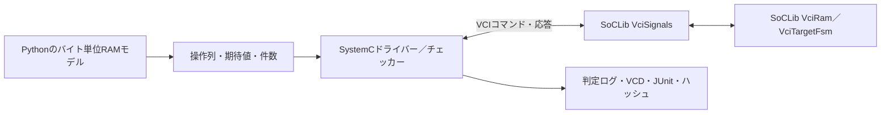

# VCIバスとSoCLibのCABAモデル

SoCLibの`VciRam`と`VciSignals`を実際にSystemCで動かし、VCIの読書き・パケット・待ち・エラー・リセットを検証する例です。外部部品を取り込む際の版固定、不具合の再現、修正後の確認も扱います。[検証の考え方](../../docs/method/vci-soclib-verification.md)、[バス例一覧](../README.md#バスレジスタアドレス)も参照してください。

## 構成と対象範囲



| 項目 | この例の仕様 |
| --- | --- |
| データ幅 | 32／64ビット、アドレス32ビット |
| RAM領域 | `0x1000–0x10ff`と`0x2000–0x20ff`、同じターゲットの独立した2領域 |
| 転送 | 1／2／4セルの連続パケット。読出しは1コマンドから複数応答、書込みは複数コマンドから1応答 |
| バイトイネーブル | 単一セル書込みの各バイト。読出しと複数セル転送は全バイト有効 |
| ID | SRCID 4ビット、TRDID 3ビット、PKTID 2ビット。応答での一致を検査 |
| 待ち | 書込みセル間の空白0〜4サイクル、各応答を観測した後の追加待ち0〜5サイクル |
| エラー | 未割当`0x3000`への単一セル読書きでエラー応答 |
| リセット | RAMをゼロ初期化し、受付途中の書込み／応答待ちの読出しを中断。復帰後の残留応答も検査 |

応答を待つ間は`rspack=0`とし、`rspval`を観測してから指定した追加待ちを入れて受け付けます。

受付済みの未完了パケットは1件です。読出し応答を待つ間に次コマンドを提示し、ターゲットが受け付けるまでコマンドが保持されることを検査します。複数IDの並行受付や順序入替えは扱いません。

対象は**CABA（Cycle Accurate / Bit Accurate）のSystemCモデル**です。CPU・VCIインターコネクト・クロスコンパイラーを含むSoC全体、合成可能なRTL、実装遅延の検証ではありません。LL／SC、非連続パケット、部分読出し、領域をまたぐパケット、VCI規格全体への適合も対象外です。

## 環境と実行

SystemC 2.3.4の静的ライブラリーとGNU拡張を有効にしたC++17コンパイラーを使います。SoCLibの必要なソースは同梱済みで、実行時にSVNや旧SoCLibビルドツールを取得する必要はありません。共通の[環境構築](../../tools/ENVIRONMENT.md#systemcとsoclibの例)でSystemCを準備します。

```sh
# 初回の全ネイティブ環境構築。既に構築済みなら不要
python3 tools/build_native.py --profile full --out artifacts/toolchains/native
export PATH="$PWD/artifacts/toolchains/native/install/bin:$PATH"

# 最小実行／seedを増やす夜間実行。出力先は毎回新しくする
python3 examples/local-vci-soclib/run.py --profile smoke --out artifacts/vci-smoke
python3 examples/local-vci-soclib/run.py --profile nightly --out artifacts/vci-nightly

# 共通ランナーから実行し、証跡も検査する
python3 tools/run_regression.py --example local-vci-soclib --profile nightly \
  --tool-bin artifacts/toolchains/native/install/bin --out artifacts/vci-campaign
```

`--systemc-config`で別の配置の`lsi-systemc-config`、`--cxx`でコンパイラーを指定できます。SystemCのビルド時と例のC++規格は17でそろえます。`--timeout`は実行、`--build-timeout`はコンパイルの上限です。各VCI受付にも有限の監視期限を設けています。

## 合格条件と検出力

各幅で基本動作・パケット・エラー・途中リセットに加え、smokeは32操作×1 seed、nightlyは128操作×3 seedのランダム試験を行います。既定seedは17、nightlyは17／18／19です。各試験の前後にリセット操作が付きます。固定試験も含め、同じseedで操作・データ・待ちを再生成できます。

- バイト単位の独立したPython RAMモデルと、受付した全読出しデータを比較します。
- コマンド／応答の待ち中保持、返却ID、エラー、`reop`、余分な応答を検査します。`VCI_COMMAND_HOLD`が比較するコマンド信号はすべてテストベンチのドライバーが駆動するので、これはドライバーの自己確認で、DUTの不具合では失敗しません。DUTの保持動作を確認するのは`VCI_RESPONSE_HOLD`などの応答側の検査だけです。
- 操作数・受付コマンド数・受付応答数・完了／中断数・リセット数・エラー数を、独立モデルの予定件数と照合します。
- [5要求・13目標](requirements.json)を**幅ごとに全達成**する必要があります。手続き型の到達記録であり、SystemVerilogの`covergroup`やRTLコードカバレッジの測定値ではありません。
- バイトイネーブル無視とSRCID破壊の変異を各幅で検出します。64ビットでは元のSoCLibの不具合も再現します。ビルド失敗・タイムアウト・別の検査での失敗は、期待した不具合の検出として数えません。

smokeは19、nightlyは23の予定判定を完了して合格します。これは転送数・要求数とは別の集計です。各試験の`checks`はリセットを含む操作列の行数であり、実クロック数や信号単位の比較回数ではありません。

初期化に使う`Loader`は`VciRam`が参照を保持します。テストベンチではRAMより先に生成し、RAMの破棄後まで存続するようにしています。

## 元のSoCLibで見つかった64ビット部分書込みの問題

取り込んだ`VciRam::on_write`では、元のセルを`unsigned int cur`に読み込んでいました。64ビットセルを部分更新すると、保存すべき上位32ビットも切り捨てられます。ローカル修正ではセル型の`ram_t cur`を使います。例えば全ビット1を書いた後、下位1バイトだけを`0x42`に更新した場合、期待値は`0xffffffffffffff42`です。

通常版ではこの値を確認し、`b8/upstream-original`では変更を戻した実コードをコンパイルして`VCI_DATA`で失敗することを確認します。この意図した失敗は検出力の合格条件です。上流へ修正を送付済みという意味ではありません。

## 証跡とライセンス

`manifest.json`・`summary.json`・`junit.xml`に加え、構成別の操作列`vectors.txt`、`simulation.log`、VCD、期待件数、ビルドログ、`executions.json`を保存します。`systemc-source.json`には実際に使ったSystemCのヘッダー・静的ライブラリー・設定コマンドのハッシュを記録し、終了時と全体集約時に再照合します。SystemCのソース取得・ビルド履歴は`build_native.py`の証跡で確認できます。

SoCLibは公式SVN revision 2672の必要部品だけを収録しています。[upstream.json](upstream.json)に全37ファイルの原版・収録版ハッシュを記録し、変更した1ファイルは原版へ戻した内容も照合します。`soclib_endian.h`のみ同じ公式SVNの通常URLから取得し、その取得先も記録しています。

**`upstream/`のSoCLibコードはLGPL-2.1-only**で、元の著作権表示と[ライセンス本文](upstream/COPYING.lgpl)を保持します。本例用に新規作成したドライバー・モデル・ランナー・文書はルートのApache-2.0 WITH LLVM-exceptionです。外部ビルドするSystemC 2.3.4はApache-2.0です。生成した実行ファイルは配布対象に含めていません。詳細は[由来と修正の記録](../../PROVENANCE.md#vci-soclib-20261102)を参照してください。
