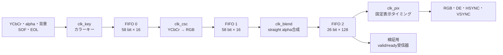

# 非同期FIFOでつなぐ画像処理・固定タイミング表示

色透過処理、YCbCr→RGB変換、アルファブレンディング、表示を、**実際に異なる4つのクロック**で動かす教材です。画素演算の正しさ、画素と制御情報の対応・順序・個数、表示に間に合う供給量を別々に確認します。[非同期FIFO単体の既存例](../local-async-fifo/README.md)、[非同期検証の手順](../../docs/method/asynchronous-verification.md)、[画像処理の検証手順](../../docs/method/image-processing-verification.md)と併せて使えます。

## まず実行します

Python 3、Icarus Verilog、vvpを用意し、リポジトリのルートから実行します。外部Pythonパッケージは不要です。出力先には未使用のディレクトリを指定します。

```sh
python3 examples/local-video-async/run.py --profile smoke --out artifacts/video-async-smoke
python3 examples/local-video-async/run.py --profile nightly --seed 17 --out artifacts/video-async-nightly
```

smokeは20件、nightlyは22件のJUnit判定です。演算、FIFOの5条件、ストリーム、表示、異常・復帰、要求との対応、入力ファイルの更新有無を確認します。nightlyではランダム試験をseed 17／18／19へ増やし、追加seedではクロック周期もseedから決めます。タイムアウト、未完了、比較0件、X/Z、想定外の異常は非ゼロ終了します。

代表ケースの画像・波形・占有量を生成する場合は、次を使います。

```sh
python3 examples/local-video-async/run.py --case display-slow --waves --out artifacts/video-async-wave
python3 examples/local-video-async/run.py --case display-starve --waves --out artifacts/video-async-error
```

## 構成とファイル



| ファイル | 役割 |
| --- | --- |
| [video_key.sv](rtl/video_key.sv) | YCbCrキーの完全一致でalphaだけを0にします |
| [video_csc.sv](rtl/video_csc.sv) | 符号付き整数演算、丸め、飽和でRGBへ変換します |
| [video_blend.sv](rtl/video_blend.sv) | 同じパケット内の背景と合成します |
| [video_async_fifo.sv](rtl/video_async_fifo.sv) | 可変幅・深さ、Grayポインタと各方向2FF、valid/readyの非同期FIFOです |
| [video_reset_sync.sv](rtl/video_reset_sync.sv) | 非同期アサート・各ドメイン2段同期解除を行います |
| [video_display.sv](rtl/video_display.sv) | prefill、固定表示タイミング、黒表示への異常処理を行います |
| [video_async_pipeline.sv](rtl/video_async_pipeline.sv) | 全段、3個のFIFO、リセット再開条件を接続します |
| [arithmetic_tb.sv](tb/arithmetic_tb.sv) | 3演算を個別に検査し、出力停止中の保持も確認します |
| [fifo_tb.sv](tb/fifo_tb.sv)／[video_fifo_checker.sv](tb/video_fifo_checker.sv) | 受理した書き込みを期待値キューへ保存し、読み出し、保持、ローカルGrayを検査します |
| [pipeline_tb.sv](tb/pipeline_tb.sv) | 独立クロック、入力bubble、出力stall、表示、周期変更、リセットを検証します |
| [model.py](model.py)／[compare.py](compare.py) | 独立整数モデル、画像生成、保存画素の再照合、PPM生成を行います |
| [run.py](run.py)／[requirements.json](requirements.json) | 1コマンドの回帰と、4要求・15目標への対応を記録します |

既存FIFOは8ビット固定で登録読み出しのため、そのソースを変更せず、この例に必要な可変幅・先頭データ提示型を別モジュールにしています。DUTのFIFOにはRTLメモリを使い、TBキューは比較にだけ使用します。

## パケットと転送の契約

入力、キー処理後、色変換後は58ビットです。`[57]`がSOF、`[56]`がEOL、`[55:32]`がYCbCrまたはRGB、`[31:24]`がalpha、`[23:0]`が背景RGBです。合成後は26ビットで、`[25]`がSOF、`[24]`がEOL、`[23:0]`がRGBです。

各クロック立ち上がり直前の`valid && ready`で1画素を受理します。送信側はreadyを待たずにvalidを提示し、停止中はvalidと全パケットを保持します。各処理段には出力保持用レジスタが1個あり、空きがあるか、保持画素を同じエッジで送り出せるときに次の画素を受理します。最大処理量は各段1画素／クロックです。

透明画素もSOF/EOLも削除しません。背景は入力時点で前景に対応付け、同じパケットへ入れます。SOF/EOLだけを別の2FFへ送ることも、ブランキングのダミー画素をFIFOへ格納することもありません。入力は各フレームのSOFから始め、各行末だけEOLを立てます。

### 画素演算

キーは`Y=81, Cb=144, Cr=90`に固定します。完全一致ならalphaを0にし、1成分でも異なれば入力alphaを保持します。試験途中には設定変更しません。

YCbCrは8ビット4:4:4です。BT.601 limited-rangeに基づく、この教材の整数仕様は次のとおりです。

```text
C = Y - 16; D = Cb - 128; E = Cr - 128
R = sat8(floor((298*C + 409*E         + 128) / 256))
G = sat8(floor((298*C - 100*D - 208*E + 128) / 256))
B = sat8(floor((298*C + 516*D         + 128) / 256))
```

入力を正の整数へ拡張してから減算し、32ビット符号付きの中間値を使います。RTLの`>>> 8`とPythonの`// 256`を対応させ、最後だけ0〜255に飽和させます。入力0／255も同じ式で定義します。RGB各成分の合成は次です。

```text
out = floor((alpha*foreground + (255-alpha)*background + 127) / 255)
```

alpha=0は背景、255は前景と完全一致します。straight alphaで、8ビットのコード値を直接演算します。ガンマ変換は行いません。RTL関数をPythonから呼び出すことはなく、Pythonの任意精度整数で独立に計算します。

## FIFOの読み出しと同期遅延

深さは2のべき乗で、最小4です。ローカルのバイナリポインタでメモリを参照し、Grayポインタだけを相手側の2FFへ送ります。fullは書き込み側、emptyは読み出し側の登録信号です。full中は書き込まず、empty中は読み出しポインタを進めません。

メモリは非同期読み出しの先頭データ提示型です。`rd_valid=1`なら現在の先頭エントリが組み合わせ出力に現れ、`rd_ready=1`との成立エッジで消費します。消費後のNBA更新でポインタが進み、次のデータへ切り替わります。停止中は先頭ポインタが進まず、データも保持します。書き込みが読み出し側へ見えるまでには、2FFと登録emptyの更新による複数クロックの遅延があります。同期RAMマクロへの置き換えには、読み出しレイテンシを含む別設計が必要です。

`valid && !ready`は正常なバックプレッシャーです。readyだけが1でvalidが0の状態も、通常の受信器では正常です。これらをoverflow／underflowエラーにはしません。固定表示が必要とする画素を用意できない場合にだけ、表示underflowとします。

TBは受理された書き込みと読み出しの個数・順序・内容を比較し、瞬時の占有量とfull／emptyの完全一致は要求しません。Grayの1ビット以下の変化は**生成元のローカルドメイン**で検査します。同期後のポインタは複数更新を飛び越せるため、同期先で一律の1ビット変化を要求しません。

## 固定タイミング表示とリセット

標準は有効64×32画素です。水平は有効64、フロントポーチ8、同期4、バックポーチ4の計80クロック、垂直は有効32、フロントポーチ3、同期2、バックポーチ3の計40行です。HSYNC／VSYNCはアクティブLowです。DEとRGB、同期信号、観測座標は同じpixel clockエッジで登録します。

`FILL = min(PREFILL, FIFO 2深さ, 1フレームの有効画素数)`まで蓄積し、FIFO先頭にSOFがあることを確認してから、表示座標(0,0)を開始します。標準PREFILLは64です。2×2画素・深さ4の試験もあり、小さい画像で容量以上の蓄積を待ち続けないことを確認します。起動待ちは黒、DE=0、同期は非アクティブです。

通常表示中はカウンタを毎pixel clock進め、有効期間だけ1画素ずつ読みます。画素不足では、その座標から黒を出し、`underflow`と`video_error`をラッチします。SOF/EOLが座標に合わない場合も`marker_error`と`video_error`をラッチします。**エラー後もDE・HSYNC・VSYNCの周期と幅、座標の進行を維持します。** 遅い画素は次の座標へ流さず、FIFO読み出しを止め、黒を継続します。

復帰には全パイプラインへの`arst_n=0`が必要です。アサートは非同期、解除は各ドメインの2FFで同期します。全4ドメインのローカル解除完了を待ち、その条件も各ドメインで同期してから処理を有効にします。FIFOの全端点が初期化を終える前に新しい入力を受けません。クロックが停止しているドメインがあれば再開も待ちます。

途中リセットでは、FIFO・処理段・進行中フレームを破棄します。片側FIFOだけをリセットして継続する契約にはしていません。TBも世代を切り替え、`RESET_DISCARD`に破棄数を記録します。再開後には異なる背景・画像・seed派生値を持つ新しいSOFから入力し、古い画素の混入を検出します。

## 帯域と深さを計算します

標準周期・位相はそれぞれ、keyが10 ns／0 ns、cscが13 ns／1 ns、blendが17 ns／3 ns、pixが20 ns／7 nsです。位相はクロック生成開始の待ち時間で、最初の立ち上がりはさらに半周期後です。

| 項目 | 標準設定の計算 |
| --- | --- |
| 有効画素 | `64×32 = 2048`画素／フレームです |
| ブランキング込み | `80×40 = 3200`pixel clock／フレームです |
| フレーム時間 | `3200×20 ns = 64 µs`です。教材用で、フレーム周波数は15625 Hzです |
| 表示の平均必要量 | `2048 / 64 µs = 32.000 M画素/s`です |
| 表示の有効期間の消費量 | `1 / 20 ns = 50.000 M画素/s`です |
| key最大処理量 | `1 / 10 ns = 100.000 M画素/s`です |
| csc最大処理量 | `1 / 13 ns = 76.923 M画素/s`です |
| blend最大処理量 | `1 / 17 ns = 58.824 M画素/s`です |
| バッファ | FIFO 0／1が16エントリ、FIFO 2が128エントリ、prefillが64画素です |

通常表示は入力bubbleを入れず、入力を連続提示します。FIFO満杯時の待機は正常動作で、標準では最遅のblendも有効期間の50 M画素/sを上回ります。これは演算回路のタイミング収束を保証する数値ではなく、1サイクル1画素と仮定した機能シミュレーション上の上限です。

`display-slow`はcscを22 nsへ遅くします。最大45.455 M画素/sなので、pixel clockより遅いものの、平均必要量32 M画素/sを上回ります。1行の有効期間1280 nsには約58.18画素しか作れず、64画素の消費との差は約5.82画素です。水平ブランキング320 nsでは約14.55画素を補充でき、1行全体1600 nsでは約72.73画素を供給できます。prefill 64と深さ128で、この差と同期遅延を吸収します。平均帯域だけでなく、有効期間中の最大不足量と同期遅延の余裕も確認します。

実行記録の最初の2フレームでは、FIFO 2の読み出し側推定占有量は標準で65〜128、22 nsの低速正常系で59〜128でした。最後のフレームでは入力が終了するため、最後の画素まで正しく読み出して占有量1へ減ります。この終端を定常状態の余裕と混同しません。

ストリーム試験は表示を接続しないため、出力を任意に待たせられます。開始時1000 pixel clockの停止で満杯を作り、その後は最大3回連続のランダムstall、入力は最大2回連続のランダムbubbleを与えます。ready待ち中の保持はbubbleとは別です。この停止条件を固定表示の正常系へそのまま適用していません。

異常系は、入力の長時間停止、またはcscを80 nsへ低速化します。80 nsでは12.5 M画素/sしか供給できず、必要な32 M画素/sに恒常的に届きません。有限のFIFOを深くしても、underflowまでの時間が延びるだけです。異常を確認した後に供給を戻し、黒表示が解除されないことと同期維持を確認してから協調リセットします。

## 検証の階層とケース

演算単体では746ベクトルを使います。キー一致と各成分の1違い、黒・白・グレー・代表色、入力0／255、飽和、符号付き中間値、丸め、alpha 0／1／127／128／254／255、異なる前景・背景を検査します。色変換単体はカラーキーを通さず、ブレンディング単体は任意のRGBを直接入力します。

| ケース | 目的・期待結果 |
| --- | --- |
| `fifo-fast/slow/phase/fractional/same-edge` | 深さ4／8で各512転送します。速い／遅い書き込み、同周波数の位相差、13:17、同時刻エッジ、空・満杯と解除、複数回wrap、停止保持を確認します |
| `stream-random-*` | 標準サイズの3フレームで全段のパケットを照合し、入力bubbleと出力stallを検証します |
| `stream-small` | 13×5、深さ4／4／8で満杯とバックプレッシャーを頻繁に作ります |
| `stream-ratios` | 17×9、周期19／11／27／13 nsと異なる位相で順序を確認します |
| `stream-reset` | FIFOに残る状態で協調リセットし、世代を切り替えて再開します |
| `display-normal` | 64×32の3フレーム全画素、SOF/EOL、座標、DE/HSYNC/VSYNCを照合します |
| `display-slow` | csc=22 nsとprefillで、有効期間の供給速度差を吸収します |
| `display-clock-change` | cscを13→22→13 nsへ変更し、画素・同期を維持します |
| `display-starve` | 入力停止でunderflowを起こし、黒表示・同期維持・ラッチ・リセット復帰を確認します |
| `display-clock-underflow` | cscを13→80→13 nsへ変更し、供給能力不足と同じ復帰契約を確認します |
| `display-reset` | 表示フレーム途中の破棄と、新しい画像での再開を確認します |
| `display-tiny` | 2×2画素、深さ4、prefillの上限調整を確認します |

透明画素はフレーム先頭・各行末にも配置し、画素数やSOF/EOLが変わらないことを全体試験で確認します。各FIFOの読み出し内容を、その段のPython期待値と比較するため、alpha・背景・制御情報の途中段階の取り違えも検出します。

転送モニターはエッジ直前のデータを比較し、Gray更新と表示出力だけはNBA後に1 ns待って判定します。TBキューは書き込み側と読み出し側で別の単調増加インデックスを所有し、キューへの書き込みをNBAにします。同期ポインタが届く前には新しいデータを読めないことも利用し、同時刻のエッジのTB実行順に依存しません。固定レイテンシで入出力画素を対応付けることはしません。

underflow試験は`EXPECTED_ERROR`、リセット破棄は`RESET_DISCARD`として記録します。想定した異常と対処を検査できた場合にだけPASSにします。要求目標の集計は成功したシナリオの証跡で、ネイティブcovergroup、コードカバレッジ、CDCサインオフとは区別します。

## 設定・画像・波形・占有量を確認します

```sh
# User-selected clocks and dimensions apply to the first random seed.
python3 examples/local-video-async/run.py --case stream-random --width 23 --height 11 \
  --depth0 4 --depth1 8 --depth2 16 --key-ns 11 --csc-ns 17 --blend-ns 23 --pix-ns 13 \
  --key-phase 0.5 --csc-phase 3 --blend-phase 1 --pix-phase 2 --seed 123 \
  --out artifacts/video-async-custom
```

`--frames`、`--prefill`、`--h-fp/--h-sync/--h-bp`、`--v-fp/--v-sync/--v-bp`も指定できます。`--help`に全引数があります。総画素数は1世代65536以下、クロック周期は4 ns以上、ポーチと同期幅は正の整数です。専用のsmall／tiny／ratiosケースは名前に対応する固定の寸法・深さ・比を使います。任意の変更後も固定表示が成立するとは限らず、平均帯域、最大停止時間、prefill、深さを再計算します。

各ケースのディレクトリに次を保存します。

- `expected-e0-f0.ppm`と`actual-e0-f0.ppm`が参照画像と実測画像です。リセット復帰後は`e1`です。完全なフレームの実測画像だけをPPMにします。正常系はRGBコードを全画素比較し、目視は補助に使います。
- `pixels.csv`には世代・フレーム・座標・RGB・エラー状態を記録します。黒表示中も位置を記録し、エラー前の画素一致、エラー後の黒、最終世代の全画素をPythonで再照合します。`image-summary.json`に件数を保存します。
- `trace.vcd`は`--waves`で生成します。`clk_key/csc/blend/pix`、各FIFOのvalid/ready・Grayポインタ・`display_level`、表示の`started/video_error/underflow`、RGB・DE・同期・座標を追います。
- `occupancy.csv`にはFIFO 2の読み出し側で見た占有量をpixel clockごとに記録します。`de`・`x/y`から有効期間とブランキングを対応付けられます。
- `manifest.json`、入力・期待値hex、ログ、`result.json`にseed、周期・位相、深さ、ソースと生成入力のハッシュを保存します。最上位にはJUnit、要求目標、ツール版を保存します。

`occupancy.csv`の`time_ns`は記録時刻（立ち上がり後1 ns）です。`read_level`はそのエッジ直前の`gray_to_bin(wsync2)-rbin`で、書き込みの可視化が遅れた読み出し側の保守的な推定値です。`accepted_balance`は同じエッジ直前のTBの受理書き込み数−受理読み出し数で、実回路のCDC信号ではありません。2つの完全一致は要求しません。`csc_ns`は要求された処理周期で、クロック生成器は次のlow/high一組から採用します。`fifo0_level`はcsc側、`fifo1_level`はblend側の推定値で、このCSVには混ぜていません。

同じprofile・引数・seedで、入力画像、bubble、stall、クロック条件を再現できます。seed=0も使用でき、TBのxorshift初期値は`0x6d2b79f5`へ対応させます。周期変更は一組のlow/highを同じ半周期で生成してから次の周期へ切り替えるTBの理想モデルです。パルス幅も検査します。PLLの再ロックや実機のクロック切り替え手順をモデル化したものではありません。

失敗時はテスト名・seed・世代・フレーム・座標・期待値・実測値・周期・位相・深さをログと結果JSONで調べます。FIFO単体の失敗は読み書きの通し番号を使います。`tests/test_video.py`では演算係数、Grayコード、透明SOFの削除、Xデータの誤実装を与え、チェッカーが非ゼロ終了することも確認します。

## 実行確認と実装時に残る確認

2026-11-18〜19にIcarus Verilog／vvp 14.0 (devel、`s20260301-411-gca6b8d376`)でsmoke／nightlyを実行しています。13件のセルフテストでは、同一seedの画像・画素CSV・占有量CSVの完全再現、別世代の画像、保存画像の改変検出、誤実装の検出を確認します。Verilator 5.052は共通RTL lintに使用し、SystemVerilogテストベンチの実行確認とは区別します。

この教材で確認するのは、離散的なRTL上の画素演算・転送規約・表示タイミング・故障対処です。HDMI等の物理インターフェース、DDRフレームバッファ、色差サブサンプリング、PLL回路、ガンマ変換、メタスタビリティのアナログ挙動は対象外です。他のシミュレータでのTB実行、合成・配置配線、実メモリマクロ、実機動作は未確認です。

実装時にはCDC/RDC静的解析、同期FFの保持・配置とMTBF、両方向のGrayバスの遅延・スキュー制約、デュアルポートメモリの推論、リセット配布、動的クロック変更時の制約を別途確認します。`ASYNC_REG`属性やRTLシミュレーションのPASSだけで物理的な安全性を保証しません。[AMDのGrayバス制約例](https://docs.amd.com/r/en-US/ug903-vivado-using-constraints/set_bus_skew-Example-Two)や[AlteraのDual Clock FIFO Timing Constraints](https://docs.altera.com/r/docs/683082/25.1/quartus-prime-pro-edition-user-guide/dual-clock-fifo-timing-constraints)を参照し、対象技術とクロック条件へ合わせます。タイミング例外だけでGrayバスの制約も済んだとは扱いません。
