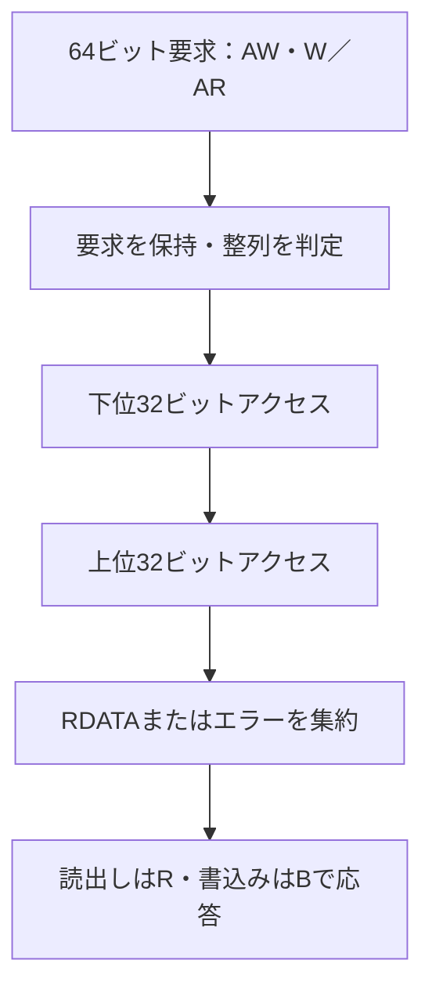

# AXI4-Liteの64ビットから32ビットへの幅変換

新規の教材用アダプターを、独立した32ビットAXI4-Liteメモリモデルへ接続します。上位のAWとWを別々に保持し、64ビットの読書きを下位32ビットアクセスへ変換します。Pythonのバイトメモリから期待値を作り、下位の実転送、上位応答、メモリ全体を照合します。

## 64ビット要求の分割と応答集約

AWとWを個別に保持し、必要な32ビット転送を下位側から順に実行して上位応答へ集約します。



図は両半分を処理する場合です。全ストローブ0の整列書込みは下位転送なしで完了します。2アクセスは原子的ではありません。

| 確認する場面 | 期待する動作 | 主な照合対象 |
| --- | --- | --- |
| 書込み | WSTRBが非ゼロの半分だけを実行 | 不要な半分へのアクセスなし |
| 片側の下位応答エラー | もう一方も処理してSLVERRを返す | 成功側の書込みは残る |
| 途中リセット | 保留状態を破棄し、完了分だけ残す | 同じ領域の再読出し |

## 教材の契約

- リトルエンディアン、上位8バイト整列、教材メモリ64バイト。読出しは常に2アクセスです。
- 書込みはWSTRBが非ゼロの半分だけを発行します。全ストローブ0なら下位アクセスなしでOKAYです。非整列はストローブ0でもSLVERRにします。
- 下位の一方がエラーでももう一方を処理し、上位へSLVERRを返します。成功した側の書込みは残り、ロールバックしません。読出しエラー側のデータは、この下位モデルの仕様として0です。
- 下位2アクセスは原子的ではありません。上位操作は1件ずつ処理し、先に保留された書込みを優先します。AXI4のバースト、ID、複数未完了操作は扱いません。
- リセットは保留要求・応答を破棄します。下位メモリの内容は保持します。1番目の応答後に中断する試験では、既に完了した書込みだけが残ることを再読出しで検査します。

これらは本アダプターの対応範囲・方針です。バス全体の一般規則は[Arm AXI仕様](https://documentation-service.arm.com/static/5f915b62f86e16515cdc3b1c)を参照してください。

## 検査・実行

下位AWとWの受付を別々に遅らせ、応答待ち0／2の2構成で実行します。実際の受付エッジに基づく上位AW先行・W先行、ゼロ／片側／疎なストローブ、B/R保持、上下それぞれのエラー、非整列、読書き途中のリセットと復帰を含め、各15目標を要求します。すべてのWSTRB値の全数検査ではありません。

4変異はデータ上下の入替え、ストローブ無視、エラー隠蔽、停止中RDATAの変化です。読出しにはR、書込みにはBの応答を要求します。下位転送数と応答完了数も照合し、余分なアクセスや未完了を合格にしません。

```sh
python3 examples/local-width-converter/run.py --out artifacts/width-converter
python3 examples/local-width-converter/run.py --profile nightly
python3 -m unittest discover -s examples/local-width-converter/tests -v
```

[共通の準備・オプション・証跡](../local-common/README.md)を使います。smokeは各seed 40操作、nightlyは300操作×3 seedに、固定34操作を各実行で追加します。2構成合計JUnitは14／18件です。下位応答データやDUTの内部状態をPythonの期待値へ取り込みません。

## 全体レビューで追加した確認

読出しをBチャネルで返す誤実装が合格してしまうことを再現し、要求種別と応答チャネルの照合を追加しました。逆方向の取り違えも検出します。AW/Wの先行順は要求の開始予定時刻ではなく、VALIDとREADYが同時に成立したエッジから計測します。復帰の目標には、先行する実際の途中リセットと、同じ領域の再読出し成功を要求します。

途中書込みの期待メモリは、最初に実行する有効ストローブ側だけを更新します。下位半分のWSTRBが0で上位半分だけを書いた後にリセットする場合も、正しいRTLを誤検出しません。これらを含む確認テストは9件です。回帰の15目標と14／18件のJUnit計画は維持しています。
