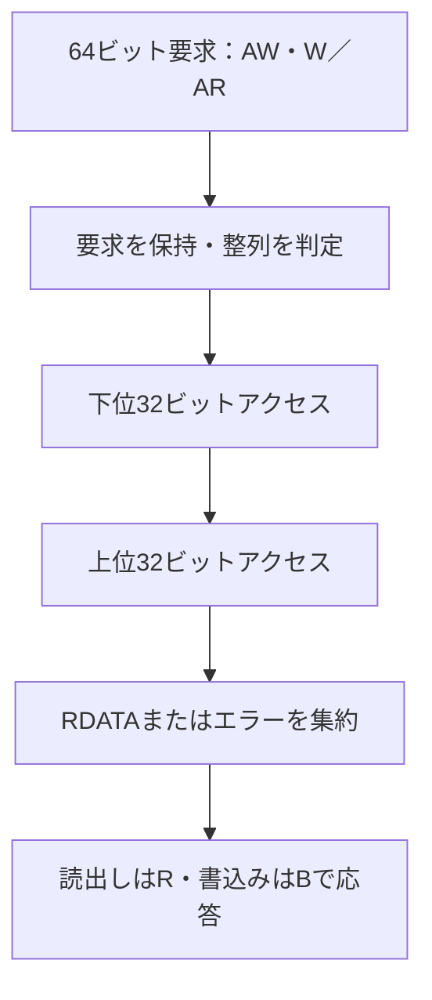

# AXI4-Liteの64ビットから32ビットへの幅変換

新規の教材用アダプターを、独立した32ビットAXI4-Liteメモリモデルへ接続します。上位のAWとWを別々に保持し、64ビットの読書きを下位32ビットアクセスへ変換します。Pythonのバイトメモリから期待値を作り、下位の実転送、上位応答、メモリ全体を照合します。

## 64ビット要求の分割と応答集約

AWとWを個別に保持し、必要な32ビット転送を下位側から順に実行して上位応答へ集約します。



図は両半分を処理する場合です。全ストローブ0の整列書込みは下位転送なしで完了します。2アクセスは原子的ではありません。

| 確認する場面 | 期待する動作 | 主な照合対象 |
| --- | --- | --- |
| 書込み | WSTRBが非ゼロの半分だけを実行 | 不要な半分へのアクセスなし |
| 片側の下位応答エラー | もう一方も処理してSLVERRを返す | 成功側の書込みは残る |
| 途中リセット | 保留状態を破棄し、完了分だけ残す | 同じ領域の再読出し |

## 教材の契約

- リトルエンディアン、上位8バイト整列、教材メモリ64バイト。読出しは常に2アクセスです。
- 書込みはWSTRBが非ゼロの半分だけを発行します。全ストローブ0なら下位アクセスなしでOKAYです。非整列はストローブ0でもSLVERRにします。
- 下位の一方がエラーでももう一方を処理し、上位へSLVERRを返します。成功した側の書込みは残り、ロールバックしません。読出しエラー側のデータは、この下位モデルの仕様として0です。
- 下位2アクセスは原子的ではありません。上位操作は1件ずつ処理し、先に保留された書込みを優先します。AXI4のバースト、ID、複数未完了操作は扱いません。
- リセットは保留要求・応答を破棄します。下位メモリの内容は保持します。1番目の応答後に中断する試験では、既に完了した書込みだけが残ることを再読出しで検査します。

これらは本アダプターの対応範囲・方針です。バス全体の一般規則は[Arm AXI仕様](https://documentation-service.arm.com/static/5f915b62f86e16515cdc3b1c)を参照してください。

## 検査・実行

下位AWとWの受付を別々に遅らせ、応答待ち0／2の2構成で実行します。実際の受付エッジに基づく上位AW先行・W先行、ゼロ／片側／疎なストローブ、B/R保持、上下それぞれのエラー、非整列、読書き途中のリセットと復帰、処理中に次の要求が待つ4通りの重なり（書込み中の書込み・読出し、読出し中の書込み・読出し）を含め、各19目標を要求します。すべてのWSTRB値の全数検査ではありません。

4種類の変異はデータ上下の入替え、ストローブ無視、エラー隠蔽、停止中RDATAの変化です。読出しにはR、書込みにはBの応答を要求します。下位転送数と応答完了数も照合し、余分なアクセスや未完了を合格にしません。

```sh
python3 examples/local-width-converter/run.py --out artifacts/width-converter
python3 examples/local-width-converter/run.py --profile nightly
python3 -m unittest discover -s examples/local-width-converter/tests -v
```

[共通の準備・オプション・証跡](../local-common/README.md)を使います。smokeは各seed 40操作、nightlyは300操作×3 seedに、固定46操作を各実行で追加します。2構成合計JUnitは14／18件です。下位応答データやDUTの内部状態をPythonの期待値へ取り込みません。

## 全体レビューで追加した確認

読出しをBチャネルで返す誤実装が合格してしまうことを再現し、要求種別と応答チャネルの照合を追加しました。逆方向の取り違えも検出します。AW/Wの先行順は要求の開始予定時刻ではなく、VALIDとREADYが同時に成立したエッジから計測します。復帰の目標には、先行する実際の途中リセットと、同じ領域の再読出し成功を要求します。

上位のAW・W・ARは、受付エッジの後にアドレス・データ・ストローブを反転した値へ変えます。アダプターが保持した値ではなく入力をそのまま使う誤実装を、下位転送の照合で検出します。非整列のSLVERRの直前には正常なB・R、全ストローブ0のOKAYの直前にはSLVERRの書込みを置き、前回の応答コードが残るだけの誤りも合格にしません。

途中書込みの期待メモリは、最初に実行する有効ストローブ側だけを更新します。下位半分のWSTRBが0で上位半分だけを書いた後にリセットする場合も、正しいRTLを誤検出しません。これらを含むセルフテストは9件です。リグレッションの15目標と14／18件のJUnit計画は維持しています。

2026-11-03の[kirimasimでの互換性確認](../../docs/case-study-kirimasim/README.md)では、テストベンチのカウンター更新と`ready`の観測が同じエッジで競合し、通常回路で`WIDTH_SUBDATA`が発生しました。カウンター更新をノンブロッキング代入へ変更し、DUTと下位スレーブが同じ`ready`を観測できるようにしました。kirimasim・Icarusの両方でsmoke／nightly、両構成の全15目標と4種類の変異を再確認し、既存セルフテスト9件も合格しました。

## 処理中に次の要求が待つ場面の追加（2026-11-21）

レビューで、試験の抜けが見つかりました。それまでのテストベンチは、上位の要求を1件ずつ、前の応答が終わってから出していました。そのため、アダプターが処理中に次の要求を受け取ってしまう誤りを見つけられませんでした。

1行のベクトルに、同じアドレスへの2件目の操作を持てるようにしました。テストベンチは、アダプターが1件目の要求を受け取った直後から2件目を出し、受け取られるまで保持します。1件目の応答が出た時点で、1件目の下位転送の数と完了数を照合し、その後の下位転送は2件目の内容と照合します。2件目が一度も待たされなかった場合は`WIDTH_OVERLAP`で不合格にします。固定シナリオに10操作を足し、ランダムでも約4割の操作に2件目を付けます。

作業用の写しのRTLで、次の誤りを固定シナリオが検出することを確かめました。

| 誤り | 結果 |
| --- | --- |
| `s_wready`から処理中の条件を外す（処理中のデータを上書き） | `WIDTH_SUBSTRB` |
| `s_arready`から処理中の条件を外す（受け取ったARを捨てる） | `WIDTH_TIMEOUT` |
| `m_rready`を反転する（下位のRの受取りが終わる前に上位へ応答） | `WIDTH_SUBCOUNT` |

次の2つは、この試験でも合格します。どちらもAXIの規則に反せず、上位から見た結果も変わらないので、検査を足していません。

- `s_awready`から処理中の条件を外す：処理中にAWだけを先に受け取って保持します。Wは受け取らないので、処理中の書込みには影響しません。
- `m_bready`を常に1にする：下位のBは、AWとWの両方を渡した後にしか来ません。その時点でアダプターは必ず応答待ちの状態にいます。

下位側の`m_bready`・`m_rready`を出すサイクルそのものは検査していません。確かめているのは、下位の転送の内容・数・完了と、上位の応答です。JUnitの件数（14／18件）とセルフテストの件数（9件）は変わりません。目標は15から19に、固定の操作は36から46になりました。Icarus Verilog 14.0開発版で、2構成のsmokeとnightly（seed 17と5）、smokeのseed 3と99が合格しました。kirimasimでは実行していません。
