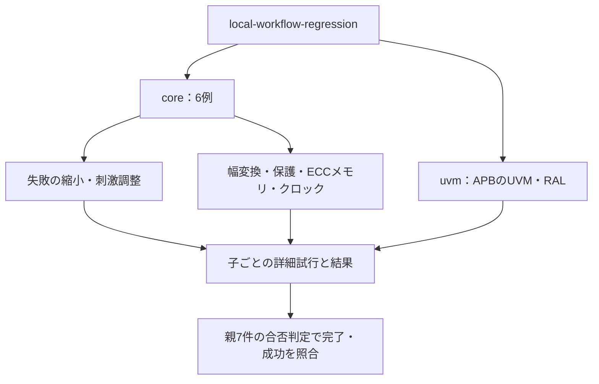

# 解析・収束・結合・UVMの7例をまとめて実行する

次のローカル例を順に起動し、子の終了状態・予定件数・全チェックの完了と合格を要求します。GitLabの登録・CI実行・CI設定変更は行いません。

1. [失敗した操作列の自動縮小](../local-failure-reduction/README.md)
2. [カバレッジによる刺激調整](../local-coverage-feedback/README.md)
3. [AXI4-Liteの64→32ビット幅変換](../local-width-converter/README.md)
4. [APBアクセス保護・設定ロック](../local-access-control/README.md)
5. [ECC付きメモリとスクラビング](../local-ecc-memory/README.md)
6. [クロック停止・再開とリセット制御](../local-clock-reset/README.md)
7. [SystemVerilog UVMとRAL](../local-uvm/README.md)

## 解析・4回路・UVMの集約

coreで解析と4回路を、uvmでUVM例を選び、allでは全7例を起動します。



探索中のRTL実行数は別の記録です。親の7件と子83／111件を重複加算しません。

| 直下の子の区分 | smoke JUnit | nightly JUnit |
| --- | --- | --- |
| 4回路・8構成 | 56件 | 72件 |
| 縮小・刺激調整 | 6＋8件 | 6＋16件 |
| UVM | 13件 | 17件 |

## 実行

共通にPython 3.10以上とIcarusを使います。UVMにはVerilator 5.052、C++20ビルド環境、別途準備したUVM 2020-3.2が必要です。

```sh
python3 examples/local-uvm/setup_uvm.py --out /tmp/lsi-uvm-library
python3 examples/local-workflow-regression/run.py \
  --uvm-home /tmp/lsi-uvm-library/1800.2-2020.3.2 \
  --out artifacts/workflow-smoke
python3 examples/local-workflow-regression/run.py \
  --uvm-home /tmp/lsi-uvm-library/1800.2-2020.3.2 \
  --profile nightly --out artifacts/workflow-nightly
```

UVMの準備前には`--stage core`で残る6例、UVMだけなら`--stage uvm --uvm-home ...`を指定できます。選んだ範囲だけの合格であり、未選択の例を合格に数えません。`--child-timeout`は子リグレッション1本ごとの上限秒数です。通常のUVMビルドは1回で両待ち構成・全変異を作ります。

## 件数と確認範囲

親JUnitは7件の集約時の合否判定、子JUnitの合計はsmoke 83件／nightly 111件です。内訳は4回路・8構成56／72件、縮小6件、刺激調整8／16件、UVM 13／17件です。探索中のRTL実行数は各子の`executions.json`へ別に保存します。親と子、既存の同じ回路のリグレッションを二重計上しません。

新規4回路の目標は各構成ごとに幅変換15、アクセス保護14、ECCメモリ11、クロック・リセット10です。刺激調整は既存Streamの11、UVMは9目標です。故障モデルと前提・対象外は各READMEに記載しています。100%はそれぞれの教材カタログの達成です。

各出力先の`manifest.json`、子ログと実行記録、子の`summary.json`・`junit.xml`・詳細証跡を照合します。未知の異常終了、空の計画、未完了、ネガティブテストだけで得たカバーを成功にしません。

```sh
python3 -m unittest discover -s examples/local-workflow-regression/tests -v
```

追加のセルフテストは、幅変換9・他3回路各5、縮小5、刺激調整4、UVM判定5、共通証跡3、集約4の計45件です。UVMの判定テストはコンパイルを行わず、実際のUVM実行は上のリグレッションで別に確認します。

2026-10-27にPython 3.14.7、Icarus Verilog 14.0開発版、Verilator 5.052、Accellera UVM 2020-3.2で全7例のsmoke／nightlyと追加時点の40テストが成功しました。各子のマニフェストのソースSHA-256が実行時のソースと一致することも確認しました。過去の190テストは追加分へ重複集計していません。全体レビューで幅変換のリグレッションテスト4件を加え、さらに今回の集約結果IDの確認1件を加え、現在のセルフテストは45件です。

一覧形式の子結果には空でない一意のチェックIDを要求し、ID欠落・重複、不正な結果要素を拒否します。
