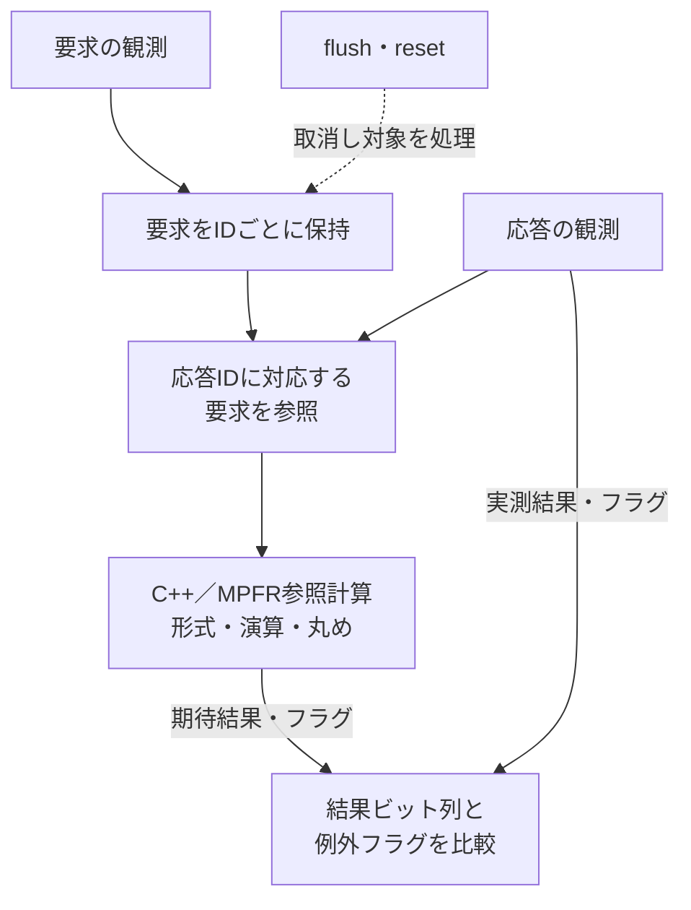

# CVFPUとcvfpu-uvmの参照例

演算IPのCVFPU（FPnew）と、その検証環境cvfpu-uvmを分けて読む例です。浮動小数点の期待値、例外フラグ、トランザクションID、flush・resetによる取消と完了を学びます。[環境の比較](../../docs/method/open-source-dv-environments.md)も参照してください。

## 参照する版

| 役割 | リポジトリと固定コミット |
| --- | --- |
| 演算IP | [cvfpu / `7093289d00ec842c94ca973e2d5ba9301fb11363`](https://github.com/openhwfoundation/cvfpu/tree/7093289d00ec842c94ca973e2d5ba9301fb11363) |
| UVM検証環境 | [cvfpu-uvm / `2f787402256b76d00e397d72a00b57120db455cf`](https://github.com/openhwfoundation/cvfpu-uvm/tree/2f787402256b76d00e397d72a00b57120db455cf) |

上記は別々に読解する版です。この2つを組み合わせて動作確認した互換性の組ではありません。実際のDUT・依存は、TB側が解決する版を記録します。

## 演算結果とプロトコルを別に追う

| 読む対象 | 固定版のファイル | 見るポイント |
| --- | --- | --- |
| IPの構成 | [fpnew_top.sv](https://github.com/openhwfoundation/cvfpu/blob/7093289d00ec842c94ca973e2d5ba9301fb11363/src/fpnew_top.sv)、[fpnew_pkg.sv](https://github.com/openhwfoundation/cvfpu/blob/7093289d00ec842c94ca973e2d5ba9301fb11363/src/fpnew_pkg.sv) | 形式、演算、丸め、フラグ、tag、受付・応答・flush |
| TBのDUT | [tb_top.sv](https://github.com/openhwfoundation/cvfpu-uvm/blob/2f787402256b76d00e397d72a00b57120db455cf/top/rtl/tb_top.sv)、[Bender.yml](https://github.com/openhwfoundation/cvfpu-uvm/blob/2f787402256b76d00e397d72a00b57120db455cf/Bender.yml) | `fpu_wrap`の構成、ラッパーのソース、実際の依存解決 |
| 比較 | [fpu_sb.svh](https://github.com/openhwfoundation/cvfpu-uvm/blob/2f787402256b76d00e397d72a00b57120db455cf/env/fpu_sb.svh) | IDごとの要求保持、応答結果と例外フラグの比較、取消と残件 |
| C++参照モデル | [operations.cpp](https://github.com/openhwfoundation/cvfpu-uvm/blob/2f787402256b76d00e397d72a00b57120db455cf/ref_model_csim/cpp/src/operations.cpp) | GMP／MPFRを使う計算、形式・丸め・特殊値とフラグの扱い |
| 選ぶテスト | [fpu_reg_list](https://github.com/openhwfoundation/cvfpu-uvm/blob/2f787402256b76d00e397d72a00b57120db455cf/simu/fpu_reg_list)、[sim_questa.yaml](https://github.com/openhwfoundation/cvfpu-uvm/blob/2f787402256b76d00e397d72a00b57120db455cf/simu/sim_questa.yaml) | テスト名・反復数、トランザクション数・seed・終了条件 |

たとえば半精度の加算なら、通常値に加え、±0、非正規化数、丸め境界、無限大、NaN、オーバーフロー・アンダーフロー等を仕様へ対応付けます。ホストの`float`や許容誤差だけで済ませず、結果のビット列とフラグ、NaNの規則、入力形式・丸めの一致を確認します。参照モデルを使うこと自体が、そのモデルの正しさの証明にはなりません。

演算値の一致に加え、受付・ID・重複・欠落、flush・resetで取り消す要求、終了時の未照合も調べます。[C++参照モデル](../local-cpp-reference/README.md)と[順不同応答のUVM](../local-uvm-outstanding/README.md)から進むと、計算と通信の検査の責務を対応付けやすくなります。

図は`fpu_sb`の比較の流れを要約したものです。値が一致しても、対応する要求がない応答や、取り消したIDの扱いまで正しいとは限らないため、数値比較とID管理の両方を追います。固定版の読解図で、フルUVMの実行結果を示すものではありません。

## 依存の固定と実行条件

固定版READMEにはCVA6依存の説明がありますが、実際には`Bender.yml`がCVFPU・CORE-V-VERIFを参照し、ラッパーを`modules/cva6-cvfpu/`から選びます。READMEの名称だけで導入せず、[.gitmodules](https://github.com/openhwfoundation/cvfpu-uvm/blob/2f787402256b76d00e397d72a00b57120db455cf/.gitmodules)、Gitのgitlink、Benderの解決結果を照合します。`master`・`develop`や`submodule update --remote`を使った後は、実際のコミットも保存してください。

[上流README](https://github.com/openhwfoundation/cvfpu-uvm/blob/2f787402256b76d00e397d72a00b57120db455cf/README.md)の経路はQuestaSim・Xcelium・VCS、C++モデルにはGMP・MPFR、依存管理にはBender等を使います。上流が挙げる丸めモード・形式・ベクトル演算等の未確認範囲も読み、IPが生成できる全構成をTBが検証したとは扱いません。CVFPU側のREADMEにもDivSqrt等の既知事項があります。

今回確認したのは固定ソース・設定・比較経路です。モデルのビルド、数値検算、フルUVM、Verilatorへの移植、カバレッジ収束は未実行です。上流のライセンスと個別SPDXを保持し、単一の本リポジトリのライセンスへ置き換えません。
