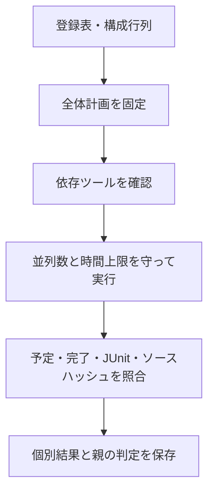

# 全検証例を同じ計画で実行する

[`run_regression.py`](run_regression.py)は、このリポジトリ単独で使う全体実行の入口です。[登録表](regressions.json)の構成行列から計画を固定し、依存確認、実行、子の合否・JUnit・ソースハッシュの照合を行います。個別ランナーの試験回数や必須目標を減らしません。

## 1. 実行範囲を選ぶ

リポジトリのルートで、Python 3.10以上とPOSIX環境を使います。

```sh
# 計画を見る。ツールの確認やシミュレーションは行わない
python3 tools/run_regression.py --profile nightly --list

# FIFOの記載全6構成をsmokeで実行する
python3 tools/run_regression.py --example local-fifo --out artifacts/fifo-campaign

# シミュレーションとSTAの個別例を選ぶ
python3 tools/run_regression.py --suite simulation --profile nightly --list

# フォーマルの全例・全構成を選ぶ
python3 tools/run_regression.py --suite formal --list
```

| 指定 | 選ぶ範囲 |
| --- | --- |
| `--suite all`（既定） | 全登録例。集約ランナーを使い、その子は別に重複起動しない。 |
| `--suite simulation` | シミュレーションとSTAの個別例。集約ランナーと証明専用の入口を選ばない。 |
| `--suite formal` | 証明用の11例。除算器は`formal.py`、FIFOは両深さを含む。分割証明は内部タスクと依存判定を親から一度実行する。 |
| `--example 名前` | 指定例へ絞る。複数回指定できる。親と子を同時に指定した場合は親から一度実行する。 |
| `--profile smoke\|nightly` | 対応する例へ渡す。専用プロファイルがないフォーマル・STAは既定の全タスク・構成を実行する。 |

`--suite simulation`には反例をシミュレーションで再現する例があり、その内部では新しいBMCも実行します。`--suite formal`は証明専用の入口の選択です。部分選択の成功を全例の成功と扱いません。

[共通lintと警告管理](../examples/local-lint/README.md)は`--suite all`に含みます。`--example local-lint`なら、全DUTの構成別lintと負例を実行します。子の`local-lint-targets`は親から一度起動します。lintは固定計画で、nightlyでも同じ範囲です。既知指摘が残った差分なしの成功と、警告0件を区別します。新しい[失敗解析](../examples/local-failure-triage/README.md)、[AIレビュー](../examples/local-ai-review/README.md)、[複数クロックUVM](../examples/local-uvm-multiclock/README.md)はシミュレーション例として両プロファイルに登録しています。

## 2. 実行環境を明示的に準備する

Icarus Verilog、Verilator 5.052、C++20コンパイラー、Cコンパイラー、make、OpenSTAを各環境へ用意します。フォーマルは[固定版環境](../examples/local-formal-common/README.md)、UVMは[ライブラリの準備](../examples/local-uvm/README.md#ライブラリの準備)、OpenSTAは[構築手順](../examples/local-sta/README.md)を参照してください。ランナー自身はツールをインストールしません。

シミュレーション側のPython依存は、専用環境へ次のように準備できます。固定するのは記載した3パッケージの版であり、OS・コンパイラー・全推移依存まで同一にする環境イメージではありません。

```sh
python3 -m venv artifacts/toolchains/sim-venv
artifacts/toolchains/sim-venv/bin/python -m pip install -r tools/simulation-requirements.txt
python3 examples/local-uvm/setup_uvm.py --out /tmp/lsi-uvm-library
```

全体実行の例は次です。事前確認だけの場合は、同じ引数へ`--check-tools`と別の`--out`を追加します。

```sh
python3 tools/run_regression.py --profile nightly --jobs 2 \
  --python artifacts/toolchains/sim-venv/bin/python \
  --formal-python artifacts/toolchains/formal-venv/bin/python \
  --rdl-python artifacts/toolchains/sim-venv/bin/python \
  --cocotb-python artifacts/toolchains/sim-venv/bin/python \
  --uvm-home /tmp/lsi-uvm-library/1800.2-2020.3.2 \
  --tool-bin artifacts/toolchains/opensta-build \
  --command-timeout 60 --formal-timeout 1800 --child-timeout 7200 \
  --build-timeout 600 --out artifacts/repository-nightly
```

`--tool-bin`はPATHへ追加するディレクトリで、繰り返し指定できます。上例はOpenSTAを既存手順の配置先へ構築した場合です。`sta`が既にPATH上にあるなら、その指定は不要です。選択したPythonのbinもPATHへ追加し、仮想環境のシンボリックリンクを保持します。cocotbへ使うPythonは子にも明示します。

事前確認では、選択した親・子に必要な実行ファイルとPythonパッケージ、UVMライブラリの有無を調べます。不足があれば全ジョブを未起動の失敗として残し、終了コード1を返します。事前確認の成功は検証の成功ではなく、`--check-tools`では例を一つも実行しません。ツールの実際の版とビルド結果は各例の証跡にも残ります。

## 3. 並列数と時間上限

`--jobs`の既定は1です。並列数を上げる場合は、子がさらに複数のC++ビルドジョブを起動することを考慮します。

| 指定 | 上限と適用先 |
| --- | --- |
| `--job-timeout` | 最上位の各ジョブ全体。既定10,800秒。 |
| `--command-timeout` | 個別シミュレーションの`--timeout`。システム検証・SoC検証・[RAL接続などの7例](../examples/local-extension-regression/README.md)の各集約では`--simulation-timeout`として子へ渡す。 |
| `--formal-timeout` | 証明専用ランナーのタスク上限、または対応する集約の同名オプション。 |
| `--child-timeout` | 対応する集約の子1本全体。 |
| `--build-timeout` | 同名オプションを持つ個別例のネイティブビルド。 |

既定の時間を持つ子に上限を上書きするのは、その指定がある場合だけです。集約が公開していない子内部のオプションまで一括変更する機能ではありません。固定計画の試験件数・seed数・構成・探索深さは変更しません。タイムアウトは失敗で、正常終了へ自動再試行して置き換えることはしません。

中断・ルートのタイムアウト時は、子ランナーが別セッションで起動したプロセスも調べ、終了処理を行います。中断したジョブを未完了として保存し、SIGINTでは130、SIGTERMでは143を返します。

## 4. 証跡と合格条件



- `manifest.json`：全ジョブのコマンド、構成、選択範囲、登録表・全体ランナーのハッシュ。
- `preflight.json`：必要な実行ファイルのPATH上の解決先、パッケージ、依存不足。実際に使った版は各子の記録も確認する。
- `progress.json`：完了数、予定数、実行中のジョブ。
- `summary.json`・`junit.xml`：ジョブごとの合否と、全体の整合性判定。
- `runs/`：各例が出力する元のマニフェスト、入力、比較、波形、DB、反例、JUnit。

終了コード0だけでは成功にしません。成功したsummary、予定と完了の一致、一覧の一意なID、失敗・スキップ・重複・欠落のないJUnit、現行ソースと外部UVMのハッシュを要求します。数値で完了件数を記録する例では、マニフェストの`cases`全IDがJUnitに存在することも確認します。`check_ids`を持つ例では、結果のID集合がその固定計画と一致することを要求し、summaryとJUnitを同時に減らしても合格にしません。終了時には、先に完了したジョブも再照合します。削減比較とバス方式別検査には、その例固有の集約形式に対応する検査を使います。

実行途中のsummaryは`complete: false`です。親JUnitの`campaign-integrity`にも未完了を示す失敗を記録し、完了済みジョブがすべて成功していても、全体の合格とは表示しません。最終判定では、予定ジョブと結果のID集合・件数・一意性も照合します。UVMが必要な例では、外部ライブラリのソースハッシュ記録も必須で、記録の欠落・空の集合・版の不一致を拒否します。

親JUnitのジョブ判定と、`runs/`の個別チェックは別集計です。両者を独立した要求数として合算しません。既存の出力先は上書きせず、新しいディレクトリで実行します。

`--list`の出力にも、実行時のマニフェストと同じオプション・入力ソースハッシュを含めます。[履歴レポート](REPORTING.md)はこの計画と複数試行を照合し、初回の失敗と、ジョブごとの最後の試行の採用可否を記録します。

## 5. 検証例を追加する

新しい`examples/*/run.py`は、`regressions.json`へ入口、方式、必要なツール、引数、構成行列を登録します。集約の場合は子と出力先の対応も記録します。登録漏れ、存在しない入口、親子関係の循環、重複構成はエラーです。

```sh
python3 -m unittest discover -s tools/tests -v
```

このセルフテストは、ツール不足、予定・JUnitの欠落、古いソース、構成選択、中断時の子の停止などを検査します。ケーススタディ由来の参照ツールの上流テスト群は、このコマンドへ含めていません。

初回の全例実行、最終補強後の再実行範囲、ハッシュ照合と環境導入の結果は[2026-10-31の記録](../PROVENANCE.md#verification-workflow-expansion-20261031)を参照してください。

固定計画・JUnit・外部UVMの判定補強と、拡張7例への時間上限の転送、全例の再確認は[2026-11-01のレビュー記録](../PROVENANCE.md#regression-integrity-review-20261101)にまとめています。
