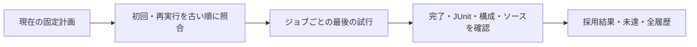

# 初回失敗と再実行を保持して結果をまとめる

[`regression_report.py`](regression_report.py)は、現在の固定計画と、古い順に指定した実行履歴を照合するツールです。シミュレーションは起動しません。JSON、JUnit、ブラウザーで開ける`report.html`へ、全試行・採用結果・不足・拒否理由を保存します。

## 1. 計画を保存して実行する

[`run_regression.py`](REGRESSION.md)の`--list`は、実行時のマニフェストと同じ構造で、コマンド、構成、オプション、登録表・ランナーのソースハッシュを保存します。計画と実行には同じ引数を使います。

```sh
python3 tools/run_regression.py --example local-fifo --profile nightly \
  --command-timeout 60 --out artifacts/fifo-first --list > artifacts/fifo-plan.json
python3 tools/run_regression.py --example local-fifo --profile nightly \
  --command-timeout 60 --out artifacts/fifo-first
python3 tools/regression_report.py --plan artifacts/fifo-plan.json \
  --campaign artifacts/fifo-first --out artifacts/fifo-report
```

実行済みの`manifest.json`も計画として指定できます。現在の登録表とオプションから同じジョブを再生成できること、計画のソースハッシュが現在と一致することを要求します。部分計画の成功は、全例の成功へ読み替えません。

## 2. 再実行を追加する

```sh
python3 tools/run_regression.py --example local-fifo --profile nightly \
  --command-timeout 60 --out artifacts/fifo-retry
python3 tools/regression_report.py --plan artifacts/fifo-plan.json \
  --campaign artifacts/fifo-first --campaign artifacts/fifo-retry \
  --out artifacts/fifo-history
```

`--campaign`の指定順が古い順です。ファイルの更新時刻から順序を推測しません。部分再実行なら、その実行で宣言したジョブだけを更新し、ほかのジョブの履歴を保持します。指定する実行は、選んだ計画のジョブの部分集合である必要があります。

**各ジョブの最後の試行を判定します。** 新しい試行が失敗・未完了なら、以前の成功へ戻って合格にしません。最後の試行が成功した場合も、初回失敗の状態・理由・出力先は残ります。試行の順序自体はレビュー対象です。



## 3. 採用条件

- 予定ID・構成・刺激を変えるコマンド引数が一致すること。seed、モード、幅、深さ、証明境界等の違いを同じ試行へ混ぜない。
- コマンドの時間上限だけの変更は許し、実際の上限とジョブ全体の上限を履歴へ記録する。出力先は各実行の`runs/ジョブID`に限定する。
- 元の親summaryとJUnitが対応し、採用する子が正常終了・固定計画完了・JUnit成功であること。
- 現在のソースと外部UVMライブラリの版が一致すること。古い成功を、ハッシュの書換えだけで採用しない。
- 終了時に採用先を再照合すること。計画・実行メタデータが集計中に変わったら失敗にする。

許可するコマンド上限は`--timeout`、`--simulation-timeout`、`--formal-timeout`、`--child-timeout`、`--build-timeout`です。これらの変更で試験数や証明境界を減らしてよいという意味ではありません。時間切れは元の試行で失敗のままです。

全ジョブに採用可能な結果があれば終了コード0、不足・失敗・不整合があれば1です。既存出力先は上書きしません。元の実行が全体として失敗していても、子の個別結果を検査できますが、最後に失敗したジョブを過去の成功で補いません。

レポートの`complete`は、計画全ジョブの最後の試行について結果記録があることを表します。元の親が途中終了していても、保存済みの完了した子は現在の版と証跡を改めて照合できます。元の親の`success`・`complete`は別に保持し、書き換えません。最後のジョブに結果がなければ未完了、結果が失敗なら不合格です。

## 4. 保存物と限界

| ファイル | 内容 |
| --- | --- |
| `summary.json` | 計画全体の合否、各ジョブの全履歴・採用先・理由、元の親の状態 |
| `report.html` | 同じ履歴と判定を読む画面。外部サービスへ送信しない。 |
| `junit.xml` | ジョブ別判定とレポート整合性判定 |
| `manifest.json` | 計画、実行メタデータ、ツールと登録表のハッシュ |

ここで保存するのは照合結果とメタデータのハッシュです。波形・ログ・DBをすべて複製する自己完結したアーカイブではありません。元の実行ディレクトリとソースを保持してください。署名・改ざん認証、人のレビューやサインオフ承認を代行しません。異なる指標のカバレッジを一つの割合へ合算する機能も持ちません。

実際の時間切れと再実行を使う[実行例](../examples/local-regression-report/README.md)、計画と要求の対応には[項目照合](../docs/method/verification-plan-automation.md)、完了判断には[総合演習](../docs/capstone-apb-irq/README.md)を参照してください。
